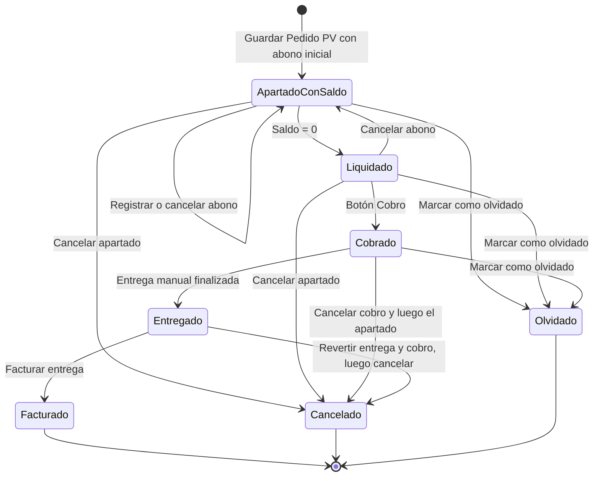

## Información General

| | |
|:--|:--|
| **Nombre del Proyecto** | Funcionalidad de Apartado de Juguetes Para Sistema Happy Island |
| Número de Solicitud de Servicio | [4212] |
| Tipo de Servicio | Mejora funcional |
| Prioridad | - [x] Urgente - [ ] Medio - [ ] Bajo |
| Área de I&N Responsable de Implementación | [Celula Otras Unidades de negocio] |
| Responsable del Requerimiento | [Leslie Karina Rivera Davila] |
| Fecha de Elaboración | 07/11/2026 |
| Product Owner | [Leslie Karina Rivera Davila] |
| Área de Negocio | [Ventas] |
| Versión | v1.0 |

---

## 1. Objetivo del Proyecto

Permitir que en punto de venta el cliente **aparte productos** con un abono inicial y los pague en varios abonos. El producto queda reservado a su nombre hasta que lo liquide y lo recoja. Con esto se busca vender a clientes que no pueden pagar todo en una sola exhibición, sin perder el control del inventario, de la cobranza ni de la facturación. También se ajusta la facturación para revisar la factura antes de timbrarla, y las consultas para dar seguimiento a los apartados.

### 1.1 Antecedentes

Hoy los pedidos tienen dos flujos:

- **Pedido Punto de Venta (flujo corto):** al guardar, la entrega del producto se genera y se finaliza en ese momento.
- **Pedido (flujo largo):** el pedido se autoriza, se entrega, se cobra y se factura en pasos separados.

En los dos flujos el orden es: **pedido, entrega, cobro y factura**. No hay forma de recibir pagos parciales antes de entregar ni de reservar producto para un cliente. El producto que un cliente quiere apartar sigue disponible para venderse a otro, y los pagos parciales no tienen dónde registrarse ligados al pedido.

En facturación, la factura que se genera desde las entregas trae precargados el cliente y las formas de pago, y el usuario no puede corregirlos antes de guardar.

### 1.2 Beneficio de Negocio

- **Necesidad actual:** no se pueden vender productos por apartado ni separar el inventario reservado del disponible. Tampoco se pueden corregir las formas de pago o el cliente de la factura antes de guardarla.
- **Impacto esperado:** el cliente aparta con al menos el 30% y abona hasta liquidar. El producto apartado queda en un almacén aparte y el cobro se arma con los abonos. La factura se revisa antes de timbrarse.
- **Beneficio operativo/comercial:** más ventas a clientes de contado que pagan en partes, inventario disponible confiable, seguimiento del saldo de cada apartado y menos cancelaciones de facturas por errores de captura. [Cuantificación por definir con el área de negocio]

### 1.3 Descripción General de la Solución

1. **Apartar.** El vendedor captura el pedido en Punto de Venta, lo marca como **Apartado** y le pone una **fecha de vigencia**. Al guardar, registra un **abono inicial de al menos 30%**, que genera un movimiento bancario **en firme** en la cuenta de efectivo de la sucursal. No se genera la entrega; el producto pasa del almacén de venta al **almacén de Apartados** de la sucursal.
2. **Abonar.** Los siguientes abonos se registran en efectivo en la pantalla de Pedidos (flujo largo), en una pestaña **Abonos**. Cada abono baja el saldo y genera un movimiento bancario **en tránsito** en la cuenta de efectivo de la sucursal. Cancelar un abono regresa el saldo y cancela su movimiento bancario.
3. **Cobrar.** Cuando el saldo llega a cero se habilita el botón **Cobro**. El cobro se genera solo, con los abonos registrados, y **no genera movimientos bancarios nuevos**, porque ya se generaron con cada abono.
4. **Entregar.** Cuando el cliente viene por su producto, el usuario crea la **entrega**. El producto sale del almacén de Apartados.
5. **Facturar.** Se factura como hoy. El usuario puede ajustar las formas de pago y el cliente antes de guardar, y la factura se **timbra cuando un usuario autorizado lo pide**.
6. **Cancelar.** Si el apartado se cancela, el producto regresa al almacén y ubicación de origen y los abonos quedan **cancelados**. Antes hay que revertir el cobro o la factura, si existen.

---
## 2. Alcance del documento

### 2.1 Funcionalidades Incluidas

- Marcar pedidos de Punto de Venta como apartados, con fecha de vigencia y saldo.
- Registrar el abono inicial al guardar el apartado.
- Reservar el producto apartado en un almacén de Apartados por sucursal.
- Consultar el apartado en Pedidos (flujo largo) y registrar o cancelar abonos ahí.
- Cobrar el apartado liquidado con las formas de pago de los abonos.
- Crear a mano la entrega del apartado y sacar el producto del almacén de Apartados.
- Cancelar apartados, regresando el producto a su almacén de origen y cancelando los abonos.
- Ajustar las formas de pago y el cliente de la factura antes de guardarla.
- Guardar las facturas pendientes de timbrar y timbrarlas bajo demanda, con permiso.
- Filtrar e identificar apartados en Detallado de pedidos y Resumen de pedidos.
- Nueva pestaña "Resultado Apartados" en el Concentrado de cobranza.
- Nueva sección de apartados en el formato Cobranza General.
- Marcar apartados como **Olvidados** para detenerlos de forma definitiva (sin cobro, entrega, facturación ni cancelación) y liberar el producto para la venta.

### 2.2 Fuera de Alcance

- Crear apartados desde Pedidos (flujo largo).
- Apartar con forma de pago Crédito.
- Cancelar en automático los apartados vencidos. Solo se avisa.
- Generar en automático la entrega cuando el apartado se liquida.
- Que la cancelación manual del cobro afecte el apartado o sus abonos.
- Cambios al flujo de pedidos que no son apartados, salvo los ajustes de factura (RF-05).

---
## 3. Actores y roles

| Actor / Rol | Descripción |
|-------------|-------------|
| Vendedor de punto de venta | Captura el pedido PV, lo marca como apartado y registra el abono inicial. |
| Cajero / Cobranza | Registra y cancela abonos y genera el cobro del apartado liquidado. |
| Almacenista / Embarques | Crea y finaliza la entrega del producto apartado. |
| Facturista | Revisa y ajusta la factura y la timbra cuando tiene permiso. |
| Supervisor / Gerente | Cancela apartados, los marca como olvidados y consulta su seguimiento. |
| Sistema | Calcula saldos y genera en automático los movimientos de almacén y los movimientos bancarios de cada abono. |

## 4. Entidad a la que aplica

Aplica al **Pedido**, en su modalidad **Pedido PV marcado como Apartado**, y a su nuevo detalle **Abonos del pedido**.

- **Estatus inicial del apartado:** Autorizado, con saldo pendiente y producto en el almacén de apartados.
- **Estatus terminal del apartado:** Finalizado (liquidado, cobrado y entregado), Cancelado u Olvidado.
- **Estatus Olvidado:** es terminal. Libera el producto para la venta y detiene el apartado de forma definitiva: no se puede reactivar, abonar, cobrar, entregar, facturar ni cancelar (RF-07).
- **Estatus del abono:** Activo o Cancelado.

El ciclo de vida del apartado es el siguiente:

El apartado nace con saldo pendiente y queda liquidado cuando los abonos cubren el total. Un apartado liquidado vuelve a tener saldo si se cancela uno de sus abonos. Después de liquidado se cobra, se entrega y se factura. Se puede cancelar en cualquier etapa anterior a la factura, revirtiendo antes lo que ya se haya hecho, salvo que esté olvidado. Antes de la entrega, el apartado se puede marcar como **Olvidado**: el producto se libera para la venta y el pedido queda detenido de forma definitiva, sin poder reactivarse ni cancelarse.

# 4.1 Formas de pago

| Cuenta Bancaria      | Forma de Pago                         |
|----------------------|---------------------------------------|
| Banorte              | Cheque Nominativo                     |
| Banorte              | Transferencia Electrónica             |
| Banorte              | Tarjeta De Débito                     |
| Banorte              | Tarjeta De Crédito                    |
| Interna (Efectivo)   | Efectivo                              |
| Interna (Efectivo)   | Aplicación de Anticipos               |
| Caja Chica           | Efectivo                              |

## 5. Índice de requerimientos

> **Navegación rápida:** haz clic en el identificador para ir al detalle.

| RF | Título | Sistema | Aplica a |
|----|--------|---------|----------|
| [RF-01](#rf-01) | Crear y guardar pedido de apartado | Ventas | Pedido PV, Pedidos (Largo) |
| [RF-02](#rf-02) | Gestionar abonos internos | Ventas / Cobranza | Pedidos (Largo) |
| [RF-03](#rf-03) | Gestionar cobros de pedidos de apartado | Cobranza / Bancos | Pedido PV, Pedidos (Largo) |
| [RF-04](#rf-04) | Inventario y entregas de apartados | Inventarios / Embarques | Movimientos de almacén, Entregas |
| [RF-05](#rf-05) | Timbrado manual de facturas | Facturación | Facturas |
| [RF-06](#rf-06) | Consultar pedidos de apartado | Consultas / Reportes | Ventas, Cuentas por cobrar |
| [RF-07](#rf-07) | Marcar pedido de apartado como Olvidado | Ventas / Cobranza / Embarques / Facturación | Pedido PV, Pedidos (Largo), Entregas, Facturas |

---
---

# RF-01 — Crear y guardar pedido de apartado

| Campo        | Valor |
|--------------|-------|
| Prioridad    | Must |
| Estado       | Definición |
| Dependencias | RF-02, RF-04 |

## Objetivo

Que el cliente pueda reservar productos dejando un abono inicial, sin que el producto se entregue ni se venda a otra persona.

## Descripción

El sistema deberá permitir marcar un Pedido como **Apartado**. Al guardarlo, deberá pedir el abono inicial. Además, no deberá generar la entrega automática que hoy se crea en punto de venta. En su lugar, moverá el producto del almacén de venta al almacén de apartados de la sucursal.

El apartado solo se crea desde Pedido PV. Evitar crear nuevo pedido apartado desde Pedidos (Largo) de aqui solo se puede ver el apartado y administrar sus abonos.

### Atributos para agregar en pedido

| Campo | Obligatorio | Descripción |
|-------|-------------|-------------|
| Apartado | Sí (Sí/No) | Indica que el pedido es un apartado. |
| Fecha vigencia apartado | Sí, si es apartado | Fecha límite para liquidar. |
| Saldo apartado | Calculado, solo lectura | Total del pedido menos los abonos activos (No Visible) |

### Diseño UX/UI

- En Pedido se agrega los campos **Apartado** y **Fecha vigencia apartado**. Al guardar un apartado aparece una ventana para capturar el abono inicial: forma de pago simpre será Efectivo, importe e indicador de abono inicial (ya marcado).
- En Pedidos (Largo) se agrega la pestaña **Abonos**, visible solo cuando el pedido es apartado independientemente de su estado actual.

## HU-1.1 — Crear pedido apartado

Como vendedor de punto de venta, quiero marcar un pedido como apartado y registrar el abono inicial, para reservar el producto al cliente mientras termina de pagarlo.

### Reglas de negocio

**RN-1.1** Si el pedido se marca como Apartado, la fecha de vigencia será obligatoria y deberá ser posterior a la fecha de registro del pedido. El sistema calculará una fecha sugerida sumando 30 días naturales mediante una variable configurable. El usuario podrá capturar cualquier fecha futura, sin límite máximo.

**RN-1.2** Un pedido solo se guarda como apartado si tiene un abono inicial registrado en ese momento.

**RN-1.3** El abono inicial deberá realizarse en efectivo, mediante una ventana emergente, por un monto mínimo del 30% y máximo del 100% del total del pedido. Al guardarlo, el sistema generará automáticamente un movimiento bancario **en firme** en la cuenta de efectivo de la sucursal. A diferencia de los abonos posteriores (RN-2.5), este movimiento no queda en tránsito.

**RN-1.4** Los pedidos con estatus Apartado deberán estar asociados a un cliente identificado y no permitirán seleccionar la forma de pago Crédito.

**RN-1.5** Al guardar, el saldo del apartado empieza en el total del pedido y en el mismo momento se le descuenta el abono inicial.

**RN-1.6** Un apartado no genera la entrega automática de punto de venta.

**RN-1.7** Al guardar un pedido como Apartado, el sistema deberá generar automáticamente los movimientos de almacén correspondientes (Salida–Entrada) para garantizar la reserva de los productos.

**RN-1.7.1** Se puede ampliar un apartado  en fecha vigente o vencido, siempre que no esté Olvidado, cancelado ni cobrado.

### Criterios de Aceptación

**CA-1.1.1 — Guardar apartado con abono inicial**
Dado que el vendedor captura un Pedido de $1,000, lo marca como Apartado y captura una vigencia válida
Cuando guarda y registra un abono inicial de $300 en efectivo
Entonces el sistema guarda el pedido como apartado con saldo de $700, asocia el abono marcado como inicial, genera un movimiento bancario en firme por $300 en la cuenta de efectivo de la sucursal y no crea ninguna entrega.

**CA-1.1.2 — Vigencia obligatoria y válida**
Dado que el pedido está marcado como Apartado y no tiene fecha de vigencia, o la vigencia no es posterior a la fecha del pedido
Cuando el vendedor intenta guardar
Entonces el sistema no guarda e informa que la fecha de vigencia es obligatoria y debe ser posterior a la fecha del pedido.

**CA-1.1.3 — Abono inicial fuera de rango**
Dado un apartado de $1,000
Cuando el vendedor captura un abono inicial de $200 o de $1,200
Entonces el sistema rechaza el abono e informa que debe estar entre $300 (30%) y $1,000 (total del pedido).

**CA-1.1.4 — Sin abono inicial no hay apartado**
Dado que se abrió la ventana de abono inicial
Cuando el vendedor la cierra sin registrar el abono
Entonces el pedido no se guarda.

**CA-1.1.5 — Forma de pago fija en Efectivo**
Dado que se abre la ventana del abono inicial
Cuando el vendedor revisa la forma de pago
Entonces la forma de pago es Efectivo y no se puede cambiar a Crédito ni a otra forma de pago.

**CA-1.1.6 — Pedido normal sin cambios**
Dado un Pedido que no está marcado como Apartado
Cuando el vendedor lo guarda
Entonces el sistema sigue el flujo actual: no pide abono y genera la entrega automática.

**CA-1.1.7 — Movimientos de almacén para apartado de productos**
Dado un pedido apartado
Cuando se guarda el pedido
Entonces el sistema genera dos movimientos de almacén: una salida del inventario disponible para venta, con tipo "SALIDA POR TRASPASO DE APARTADO", y una entrada al inventario de productos apartados, con tipo "ENTRADA POR TRASPASO DE APARTADO".

## HU-1.2 — Ver y administrar el apartado en Pedidos (Largo)

Como cajero, quiero abrir el apartado en Pedidos (Largo) y ver sus abonos, para darle seguimiento sin alterar lo que se vendió.

### Reglas de negocio

**RN-1.8** En Pedidos (Largo) no se pueden crear pedidos de apartado. El campo Apartado no está disponible al capturar un pedido nuevo.

**RN-1.9** Un pedido apartado creado desde Pedido PV es de solo lectura en Pedidos (Largo). Sus botones de acción están deshabilitados, excepto la pestaña Abonos y el botón Cobro (RF-03).

**RN-1.10** La pestaña Abonos deberá habilitarse y permitir la edición únicamente cuando el pedido sea apartado.

### Criterios de Aceptación

**CA-1.2.1 — Apartado en solo lectura**
Dado un apartado creado en Pedido PV
Cuando el cajero lo abre en Pedidos (Largo)
Entonces todos los datos y acciones aparecen bloqueados, excepto la pestaña Abonos y el botón Cobro (este último solo si el apartado está liquidado, RF-03).

**CA-1.2.2 — Pestaña Abonos solo en apartados**
Dado un pedido normal
Cuando se abre en Pedidos (Largo)
Entonces la pestaña Abonos no se muestra.

**CA-1.2.3 — No crear apartados en Pedidos (Largo)**
Dado que un usuario captura un pedido nuevo en Pedidos (Largo)
Cuando busca la opción Apartado
Entonces la opción no está disponible.

## HU-1.3 — Cancelar un pedido apartado

Como supervisor, quiero cancelar un pedido apartado, para liberar el producto.

### Reglas de negocio

**RN-1.11** El sistema deberá permitir la cancelación de un pedido de apartado únicamente cuando este no se encuentre cobrado, previamente cancelado ni marcado como Olvidado (RN-7.11).

**RN-1.12** Si el pedido de apartado presenta avances en alguno de sus procesos, el sistema deberá requerir la reversión de dichos avances antes de permitir su cancelación.

**RN-1.13** El sistema no deberá permitir la cancelación de un apartado que cuente con factura asociada, a menos que previamente el usuario realice la reversa de dicha factura.

**RN-1.14** Al cancelar un apartado, el sistema deberá cancelar automáticamente los movimientos de almacén asociados, reingresando los productos desde el almacén de apartados al almacén y ubicación de origen.

**RN-1.15** Si la fecha de vigencia ya pasó y el apartado no está liquidado, el sistema muestra una alerta en el pedido. No lo cancela solo.

### Criterios de Aceptación

**CA-1.3.1 — Cancelar apartado sin cobro**
Dado un apartado con $600 abonados y sin cobro
Cuando el supervisor lo cancela
Entonces el producto regresa al almacén y ubicación de origen y los abonos quedan cancelados.

**CA-1.3.2 — Cancelar apartado con cobro**
Dado un apartado con una cobro y no factura
Cuando el supervisor intenta cancelarlo
Entonces el sistema le pide revertir primero el proceso de cobro, y después le permite cancelar.

**CA-1.3.3 — Apartado facturado**
Dado un apartado ya facturado
Cuando el supervisor intenta cancelarlo
Entonces el sistema lo impide e informa que primero se debe cancelar la factura.

**CA-1.3.4 — Vigencia vencida**
Dado un apartado con saldo y la vigencia vencida
Cuando se abre el pedido
Entonces el sistema muestra la alerta "Apartado vencido" y permite seguir abonando o cancelarlo.

### Casos de prueba

**CP-1.1.1 — Apartado exitoso con 30%**
Verifica: CA-1.1.1 · RN-1.3 · RN-1.5 · RN-1.6
Dado un Pedido PV de $1,000 marcado como Apartado con vigencia de 30 días
Cuando se guarda con un abono inicial de $300 en efectivo
Entonces el saldo queda en $700, existe un abono inicial activo y no hay entregas.

**CP-1.1.2 — Abono inicial mayor al 30%**
Verifica: CA-1.1.1 · RN-1.3
Dado un apartado de $1,000
Cuando el abono inicial es de $500
Entonces se guarda y el saldo queda en $500.

**CP-1.1.3 — Falta la vigencia**
Verifica: CA-1.1.2 · RN-1.1
Dado un apartado sin fecha de vigencia
Cuando se intenta guardar
Entonces se muestra el mensaje de campo obligatorio.

**CP-1.1.4 — Vigencia anterior a la fecha del pedido**
Verifica: CA-1.1.2 · RN-1.1
Dado un apartado con vigencia de ayer
Cuando se intenta guardar
Entonces el sistema lo rechaza.

**CP-1.1.5 — Abono inicial menor al 30%**
Verifica: CA-1.1.3 · RN-1.3
Dado un apartado de $1,000
Cuando el abono inicial es de $290
Entonces el sistema lo rechaza.

**CP-1.1.6 — Abono inicial mayor al total**
Verifica: CA-1.1.3 · RN-1.3
Dado un apartado de $1,000
Cuando el abono inicial es de $1,200
Entonces el sistema lo rechaza.

**CP-1.1.7 — Se cierra la ventana del abono**
Verifica: CA-1.1.4 · RN-1.2
Dado que se abrió la ventana de abono inicial
Cuando el usuario la cancela
Entonces no queda ningún pedido apartado guardado.

**CP-1.1.8 — Forma de pago fija en Efectivo**
Verifica: CA-1.1.5 · RN-1.3 · RN-1.4
Dado que se abre la ventana del abono inicial
Cuando el usuario intenta cambiar la forma de pago
Entonces la forma de pago es Efectivo y el campo no permite elegir Crédito ni otra forma de pago.

**CP-1.1.9 — Pedido PV normal**
Verifica: CA-1.1.6 · RN-1.6
Dado un Pedido PV no marcado como Apartado
Cuando se guarda
Entonces se genera la entrega automática como hoy.

**CP-1.2.1 — Edición bloqueada en Pedidos (Largo)**
Verifica: CA-1.2.1 · RN-1.9
Dado un apartado abierto en Pedidos (Largo)
Cuando el usuario intenta cambiar una cantidad o usar Clonar o Finalizar
Entonces los campos y botones aparecen deshabilitados.

**CP-1.2.2 — Abonos editables en Pedidos (Largo)**
Verifica: CA-1.2.1 · RN-1.9
Dado un apartado abierto en Pedidos (Largo)
Cuando el usuario entra a la pestaña Abonos
Entonces puede registrar un abono.

**CP-1.2.3 — Pedido normal sin pestaña Abonos**
Verifica: CA-1.2.2 · RN-1.10
Dado un pedido no apartado
Cuando se abre en Pedidos (Largo)
Entonces no aparece la pestaña Abonos.

**CP-1.2.4 — Sin opción Apartado en Pedidos (Largo)**
Verifica: CA-1.2.3 · RN-1.8
Dado un pedido nuevo en Pedidos (Largo)
Cuando el usuario revisa los campos
Entonces Apartado no está disponible.

**CP-1.3.1 — Cancelar sin cobro**
Verifica: CA-1.3.1 · RN-1.11 · RN-1.14
Dado un apartado con $600 abonados
Cuando se cancela
Entonces se cancelan los movimientos de almacén ya aplicados, el producto regresa al almacén y ubicación de origen y los abonos quedan cancelados.

**CP-1.3.2 — Cancelar con cobro**
Verifica: CA-1.3.2 · RN-1.11 · RN-1.12
Dado un apartado con un cobro
Cuando se intenta cancelar
Entonces el sistema lo bloquea hasta que se revierta el cobro.

**CP-1.3.3 — Cancelar apartado facturado**
Verifica: CA-1.3.3 · RN-1.13
Dado un apartado facturado
Cuando se intenta cancelar
Entonces el sistema lo impide.

**CP-1.3.4 — Alerta de vencimiento**
Verifica: CA-1.3.4 · RN-1.15
Dado un apartado con saldo y la vigencia vencida
Cuando se abre
Entonces se muestra "Apartado vencido" y el apartado sigue vigente.

| CA | Caso(s) de prueba | Escenarios cubiertos |
| --- | --- | --- |
| CA-1.1.1 | CP-1.1.1, CP-1.1.2 | Camino feliz, alternativo |
| CA-1.1.2 | CP-1.1.3, CP-1.1.4 | Validación |
| CA-1.1.3 | CP-1.1.5, CP-1.1.6 | Validación de límites |
| CA-1.1.4 | CP-1.1.7 | Error |
| CA-1.1.5 | CP-1.1.8 | Validación |
| CA-1.1.6 | CP-1.1.9 | Alternativo (sin regresión) |
| CA-1.2.1 | CP-1.2.1, CP-1.2.2 | Permisos y visibilidad |
| CA-1.2.2 | CP-1.2.3 | Visibilidad |
| CA-1.2.3 | CP-1.2.4 | Restricción |
| CA-1.3.1 | CP-1.3.1 | Camino feliz |
| CA-1.3.2 | CP-1.3.2 | Estado no permitido |
| CA-1.3.3 | CP-1.3.3 | Estado no permitido |
| CA-1.3.4 | CP-1.3.4 | Alternativo |

---

**Regla transversal:**
El apartado no sigue el flujo automático de punto de venta (entrega y cobro inmediatos). La entrega (RF-04) y el cobro (RF-03) solo ocurren después de liquidarlo.

[⬆ Volver al índice de requerimientos](#indice)

---

# RF-02 — Gestionar abonos internos

| Campo        | Valor |
|--------------|-------|
| Prioridad    | Must |
| Estado       | Definición |
| Dependencias | RF-01 |

## Descripción

El sistema deberá permitir registrar y cancelar abonos de un pedido de apartado desde la pestaña **Abonos** de Pedidos (Largo), y deberá recalcular el saldo en automático. Cuando el saldo llegue a cero, el pedido quedará **liquidado**: se habilitará el botón Cobro (RF-03) y se podrá crear la entrega (RF-04).

### Información / atributos

| Campo | Obligatorio | Descripción |
|-------|-------------|-------------|
| Número de abono | Automático | Consecutivo dentro del pedido. |
| Fecha | Automático | Fecha y hora del registro. |
| Forma de pago | Automático | Siempre Efectivo (RN-1.3, RN-2.0). |
| Importe | Sí | Mayor a cero y no mayor al saldo pendiente. |
| Cuenta bancaria | Automático | La cuenta interna de efectivo de la sucursal, que corresponde a la forma de pago Efectivo. |
| Moneda | Automático | La moneda del pedido. |
| Inicial | Automático | Indica si fue el abono inicial. |
| Estatus | Automático | Activo o Cancelado. |

## HU-2.1 — Registrar abono

Como cajero, quiero registrar los abonos que el cliente va dejando, para saber en todo momento cuánto le falta pagar.

### Reglas de negocio

**RN-2.0** Para liquidar el 70 % restante del apartado, el sistema deberá permitir únicamente la forma de pago Efectivo. La cuenta bancaria que se afectará se determinará automáticamente de acuerdo con dicha forma de pago.

**RN-2.1** Los abonos deberán registrarse exclusivamente desde la pestaña Abonos de la interfaz de usuario de Pedidos (Largo). Unicamente con los estatus Activo y Cancelado.

**RN-2.2** El importe debe ser mayor a cero y no mayor al saldo pendiente.

**RN-2.3** Los abonos se generarán con estatus Activo y disminuirán el saldo pendiente del apartado. Una vez guardados, no podrán editarse únicamente podrán cancelarse.

**RN-2.4** El sistema no deberá permitir el registro de abonos en pedidos de apartado que se encuentren cancelados, saldados o cobrados.

**RN-2.5** Al guardar un abono posterior al inicial (registrado desde la pestaña Abonos), el sistema deberá generar automáticamente un movimiento bancario **en tránsito**, vinculado al abono y al pedido, que afectará el saldo de la cuenta bancaria asociada a la forma de pago utilizada. El abono inicial genera su movimiento en firme (RN-1.3).

### Criterios de Aceptación

**CA-2.1.1 — Registrar abono**
Dado un apartado con saldo de $700
Cuando el cajero registra un abono de $200 en efectivo
Entonces el abono queda activo y el saldo baja a $500.

**CA-2.1.2 — Liquidar apartado**
Dado un apartado con saldo de $500
Cuando el cajero registra un abono de $500
Entonces el saldo queda en $0, el pedido se marca como liquidado y se habilita el botón Cobro.

**CA-2.1.3 — Importe mayor al saldo**
Dado un apartado con saldo de $500
Cuando el cajero captura $600
Entonces el sistema rechaza el abono.

**CA-2.1.4 — Apartado cancelado**
Dado un apartado cancelado
Cuando el cajero intenta abonar
Entonces la pestaña Abonos no permite agregar registros.

**CA-2.1.5 — Registrar movimiento bancario por abono**
Dado que se registra un abono a un pedido de apartado.
Cuando el cajero confirma el registro del abono.
Entonces el sistema deberá generar un movimiento bancario asociado al abono y al pedido correspondiente, para controlar el saldo y garantizar la trazabilidad de las operaciones.

**CA-2.1.6 — Evitar la generación de movimientos bancarios desde el cobro**
Dado que se realiza el cobro de un pedido de apartado.
Cuando el cajero confirma el cobro.
Entonces el sistema no deberá generar movimientos bancarios adicionales, ya que estos fueron generados previamente al registrar cada abono del apartado.

## HU-2.2 — Cancelar abono

Como cajero, quiero cancelar un abono registrado por error, para que el saldo del cliente sea correcto.

### Reglas de negocio

**RN-2.6** Al cancelar un abono, el sistema deberá reintegrar su importe al saldo del apartado y cancelar el movimiento bancario asociado.

**RN-2.7** El sistema no deberá permitir cancelar un abono cuando el pedido de apartado esté cancelado, cuente con un cobro vigente o entregado.

**RN-2.8** El abono inicial no se puede cancelar mientras el apartado esté activo, porque un apartado debe tener abono inicial (RN-1.2).

**RN-2.8.1** Los abonos deberán cancelarse manualmente por el usuario autorizado.

**RN-2.8.2** Los abonos iniciales se cancelarán automáticamente al cancelar el pedido Apartado.

### Criterios de Aceptación

**CA-2.2.1 — Cancelar abono**
Dado un apartado con saldo de $300 y un abono activo de $200
Cuando el cajero lo cancela
Entonces el abono queda cancelado asi como su movimiento bancario relacionado y el saldo sube a $500.

**CA-2.2.2 — Cancelar abono con cobro vigente**
Dado un apartado liquidado y cobrado
Cuando el cajero intenta cancelar un abono
Entonces el sistema lo impide e indica que primero se debe cancelar el cobro.

**CA-2.2.3 — Cancelar abono inicial**
Dado un apartado activo
Cuando el cajero intenta cancelar el abono inicial
Entonces el sistema lo impide.

### Casos de prueba

**CP-2.1.1 — Abono parcial**
Verifica: CA-2.1.1 · RN-2.3
Dado un saldo de $700
Cuando se abonan $200
Entonces el saldo queda en $500.

**CP-2.1.2 — Abono que liquida**
Verifica: CA-2.1.2 · RN-2.3
Dado un saldo de $500
Cuando se abonan $500
Entonces el saldo queda en $0 y el botón Cobro se habilita.

**CP-2.1.3 — Abono después de liquidar**
Verifica: CA-2.1.2 · RN-2.4
Dado un apartado con saldo $0
Cuando se intenta otro abono
Entonces el sistema lo rechaza.

**CP-2.1.4 — Importe mayor al saldo**
Verifica: CA-2.1.3 · RN-2.2
Dado un saldo de $500
Cuando se capturan $600
Entonces el sistema lo rechaza.

**CP-2.1.5 — Importe cero**
Verifica: CA-2.1.3 · RN-2.2
Dado un apartado con saldo
Cuando se capturan $0
Entonces el sistema lo rechaza.

**CP-2.1.6 — Abonar a un apartado cancelado**
Verifica: CA-2.1.4 · RN-2.4
Dado un apartado cancelado
Cuando se abre la pestaña Abonos
Entonces no se pueden agregar abonos.

**CP-2.1.7 — Abonar desde Pedido PV**
Verifica: CA-2.1.1 · RN-2.1
Dado un apartado abierto en Pedido PV
Cuando el usuario busca registrar un abono
Entonces la opción no existe en esa pantalla.

**CP-2.1.8 — Movimiento bancario por abono**
Verifica: CA-2.1.5 · RN-2.0 · RN-2.5
Dado un apartado con saldo de $700
Cuando se registra un abono de $200 en efectivo
Entonces se crea un movimiento bancario en tránsito por $200 en la cuenta de efectivo de la sucursal, ligado al abono y al pedido.

**CP-2.2.1 — Cancelación con reversa de saldo**
Verifica: CA-2.2.1 · RN-2.6
Dado un abono activo de $200 y un saldo de $300
Cuando se cancela el abono
Entonces el saldo queda en $500 y el movimiento bancario del abono queda cancelado.

**CP-2.2.2 — Abono bloqueado por cobro**
Verifica: CA-2.2.2 · RN-2.7
Dado un apartado cobrado
Cuando se intenta cancelar un abono
Entonces el sistema lo impide.

**CP-2.2.3 — Abono inicial protegido**
Verifica: CA-2.2.3 · RN-2.8
Dado un apartado activo
Cuando se intenta cancelar el abono inicial
Entonces el sistema lo impide.

| CA | Caso(s) de prueba | Escenarios cubiertos |
| --- | --- | --- |
| CA-2.1.1 | CP-2.1.1, CP-2.1.7 | Camino feliz, Permisos |
| CA-2.1.2 | CP-2.1.2, CP-2.1.3 | Camino feliz, Error |
| CA-2.1.3 | CP-2.1.4, CP-2.1.5 | Validación |
| CA-2.1.4 | CP-2.1.6 | Estado no permitido |
| CA-2.1.5 | CP-2.1.8 | Camino feliz |
| CA-2.1.6 | CP-3.1.4 (RF-03) | Camino feliz |
| CA-2.2.1 | CP-2.2.1 | Camino feliz |
| CA-2.2.2 | CP-2.2.2 | Estado no permitido |
| CA-2.2.3 | CP-2.2.3 | Validación |

[⬆ Volver al índice de requerimientos](#indice)

---

# RF-03 — Gestionar cobros de pedidos de apartado

| Campo        | Valor |
|--------------|-------|
| Prioridad    | Must |
| Estado       | Definición |
| Dependencias | RF-02 |

## Descripción

El sistema deberá habilitar el botón **Cobro** en Pedido PV y en Pedidos (Largo) cuando el apartado esté liquidado y no tenga otro cobro vigente, sin importar si ya se entregó el producto. Al presionarlo, el sistema genera el cobro con los importes y las formas de pago de los abonos, sin abrir la ventana de captura. Los pedidos normales conservan el flujo actual.

## HU-3.1 — Cobrar apartado liquidado

Como cajero, quiero generar el cobro de un apartado liquidado con un solo clic, para no volver a capturar pagos que ya registré como abonos.

### Reglas de negocio

**RN-3.1** El botón Cobro solo está activo si el apartado tiene saldo cero, no tiene un cobro vigente y no está marcado como Olvidado (RN-7.8).

**RN-3.2** El cobro de un pedido apartado se integrará con los abonos activos, generando un renglón por cada forma de pago con el importe acumulado correspondiente. No se generarán movimientos bancarios adicionales, ya que estos se generan al registrar cada abono.

**RN-3.3** Al generarse el cobro, el pedido queda marcado como **cobrado**.

**RN-3.4** Si se cancela el cobro a mano, el apartado y sus abonos no cambian. El pedido deja de estar cobrado y el botón Cobro se vuelve a habilitar. No se puede cancelar el cobro de un pedido marcado como Olvidado (RN-7.8).

**RN-3.5** Los cobros de pedidos normales deberán seguir el flujo de operación actual del sistema, sin modificaciones.

### Criterios de Aceptación

**CA-3.1.1 — Cobro automático**
Dado un apartado de $1,000 liquidado con un abono inicial de $300 y un abono de $700, ambos en efectivo
Cuando el cajero presiona Cobro
Entonces se genera un cobro de $1,000 con un solo renglón de efectivo, sin abrir la ventana de captura, y el pedido queda cobrado.

**CA-3.1.2 — Sin movimientos bancarios adicionales**
Dado el cobro anterior, cuyos abonos ya generaron sus movimientos en la cuenta de efectivo: $300 en firme del abono inicial (RN-1.3) y $700 en tránsito del abono posterior (RN-2.5)
Cuando se guarda
Entonces el sistema no crea movimientos bancarios adicionales.

**CA-3.1.3 — Botón deshabilitado**
Dado un apartado con saldo de $200, o uno con cobro vigente
Cuando se abre en Pedido PV o en Pedidos (Largo)
Entonces el botón Cobro aparece deshabilitado.

**CA-3.1.4 — Cancelar el cobro**
Dado un apartado cobrado
Cuando el cajero cancela el cobro
Entonces los abonos y el saldo no cambian, el pedido deja de estar cobrado y el botón Cobro se habilita de nuevo.

## HU-3.2 — Cobro de pedido normal

Como cajero, quiero que los pedidos normales se cobren igual que hoy, para no cambiar la operación diaria.

### Reglas de negocio

**RN-3.6** En los pedidos no apartados, el botón Cobro abre la ventana de captura con sus reglas actuales.

### Criterios de Aceptación

**CA-3.2.1 — Pedido normal**
Dado un Pedido PV normal con su entrega finalizada
Cuando el cajero presiona Cobro
Entonces se abre la ventana de captura de cobro, como hoy.

### Casos de prueba

**CP-3.1.1 — Cobro de apartado liquidado**
Verifica: CA-3.1.1 · RN-3.2 · RN-3.3
Dado un apartado liquidado con un abono inicial de $300 y un abono de $700, ambos en efectivo
Cuando se presiona Cobro
Entonces el cobro tiene un solo renglón de efectivo por $1,000 y el pedido queda cobrado.

**CP-3.1.2 — Varios abonos con la misma forma de pago**
Verifica: CA-3.1.1 · RN-3.2
Dado un apartado con tres abonos en efectivo de $300, $300 y $400
Cuando se cobra
Entonces el cobro tiene un solo renglón de efectivo por $1,000.

**CP-3.1.3 — Cobro antes de la entrega**
Verifica: CA-3.1.1 · RN-3.1
Dado un apartado liquidado y sin entrega
Cuando se presiona Cobro
Entonces el cobro se genera.

**CP-3.1.4 — Sin movimientos bancarios al cobrar**
Verifica: CA-3.1.2 · RN-3.2
Dado un apartado liquidado con dos abonos en efectivo: el inicial, con su movimiento en firme, y uno posterior, con su movimiento en tránsito
Cuando se guarda el cobro
Entonces la cuenta de efectivo conserva solo los dos movimientos de los abonos y no aparece ninguno nuevo.

**CP-3.1.5 — Botón deshabilitado con saldo**
Verifica: CA-3.1.3 · RN-3.1
Dado un apartado con saldo de $200
Cuando se abre
Entonces el botón Cobro está deshabilitado.

**CP-3.1.6 — Botón deshabilitado con cobro vigente**
Verifica: CA-3.1.3 · RN-3.1
Dado un apartado ya cobrado
Cuando se abre
Entonces el botón Cobro está deshabilitado.

**CP-3.1.7 — Botón también en Pedidos (Largo)**
Verifica: CA-3.1.3 · RN-3.1
Dado un apartado liquidado abierto en Pedidos (Largo)
Cuando se revisan las acciones
Entonces el botón Cobro está habilitado.

**CP-3.1.8 — Cancelar el cobro**
Verifica: CA-3.1.4 · RN-3.4
Dado un apartado cobrado
Cuando se cancela el cobro
Entonces los abonos siguen activos, el saldo sigue en $0 y el botón Cobro se habilita.

**CP-3.2.1 — Pedido normal sin cambios**
Verifica: CA-3.2.1 · RN-3.6
Dado un Pedido PV normal
Cuando se presiona Cobro
Entonces aparece la ventana de captura de cobro.

| CA | Caso(s) de prueba | Escenarios cubiertos |
| --- | --- | --- |
| CA-3.1.1 | CP-3.1.1, CP-3.1.2, CP-3.1.3 | Camino feliz, alternativos |
| CA-3.1.2 | CP-3.1.4 | Camino feliz |
| CA-3.1.3 | CP-3.1.5, CP-3.1.6, CP-3.1.7 | Visibilidad |
| CA-3.1.4 | CP-3.1.8 | Alternativo |
| CA-3.2.1 | CP-3.2.1 | Sin regresión |

[⬆ Volver al índice de requerimientos](#indice)

---

# RF-04 — Inventario y entregas de apartados

| Campo        | Valor |
|--------------|-------|
| Prioridad    | Must |
| Estado       | Definición |
| Dependencias | RF-01 |

## Descripción

El sistema deberá manejar un **almacén virtual de Apartados por sucursal**. Al guardar un apartado, el producto pasa del almacén de venta a ese almacén. Cuando el cliente recoge, el usuario crea la entrega a mano y el producto sale del almacén de Apartados. Los movimientos de almacén que genere un apartado quedarán ligados al pedido.

### Nuevas operaciones de almacén

| Operación | Tipo | Efecto |
|-----------|------|--------|
| Salida por traspaso de apartado | Salida | Resta del almacén y la ubicación actuales del producto. |
| Entrada por traspaso de apartado | Entrada | Suma al almacén de Apartados, en la ubicación predeterminada del producto. |
| Entrega de apartado | Salida | Resta del almacén de Apartados, en la ubicación predeterminada, al entregar. |

## HU-4.1 — Relacionar movimientos de almacén con el apartado

Como almacenista, quiero que los movimientos de un apartado queden ligados a su pedido, para rastrear dónde está el producto apartado.

### Reglas de negocio

**RN-4.1** Los movimientos de almacén tienen un campo **Pedido** que solo se llena cuando un apartado genera el movimiento. En los demás movimientos queda vacío.

**RN-4.2** Al guardar el apartado se generan, por cada producto, una Salida por traspaso de apartado y una Entrada por traspaso de apartado por la misma cantidad.

**RN-4.3** Si el almacén de venta no tiene existencia suficiente, el apartado no se guarda, salvo que la sucursal permita stock negativo.

**RN-4.4** Cada sucursal que use apartados debe tener configurado su almacén de Apartados.

**RN-4.5** Las entregas de pedidos normales siguen afectando el almacén de venta (piso o bodega) y no llenan el campo Pedido.

### Criterios de Aceptación

**CA-4.1.1 — Traspaso al apartar**
Dado un apartado de 10 piezas del producto A, que está en Bodega, ubicación B-01
Cuando se guarda
Entonces se crea una salida de 10 piezas de Bodega B-01 y una entrada de 10 piezas al almacén de Apartados en la ubicación predeterminada, y ambos movimientos quedan ligados al pedido.

**CA-4.1.2 — Sin existencia**
Dado que Bodega solo tiene 5 piezas
Cuando se intenta apartar 10
Entonces el sistema impide guardar e informa la existencia disponible.

**CA-4.1.3 — Sucursal sin almacén de Apartados**
Dado una sucursal sin almacén de Apartados configurado
Cuando se intenta guardar un apartado
Entonces el sistema lo impide e indica que falta la configuración.

**CA-4.1.4 — Pedido normal**
Dado un Pedido PV normal
Cuando se genera su entrega
Entonces el movimiento resta del almacén de venta y no queda ligado a ningún pedido.

## HU-4.2 — Crear entrega manual de apartado

Como almacenista, quiero crear la entrega del apartado cuando el cliente viene por su producto, para sacarlo del almacén de Apartados.

### Reglas de negocio

**RN-4.6** La entrega de un apartado solo se crea a mano y se arma con los productos del apartado.

**RN-4.7** Solo se puede crear la entrega cuando el apartado está liquidado.

**RN-4.8** Al finalizar la entrega se genera una Entrega de apartado desde el almacén de Apartados, ubicación predeterminada, ligada al pedido.

**RN-4.9** Si la entrega se cancela o se desembarca, el producto regresa al almacén de Apartados.

### Criterios de Aceptación

**CA-4.2.1 — Entregar apartado**
Dado un apartado liquidado de 10 piezas
Cuando el almacenista crea y finaliza la entrega
Entonces salen 10 piezas del almacén de Apartados y el movimiento queda ligado al pedido.

**CA-4.2.2 — Apartado con saldo**
Dado un apartado con saldo pendiente
Cuando se intenta crear la entrega
Entonces el sistema lo impide.

**CA-4.2.3 — Revertir la entrega**
Dado una entrega de apartado finalizada y no facturada
Cuando se cancela o se desembarca
Entonces el producto regresa al almacén de Apartados.

### Casos de prueba

**CP-4.1.1 — Traspaso correcto**
Verifica: CA-4.1.1 · RN-4.1 · RN-4.2
Dado un apartado de 10 piezas desde Bodega B-01
Cuando se guarda
Entonces existen la salida y la entrada por 10 piezas, ambas ligadas al pedido.

**CP-4.1.2 — Varios productos**
Verifica: CA-4.1.1 · RN-4.2
Dado un apartado con los productos A y B
Cuando se guarda
Entonces cada producto tiene su salida y su entrada.

**CP-4.1.3 — Sin existencia**
Verifica: CA-4.1.2 · RN-4.3
Dado que hay 5 piezas en existencia
Cuando se apartan 10
Entonces el sistema lo rechaza.

**CP-4.1.4 — Sin almacén de Apartados**
Verifica: CA-4.1.3 · RN-4.4
Dado una sucursal sin almacén de Apartados
Cuando se guarda un apartado
Entonces el sistema lo rechaza.

**CP-4.1.5 — Entrega normal sin pedido ligado**
Verifica: CA-4.1.4 · RN-4.5
Dado un Pedido PV normal
Cuando se genera su entrega
Entonces el movimiento no está ligado a un pedido y resta del almacén de venta.

**CP-4.2.1 — Entrega de apartado**
Verifica: CA-4.2.1 · RN-4.6 · RN-4.8
Dado un apartado liquidado
Cuando se crea y finaliza la entrega
Entonces el movimiento es una Entrega de apartado desde el almacén de Apartados.

**CP-4.2.2 — Entrega bloqueada por saldo**
Verifica: CA-4.2.2 · RN-4.7
Dado un apartado con saldo de $200
Cuando se intenta crear la entrega
Entonces el sistema la rechaza.

**CP-4.2.3 — Sin entrega automática al liquidar**
Verifica: CA-4.2.1 · RN-4.6
Dado un apartado que se acaba de liquidar
Cuando se revisan sus entregas
Entonces no existe ninguna entrega creada en automático.

**CP-4.2.4 — Desembarque**
Verifica: CA-4.2.3 · RN-4.9
Dado una entrega de apartado finalizada
Cuando se desembarca
Entonces el producto regresa al almacén de Apartados.

| CA | Caso(s) de prueba | Escenarios cubiertos |
| --- | --- | --- |
| CA-4.1.1 | CP-4.1.1, CP-4.1.2 | Camino feliz, alternativo |
| CA-4.1.2 | CP-4.1.3 | Validación |
| CA-4.1.3 | CP-4.1.4 | Configuración faltante |
| CA-4.1.4 | CP-4.1.5 | Sin regresión |
| CA-4.2.1 | CP-4.2.1, CP-4.2.3 | Camino feliz, alternativo |
| CA-4.2.2 | CP-4.2.2 | Estado no permitido |
| CA-4.2.3 | CP-4.2.4 | Reversa |

[⬆ Volver al índice de requerimientos](#indice)

---

# RF-05 — Timbrado manual de facturas

| Campo        | Valor |
|--------------|-------|
| Prioridad    | Should |
| Estado       | Definición |
| Dependencias | Ninguna |

## Descripción

Al facturar entregas, el sistema deberá permitir que el usuario revise y corrija la factura **antes de guardarla**: quitar o ajustar las formas de pago precargadas y cambiar el cliente. Las facturas se guardarán como **pendientes de timbrar** y se timbrarán cuando un usuario con permiso lo pida.

> Nota técnica: hoy ya existe el botón **Timbrar** y el permiso especial "FC-MAN-TIMBRADO". Lo que cambia es que esa factura queda editable antes de guardar.

## HU-5.1 — Ajustar la factura antes de guardar

Como facturista, quiero corregir las formas de pago y el cliente de la factura generada desde entregas, para que el comprobante salga correcto desde el principio.

### Reglas de negocio

**RN-5.1** Antes de guardar, el facturista puede eliminar renglones de formas de pago precargadas y cambiar sus importes.

**RN-5.2** La suma de las formas de pago debe ser igual al total de la factura (regla actual).

**RN-5.3** Al cambiar el cliente se actualizan sus datos fiscales: razón social, RFC, régimen, uso de CFDI y domicilio fiscal.

**RN-5.4** Una vez guardada, la factura ya no se puede editar.

### Criterios de Aceptación

**CA-5.1.1 — Editar formas de pago**
Dado una factura nueva generada desde entregas, con efectivo $500 y tarjeta $500
Cuando el facturista elimina la tarjeta y cambia el efectivo a $1,000
Entonces el sistema acepta los cambios y permite guardar.

**CA-5.1.2 — Formas de pago que no cuadran**
Dado una factura de $1,000
Cuando las formas de pago suman $900
Entonces el sistema no guarda e informa la diferencia.

**CA-5.1.3 — Cambiar el cliente**
Dado una factura nueva generada desde entregas
Cuando el facturista cambia el cliente
Entonces se actualizan sus datos fiscales.

**CA-5.1.4 — Factura guardada no editable**
Dado una factura ya guardada
Cuando el facturista intenta cambiar sus formas de pago o el cliente
Entonces los campos aparecen bloqueados.

## HU-5.2 — Timbrar bajo demanda

Como facturista autorizado, quiero timbrar la factura cuando la haya revisado, para evitar cancelaciones por errores.

### Reglas de negocio

**RN-5.5** Toda factura fiscal se guarda con estatus de timbrado **Pendiente**.

**RN-5.6** Solo los usuarios con el permiso de timbrado manual ven el botón Timbrar.

### Criterios de Aceptación

**CA-5.2.1 — Factura pendiente**
Dado una factura generada desde entregas
Cuando se guarda
Entonces queda con estatus de timbrado Pendiente.

**CA-5.2.2 — Timbrar con permiso**
Dado una factura pendiente y un usuario con permiso
Cuando presiona Timbrar
Entonces la factura se envía a timbrar.

**CA-5.2.3 — Sin permiso**
Dado un usuario sin permiso de timbrado
Cuando abre una factura pendiente
Entonces no ve el botón Timbrar.

### Casos de prueba

**CP-5.1.1 — Eliminar forma de pago**
Verifica: CA-5.1.1 · RN-5.1
Dado una factura nueva con dos formas de pago
Cuando se elimina una y se ajusta la otra al total
Entonces la factura se guarda.

**CP-5.1.2 — Factura guardada no editable**
Verifica: CA-5.1.4 · RN-5.4
Dado una factura ya guardada
Cuando se intenta editar sus formas de pago
Entonces los campos están bloqueados.

**CP-5.1.3 — Formas de pago no cuadran**
Verifica: CA-5.1.2 · RN-5.2
Dado una factura de $1,000 con formas de pago que suman $900
Cuando se intenta guardar
Entonces el sistema lo rechaza.

**CP-5.1.4 — Cambio de cliente**
Verifica: CA-5.1.3 · RN-5.3
Dado una factura nueva
Cuando se cambia el cliente
Entonces se actualizan la razón social, el RFC, el régimen, el uso de CFDI y el domicilio fiscal.

**CP-5.2.1 — Guardado pendiente**
Verifica: CA-5.2.1 · RN-5.5
Dado una factura nueva
Cuando se guarda
Entonces queda con timbrado Pendiente.

**CP-5.2.2 — Timbrado con permiso**
Verifica: CA-5.2.2 · RN-5.6
Dado un usuario con permiso
Cuando timbra una factura pendiente
Entonces la factura queda Timbrada.

**CP-5.2.3 — Sin permiso**
Verifica: CA-5.2.3 · RN-5.6
Dado un usuario sin permiso
Cuando abre una factura pendiente
Entonces no aparece el botón Timbrar.

| CA | Caso(s) de prueba | Escenarios cubiertos |
| --- | --- | --- |
| CA-5.1.1 | CP-5.1.1 | Camino feliz |
| CA-5.1.2 | CP-5.1.3 | Validación |
| CA-5.1.3 | CP-5.1.4 | Camino feliz |
| CA-5.1.4 | CP-5.1.2 | Estado no permitido |
| CA-5.2.1 | CP-5.2.1 | Camino feliz |
| CA-5.2.2 | CP-5.2.2 | Camino feliz |
| CA-5.2.3 | CP-5.2.3 | Permisos |

[⬆ Volver al índice de requerimientos](#indice)

---

# RF-06 — Consultar pedidos de apartado

| Campo        | Valor |
|--------------|-------|
| Prioridad    | Should |
| Estado       | Definición |
| Dependencias | RF-01, RF-02 |

## Descripción

El sistema deberá permitir distinguir los apartados en las consultas de Ventas y dar seguimiento a sus abonos en Cuentas por Cobrar.

## HU-6.1 — Filtrar apartados en las consultas de pedidos

Como supervisor, quiero filtrar los apartados en Detallado de pedidos y en Resumen de pedidos, para analizarlos aparte de los pedidos normales.

### Reglas de negocio

**RN-6.1** Ambas consultas tienen el filtro **Tipo de pedido** con las opciones Todos, Apartados y Normales. El valor por omisión es Todos.

**RN-6.2** Los resultados muestran la columna de solo lectura **Apartado** (Sí/No).

### Criterios de Aceptación

**CA-6.1.1 — Filtrar apartados**
Dado que existen pedidos normales y apartados
Cuando el usuario filtra Apartados en Detallado de pedidos o en Resumen de pedidos
Entonces solo aparecen apartados, con la columna Apartado en "Sí".

**CA-6.1.2 — Valor por omisión**
Dado que el usuario no cambia el filtro
Cuando ejecuta la consulta
Entonces aparecen todos los pedidos y se distinguen por la columna Apartado.

## HU-6.2 — Consulta Concentrado de cobranza apartado

Como cobranza, quiero ver los apartados con sus abonos en el Concentrado de cobranza, para dar seguimiento a lo que falta por cobrar.

### Reglas de negocio

**RN-6.3** La pestaña respeta los filtros generales de la consulta: cliente, sucursal, fechas y moneda.

**RN-6.4** Se muestra un renglón por abono, con estos campos: fecha del pedido, cliente, pedido, importe, saldo, fecha de vigencia, apartado, número de abono, fecha de abono, importe del abono, forma de pago, moneda del abono y estatus del pedido.

### Criterios de Aceptación

**CA-6.2.1 — Ver apartados y abonos**
Dado un cliente con un apartado de $1,000 y dos abonos
Cuando se consulta el Concentrado de cobranza de ese cliente
Entonces la pestaña Resultado Apartados muestra dos renglones con los datos de cada abono y el saldo del apartado.

**CA-6.2.2 — Respeta los filtros**
Dado un rango de fechas que no incluye ningún apartado
Cuando se ejecuta la consulta
Entonces la pestaña aparece vacía.

### Casos de prueba

**CP-6.1.1 — Filtro Apartados**
Verifica: CA-6.1.1 · RN-6.1 · RN-6.2
Dado dos pedidos normales y un apartado
Cuando se filtra Apartados
Entonces aparece un solo pedido, con Apartado "Sí".

**CP-6.1.2 — Filtro Normales**
Verifica: CA-6.1.1 · RN-6.1
Dado los mismos datos
Cuando se filtra Normales
Entonces aparecen dos pedidos con Apartado "No".

**CP-6.1.3 — Filtro por omisión y columna de solo lectura**
Verifica: CA-6.1.2 · RN-6.1 · RN-6.2
Dado los mismos datos
Cuando se ejecuta la consulta sin cambiar el filtro
Entonces el filtro está en Todos, aparecen los tres pedidos con la columna Apartado en "Sí" o "No", y la columna no se puede editar.

**CP-6.2.1 — Renglón por abono**
Verifica: CA-6.2.1 · RN-6.4
Dado un apartado con dos abonos
Cuando se consulta
Entonces aparecen dos renglones con los 13 campos.

**CP-6.2.2 — Filtros sin resultados**
Verifica: CA-6.2.2 · RN-6.3
Dado un rango de fechas sin apartados
Cuando se consulta
Entonces la pestaña está vacía.

**CP-6.3.1 — Totales de la sección**
Verifica: CA-6.3.1 · RN-6.5
Dado un apartado con cargo de $1,000 y abonos por $600
Cuando se imprime
Entonces el saldo es $400.

**CP-6.3.2 — Apartado cancelado excluido**
Verifica: CA-6.3.2 · RN-6.6
Dado un apartado cancelado
Cuando se imprime
Entonces no aparece.

| CA | Caso(s) de prueba | Escenarios cubiertos |
| --- | --- | --- |
| CA-6.1.1 | CP-6.1.1, CP-6.1.2 | Camino feliz, alternativo |
| CA-6.1.2 | CP-6.1.3 | Valor por omisión, visibilidad |
| CA-6.2.1 | CP-6.2.1 | Camino feliz |
| CA-6.2.2 | CP-6.2.2 | Alternativo |
| CA-6.3.1 | CP-6.3.1 | Camino feliz |
| CA-6.3.2 | CP-6.3.2 | Validación |

[⬆ Volver al índice de requerimientos](#indice)

---

# RF-07 — Marcar pedido de apartado como Olvidado

| Campo        | Valor |
|--------------|-------|
| Prioridad    | Should |
| Estado       | Definición |
| Dependencias | RF-01, RF-02, RF-03, RF-04, RF-06 |

## Objetivo

Detener los pedidos de apartado que el cliente haya dejado de atender, evitando que se les dé seguimiento o avance por error.

## Descripción

El sistema deberá permitir que un usuario autorizado marque un pedido de apartado con el estatus Olvidado. Mientras el pedido mantenga este estatus, permanecerá bloqueado y solo estará disponible para consulta. No se permitirá cancelarlo, gestionar abonos, realizar cobros, generar entregas ni emitir facturas. El estatus es definitivo: no se puede reactivar. Al marcarlo, el producto se libera para la venta.

### Información / Bitácora

| Campo | Obligatorio | Descripción |
|-------|-------------|-------------|
| Estatus | Automático | Toma el valor **Olvidado** al marcar el pedido. |
| Estatus anterior | Automático | Etapa en que estaba el pedido al marcarlo (con saldo, liquidado o cobrado). Solo es informativo. |
| Motivo | Sí | Texto que explica por qué se marca como olvidado. |
| Fecha | Automático | Fecha y hora en que se marcó. |
| Usuario | Automático | Usuario que marcó el pedido. |

### Diseño UX/UI

- En listado de Pedidos (Largo) y listado Pedido PV agrega el botónes **Olvidado**, visible solo para pedidos apartados y solo para usuarios con permiso. 

- Agregar una bitácora de cambios en el módulo Pedido, donde se registren las acciones de Olvidado.

## HU-7.1 — Marcar pedido como olvidado

Como supervisor con permiso especial, quiero marcar como olvidado un apartado que el cliente dejó de atender, para que nadie lo cobre, lo entregue ni lo facture por error.

### Reglas de negocio

**RN-7.1** Solo se permitirá marcar como Olvidado aquellos pedidos que correspondan a la modalidad de Apartado. Esta acción deberá estar restringida a usuarios que cuenten con un permiso especial.

**RN-7.2** Solo se puede marcar como Olvidado un pedido apartado con saldo > 0, que no esté cancelado, entregado ni facturado. Se puede marcar con saldo, liquidado o cobrado. Es obligatorio registrar un motivo.

**RN-7.3** Al marcar un pedido como Olvidado, el sistema deberá actualizar su estatus a Olvidado y registrar automáticamente en la bitácora de cambios la transición de estatus realizada.

**RN-7.4** Al Marcar el pedido como olvidado ya no se permitira hacer abonos, ni el cobro, ni entregas y se conservar los movimientos bancarios ligados al pedido. 

**RN-7.5** Al marcar un pedido como Olvidado, se bloquearán la edicion a abonos, cobros y entregas, conservando los movimientos bancarios asociados y vigentes.

**RN-7.6** Al marcar un pedido con estaus Olvidado, el sistema deberá liberar el producto apartado: cancelar los movimientos de almacén generados al reservarlo y regresar el producto al almacén y ubicación de origen, disponible para la venta. Los abonos, el cobro (si existe) y los movimientos bancarios se conservan.

### Criterios de Aceptación

**CA-7.1.1 — Marcar apartado como olvidado**
Dado que el pedido de apartado con saldo pendiente de $400 y un usuario que cuenta con el permiso correspondiente.
Cuando el usuario marca el pedido como Olvidado, indicando el motivo: "Cliente no responde llamadas".
Entonces el pedido deberá actualizarse al estatus Olvidado, conservar su saldo pendiente sin modificaciones y liberar el inventario, regresando el producto al stock disponible para su venta.

**CA-7.1.2 — Motivo obligatorio**
Dado que el usuario presiona Marcar como olvidado
Cuando intenta confirmar sin capturar el motivo
Entonces el sistema no marca el pedido e informa que el motivo es obligatorio.

**CA-7.1.3 — Usuario sin permiso**
Dado un usuario sin el permiso para marcar pedidos olvidados
Cuando abre un apartado en Pedidos (Largo)
Entonces no ve el botón Marcar como olvidado.

**CA-7.1.4 — Apartado entregado, facturado o cancelado**
Dado un apartado facturado, entregado o cancelado
Cuando el usuario intenta marcarlo como olvidado
Entonces el sistema no lo permite.

**CA-7.1.5 — Pedido normal**
Dado un pedido que no es apartado
Cuando se abre en Pedidos (Largo)
Entonces no aparece el botón Marcar como olvidado.

**CA-7.1.6 — Registrar en bitácora el cambio de estatus a Olvidado**
Dado un pedido que corresponde a la modalidad de apartado.
Cuando se marca como Olvidado y la acción se realiza exitosamente.
Entonce el sistema deberá registrar en la bitácora el cambio realizado, incluyendo usuario, fecha y hora, y descripción del cambio.

**CA-7.1.7 — Marcar apartado cobrado como olvidado**
Dado un apartado liquidado, cobrado y sin entrega, y un usuario con el permiso correspondiente
Cuando el usuario lo marca como Olvidado con motivo
Entonces el sistema lo permite, conserva el cobro y los abonos sin cambios, guarda Cobrado como estatus anterior y libera el producto para la venta.

## HU-7.2 — Bloquear el avance del pedido olvidado

Como cajero, almacenista o facturista, quiero que el sistema me impida avanzar un pedido olvidado, para no cobrar, entregar ni facturar algo que está detenido.

### Reglas de negocio

**RN-7.7** En un pedido olvidado, la pestaña Abonos queda en solo lectura: no se pueden registrar ni cancelar abonos.

**RN-7.8** Un pedido olvidado no se puede cobrar: el botón Cobro está deshabilitado aunque el apartado esté liquidado, y el sistema rechaza el cobro desde cualquier pantalla. Si el pedido ya estaba cobrado al marcarlo, el cobro se conserva y no se puede cancelar mientras el pedido siga olvidado.

**RN-7.9** En un pedido olvidado, No se puede crear la entrega de un pedido olvidado.

**RN-7.10** En un pedido olvidado, No se puede facturar ninguna entrega ligada a un pedido olvidado.

**RN-7.11** Un pedido olvidado no se puede cancelar. La opción Cancelar queda deshabilitada y el sistema rechaza la cancelación desde cualquier pantalla.

**RN-7.12** El bloqueo aplica en todas las pantallas donde el pedido puede avanzar: Pedido PV, Pedidos (Largo), Cobranza, Entregas y Facturación.

**RN-7.13** Los pedidos con estatus Olvidado serán únicamente de consulta y no permitirán realizar modificaciones.

### Criterios de Aceptación

**CA-7.2.1 — Abonos bloqueados**
Dado un apartado olvidado con saldo de $400
Cuando el cajero intenta registrar o cancelar un abono
Entonces la pestaña Abonos no permite cambios.

**CA-7.2.2 — Cobro bloqueado**
Dado un apartado liquidado y olvidado
Cuando el cajero lo abre en Pedido PV o en Pedidos (Largo)
Entonces el botón Cobro aparece deshabilitado.

**CA-7.2.3 — Entrega bloqueada**
Dado un apartado olvidado
Cuando el almacenista intenta crear su entrega
Entonces el sistema lo impide y muestra el mensaje "El pedido está marcado como olvidado".

**CA-7.2.4 — Factura bloqueada**
Dado un apartado olvidado
Cuando el facturista intenta facturarlo
Entonces el sistema lo impide y muestra el mensaje "El pedido está marcado como olvidado".

**CA-7.2.5 — Cancelación bloqueada**
Dado un apartado olvidado
Cuando el supervisor intenta cancelarlo
Entonces el sistema lo impide, muestra el mensaje "El pedido está marcado como olvidado" y no modifica los abonos, el cobro ni los movimientos bancarios.

**CA-7.2.6 — Cancelación del cobro bloqueada**
Dado un apartado cobrado que después se marcó como Olvidado
Cuando el cajero intenta cancelar el cobro
Entonces el sistema lo impide, muestra el mensaje "El pedido está marcado como olvidado" y el cobro sigue vigente.

## HU-7.3 — Identificar pedidos olvidados en las consultas

Como supervisor, quiero identificar los pedidos olvidados en las consultas, para darles seguimiento.

### Reglas de negocio

**RN-7.14** En Detallado de pedidos y Resumen de pedidos, el filtro de estatus incluye la opción **Olvidado**, y los resultados muestran ese estatus.

**RN-7.15** En la pestaña Resultado Apartados del Concentrado de cobranza y en la sección de apartados del formato Cobranza General, los pedidos olvidados aparecen con el estatus Olvidado.

### Criterios de Aceptación

**CA-7.3.1 — Filtrar olvidados**
Dado que existen apartados activos y olvidados
Cuando el usuario filtra el estatus Olvidado en Detallado de pedidos o en Resumen de pedidos
Entonces solo aparecen los pedidos olvidados.

**CA-7.3.2 — Olvidados en cobranza**
Dado un apartado olvidado con saldo de $400
Cuando se consulta el Concentrado de cobranza o se imprime el formato Cobranza General
Entonces el apartado aparece con estatus Olvidado y saldo de $400.

### Casos de prueba

**CP-7.1.1 — Marcar apartado con saldo**
Verifica: CA-7.1.1 · RN-7.2 · RN-7.4 · RN-7.5 · RN-7.6
Dado un apartado con saldo de $400 y un usuario con permiso
Cuando lo marca como olvidado con motivo
Entonces el estatus es Olvidado, el saldo sigue en $400, los traspasos al almacén de Apartados quedan cancelados, el producto regresa a su almacén y ubicación de origen, y los abonos y sus movimientos bancarios no cambian.

**CP-7.1.2 — Marcar apartado cobrado**
Verifica: CA-7.1.7 · RN-7.2 · RN-7.6
Dado un apartado liquidado, cobrado y sin entrega
Cuando se marca como olvidado
Entonces el sistema lo permite, guarda Cobrado como estatus anterior, el cobro sigue vigente y el producto regresa a su almacén y ubicación de origen.

**CP-7.1.3 — Sin motivo**
Verifica: CA-7.1.2 · RN-7.2
Dado que se abrió la ventana para marcar como olvidado
Cuando se confirma sin motivo
Entonces el sistema lo rechaza.

**CP-7.1.4 — Sin permiso**
Verifica: CA-7.1.3 · RN-7.1
Dado un usuario sin permiso
Cuando abre un apartado
Entonces no aparece el botón Marcar como olvidado.

**CP-7.1.5 — Apartado entregado**
Verifica: CA-7.1.4 · RN-7.2
Dado un apartado con entrega finalizada
Cuando se intenta marcar como olvidado
Entonces el sistema lo impide.

**CP-7.1.6 — Apartado cancelado**
Verifica: CA-7.1.4 · RN-7.2
Dado un apartado cancelado
Cuando se intenta marcar como olvidado
Entonces el sistema lo impide.

**CP-7.1.7 — Pedido normal**
Verifica: CA-7.1.5 · RN-7.1
Dado un pedido normal
Cuando se abre en Pedidos (Largo)
Entonces no aparece el botón Marcar como olvidado.

**CP-7.1.8 — Registro en bitácora**
Verifica: CA-7.1.6 · RN-7.3
Dado un apartado con saldo y un usuario con permiso
Cuando lo marca como olvidado con el motivo "Cliente no responde llamadas"
Entonces la bitácora del pedido tiene un registro con el usuario, la fecha y hora, el cambio de estatus a Olvidado y el motivo capturado.

**CP-7.2.1 — Registrar abono en pedido olvidado**
Verifica: CA-7.2.1 · RN-7.7
Dado un apartado olvidado con saldo
Cuando se intenta registrar un abono
Entonces el sistema no lo permite.

**CP-7.2.2 — Cancelar abono en pedido olvidado**
Verifica: CA-7.2.1 · RN-7.7
Dado un apartado olvidado con un abono activo
Cuando se intenta cancelar el abono
Entonces el sistema no lo permite.

**CP-7.2.3 — Cobro deshabilitado**
Verifica: CA-7.2.2 · RN-7.8
Dado un apartado liquidado y olvidado
Cuando se abre en Pedido PV y en Pedidos (Largo)
Entonces el botón Cobro está deshabilitado en ambas pantallas.

**CP-7.2.4 — Entrega bloqueada**
Verifica: CA-7.2.3 · RN-7.9 · RN-7.12
Dado un apartado liquidado y olvidado
Cuando se intenta crear la entrega desde Entregas
Entonces el sistema la rechaza con el mensaje "El pedido está marcado como olvidado".

**CP-7.2.5 — Factura bloqueada**
Verifica: CA-7.2.4 · RN-7.10 · RN-7.12
Dado un apartado olvidado
Cuando se intenta facturar desde Facturación
Entonces el sistema lo rechaza con el mensaje "El pedido está marcado como olvidado".

**CP-7.2.6 — Cancelar pedido olvidado con saldo**
Verifica: CA-7.2.5 · RN-7.11
Dado un apartado olvidado con saldo de $400
Cuando se intenta cancelar
Entonces el sistema lo rechaza con el mensaje "El pedido está marcado como olvidado", y los abonos, el saldo y los movimientos bancarios no cambian.

**CP-7.2.7 — Cancelar pedido olvidado desde Pedido PV y Pedidos (Largo)**
Verifica: CA-7.2.5 · RN-7.11 · RN-7.12
Dado un apartado liquidado y olvidado
Cuando se intenta cancelar desde Pedido PV y desde Pedidos (Largo)
Entonces la opción Cancelar está deshabilitada en ambas pantallas.

**CP-7.2.8 — Cancelar el cobro de un pedido olvidado**
Verifica: CA-7.2.6 · RN-7.8 · RN-3.4
Dado un apartado cobrado y olvidado
Cuando se intenta cancelar su cobro
Entonces el sistema lo rechaza y el cobro, los abonos y el saldo no cambian.

**CP-7.2.9 — Olvidado es definitivo**
Verifica: CA-7.2.1 · CA-7.2.2 · RN-7.13
Dado un apartado olvidado
Cuando un usuario, incluso con permiso, busca cambiarlo de estatus o modificarlo
Entonces no existe la opción de reactivarlo y todos sus datos aparecen en solo lectura.

**CP-7.3.1 — Filtro Olvidado**
Verifica: CA-7.3.1 · RN-7.14
Dado dos apartados activos y uno olvidado
Cuando se filtra el estatus Olvidado
Entonces aparece un solo pedido.

**CP-7.3.2 — Olvidado en cobranza**
Verifica: CA-7.3.2 · RN-7.15
Dado un apartado olvidado con saldo de $400
Cuando se consulta el Concentrado de cobranza y se imprime el formato Cobranza General
Entonces en ambos aparece con estatus Olvidado y saldo de $400.

| CA | Caso(s) de prueba | Escenarios cubiertos |
| --- | --- | --- |
| CA-7.1.1 | CP-7.1.1 | Camino feliz |
| CA-7.1.2 | CP-7.1.3 | Validación |
| CA-7.1.3 | CP-7.1.4 | Permisos |
| CA-7.1.4 | CP-7.1.5, CP-7.1.6 | Estado no permitido |
| CA-7.1.5 | CP-7.1.7 | Sin regresión |
| CA-7.1.6 | CP-7.1.8 | Auditoría |
| CA-7.1.7 | CP-7.1.2 | Alternativo |
| CA-7.2.1 | CP-7.2.1, CP-7.2.2 | Estado no permitido |
| CA-7.2.2 | CP-7.2.3 | Estado no permitido |
| CA-7.2.3 | CP-7.2.4 | Estado no permitido |
| CA-7.2.4 | CP-7.2.5 | Estado no permitido |
| CA-7.2.5 | CP-7.2.6, CP-7.2.7 | Estado no permitido |
| CA-7.2.6 | CP-7.2.8 | Estado no permitido |
| CA-7.2.1, CA-7.2.2 | CP-7.2.9 | Estado terminal |
| CA-7.3.1 | CP-7.3.1 | Camino feliz |
| CA-7.3.2 | CP-7.3.2 | Camino feliz |

**Regla transversal:**
El estatus Olvidado es definitivo. Libera el producto para la venta, pero conserva los abonos, el cobro (si existe) y los movimientos bancarios. Un pedido olvidado no se puede reactivar, abonar, cobrar, entregar, facturar ni cancelar.

[⬆ Volver al índice de requerimientos](#indice)

---
---

## Requerimientos no funcionales

| ID | Categoría | Requerimiento | Métrica |
|----|-----------|---------------|---------|
| RNF-001 | Integridad | El apartado, su abono inicial y sus movimientos de traspaso se guardan juntos: o se guarda todo o nada. | 0 apartados sin abono inicial o sin traspaso. |
| RNF-002 | Concurrencia | Dos usuarios no pueden apartar la misma existencia al mismo tiempo. | 0 existencias negativas por apartados simultáneos en pruebas con 2 usuarios. |
| RNF-003 | Auditoría | Cada abono, cancelación, cobro y traspaso registra quién lo hizo y cuándo. | 100% de los registros con usuario y fecha. |
| RNF-004 | Rendimiento | Guardar un apartado de hasta 20 productos, con su abono inicial, tarda poco. | ≤ 3 segundos. |
| RNF-005 | Seguridad | Registrar o cancelar abonos, cancelar apartados, marcar pedidos olvidados y timbrar requieren permisos que se configuran por rol. | 100% de las acciones protegidas. |
| RNF-006 | Integridad | El bloqueo de un pedido olvidado se valida en el servidor, no solo en la pantalla, para que no se pueda cobrar, entregar ni facturar por otra vía. | 0 cobros, entregas o facturas de pedidos olvidados. |

## Matriz de trazabilidad

| Objetivo de negocio | RF | Historia | Criterios de aceptación | Prioridad | Estado |
|---------------------|----|----------|-------------------------|-----------|--------|
| OBJ-1 Vender por apartado en punto de venta | RF-01 | HU-1.1, HU-1.2, HU-1.3 | CA-1.1.1 a CA-1.3.4 | Must | Propuesto |
| OBJ-2 Controlar el saldo del cliente | RF-02 | HU-2.1, HU-2.2 | CA-2.1.1 a CA-2.2.3 | Must | Propuesto |
| OBJ-3 Conservar el estándar de cobros y bancos | RF-03 | HU-3.1, HU-3.2 | CA-3.1.1 a CA-3.2.1 | Must | Propuesto |
| OBJ-4 Separar el inventario apartado del disponible | RF-04 | HU-4.1, HU-4.2 | CA-4.1.1 a CA-4.2.3 | Must | Propuesto |
| OBJ-5 Reducir errores en el timbrado | RF-05 | HU-5.1, HU-5.2 | CA-5.1.1 a CA-5.2.3 | Should | Propuesto |
| OBJ-6 Dar seguimiento a los apartados | RF-06 | HU-6.1, HU-6.2, HU-6.3 | CA-6.1.1 a CA-6.3.2 | Should | Propuesto |
| OBJ-7 Detener los apartados que el cliente dejó de atender | RF-07 | HU-7.1, HU-7.2, HU-7.3 | CA-7.1.1 a CA-7.3.2 | Should | Propuesto |

## Supuestos

| ID | Supuesto | Impacto si es falso |
|----|----------|---------------------|
| SUP-01 | El abono inicial es de **al menos** 30%, no de exactamente 30%. | Habría que bloquear el importe en exactamente el 30%. |
| SUP-02 | Los movimientos bancarios de un apartado se generan al registrar **cada abono**, no al cobrar, para que la cuenta de efectivo refleje el dinero conforme entra. | Si el banco solo debe reflejar el cobro final, cambian RN-2.5, RN-2.6 y RN-3.2. |
| SUP-03 | Al cancelar un apartado no se genera saldo a favor. Los abonos se cancelan y la devolución del dinero al cliente se hace fuera de este proceso. | Si el cliente debe conservar lo abonado, habría que generar saldo a favor en Cuentas por Cobrar o un mecanismo de devolución. |
| SUP-04 | La factura de un apartado sigue el flujo actual de facturar entregas. | Si se requiere un CFDI por cada abono, cambia el alcance fiscal. |
| SUP-05 | Los abonos se registran en la misma moneda del pedido. | Habría que manejar tipo de cambio por abono. |
| SUP-06 | El estatus Olvidado aplica solo a pedidos de apartado y es definitivo (no se reactiva). | Si aplica a pedidos normales, hay que extender RN-7.1 al flujo largo y al de punto de venta. Si debe poder reactivarse, hay que agregar una HU de reactivación y definir cómo se vuelve a apartar el producto ya liberado. |
| SUP-07 | Marcar un pedido como olvidado libera el producto, pero conserva los abonos, el cobro y los movimientos bancarios. La devolución del dinero al cliente se resuelve fuera de este proceso. | Si los abonos deben cancelarse o generar saldo a favor, hay que agregarlo a RF-07. |

## Dependencias

| ID | Dependencia | De quién / de qué |
|----|-------------|-------------------|
| DEP-01 | Dar de alta el almacén de Apartados en cada sucursal, con sus ubicaciones predeterminadas. | Administración / Inventarios |
| DEP-02 | Dar de alta las tres operaciones de almacén nuevas. | TI |
| DEP-03 | Configurar la cuenta interna de efectivo en cada sucursal. | Tesorería |
| DEP-04 | Definir los permisos nuevos y asignarlos por rol. | Seguridad / TI |

## Riesgos

| ID | Riesgo | Prob. | Impacto | Mitigación |
|----|--------|-------|---------|------------|
| RGO-01 | Las existencias se actualizan con un proceso de base de datos que no está en el código del sistema. Las operaciones nuevas podrían no reflejarse en el stock. | Alta | Alto | Revisar y ajustar ese proceso antes de desarrollar y probar el stock por operación. |
| RGO-02 | Hoy el cobro genera movimiento bancario. Si en un apartado no se suprime, el dinero quedaría duplicado: una vez por cada abono y otra al cobrar. También podría afectar a los pedidos normales si la regla no se limita a apartados. | Media | Alto | Aplicar RN-3.2 solo a apartados y probar que los pedidos normales sigan generando su movimiento al cobrar. |
| RGO-03 | Hoy el Pedido PV genera y finaliza la entrega al guardar. Omitirla solo en apartados puede romper el flujo corto. | Media | Alto | Pruebas de no regresión del Pedido PV normal (CP-1.1.9). |
| RGO-04 | Dejar editable la factura generada desde entregas puede descuadrar las formas de pago contra el cobro. | Media | Medio | Mantener la validación de que la suma de las formas de pago sea igual al total (RN-5.2). |
| RGO-05 | Apartados vencidos que nadie cancela dejan producto inmovilizado. | Media | Medio | Alerta de vencimiento, consulta filtrable por vigencia y estatus Olvidado para detenerlos y liberar el producto. |
| RGO-06 | El bloqueo de Olvidado se valida solo en Pedidos y alguien cobra, entrega o factura desde otra pantalla. | Media | Alto | Validar el estatus en Pedido PV, Pedidos (Largo), Entregas y Facturación (RN-7.11, RNF-006). |