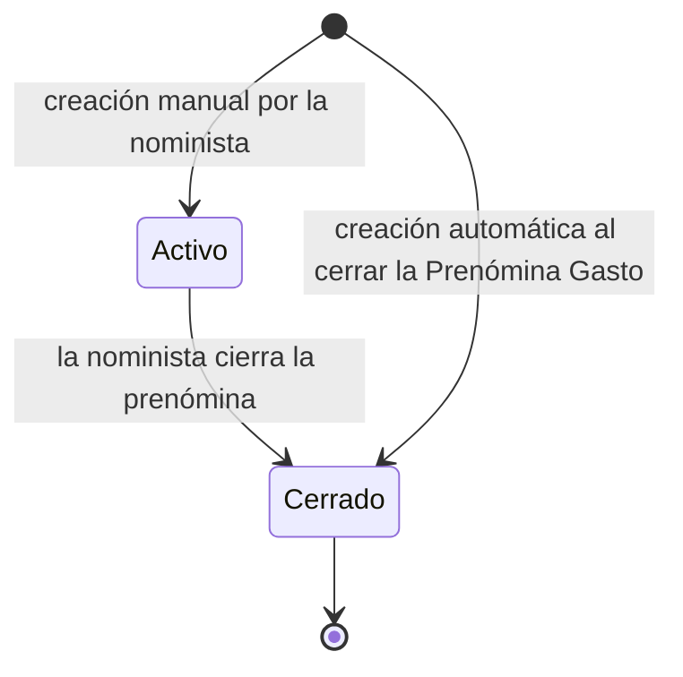
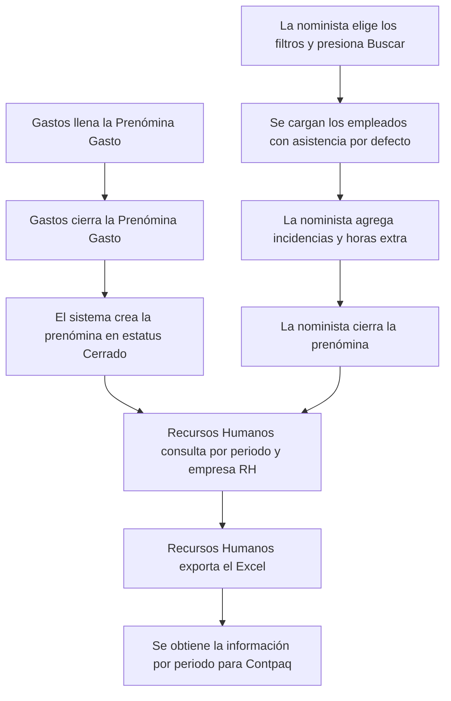
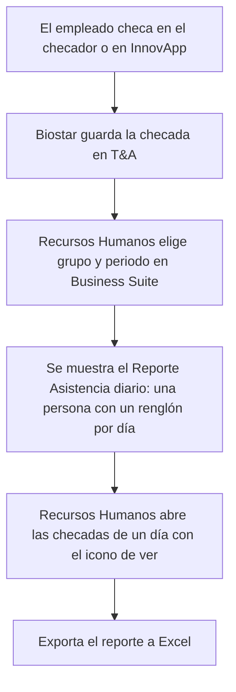
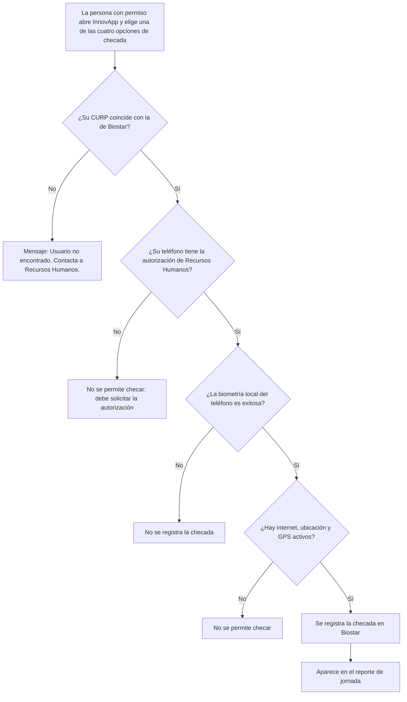

# Requerimientos Funcionales — Control de Asistencia: Prenómina, Reporte de jornada e InnovApp

Oct 8, 2026 · @Alejandro Saucedo

Este documento explica, en lenguaje sencillo, lo que debe hacer el proyecto Control de Asistencia Integración de Sistemas (solicitud 3976) en sus tres entregables: Prenómina, Reporte de jornada desde Biostar e InnovApp.

| Campo | Valor |
| --- | --- |
| Versión | 1.6 |
| Fecha | 2026-10-15 |
| Estado | Definición |
| Módulo | Business Suite, Biostar (complemento T&A), InnovApp y Contpaq |
| Autor | Análisis de Negocio |
| Área de negocio | Recursos Humanos |
| Área responsable | Célula de Innovación |

## 1. Propósito del documento

Este documento explica qué debe hacer el sistema en los tres entregables del proyecto, para que Recursos Humanos, las noministas, Gastos y el equipo de desarrollo entiendan lo mismo antes de construir. Se necesita antes del 1 de enero de 2027, cuando la Ley Federal del Trabajo (LFT) exige un registro electrónico de la jornada de trabajo.

Los tres entregables son:

1. **Prenómina:** los módulos Prenómina, Prenómina Gasto y Consulta Prenómina; los catálogos "Conceptos Prenómina" y "Periodos Nómina"; los campos nuevos del expediente (Frecuencia y Turno); las horas extra; la validación de duplicados y la creación automática.
2. **Reporte de jornada desde Biostar:** el reporte, sus filtros, sus columnas y su exportación a Excel; la opción de comida en el checador y la lectura del complemento T&A de Biostar.
3. **InnovApp:** la checada móvil (validación de CURP, ubicación, GPS e internet), el permiso por persona, la autorización del teléfono por Recursos Humanos y la alternativa supervisada por Recursos Humanos.

Los requerimientos (RF) de cada entregable son:

**Entregable 1 — Prenómina**

- RF-01 Catálogos "Conceptos Prenómina" y "Periodos Nómina".
- RF-02 Campos nuevos del expediente: Frecuencia y Turno.
- RF-03 Prenómina: creación manual por la nominista.
- RF-04 Horas extra.
- RF-05 Prenómina Gasto.
- RF-06 Creación automática de la prenómina.
- RF-07 Validación de empleado duplicado.
- RF-08 Consulta Prenómina.
- RF-09 Exportar el Excel a Recursos Humanos.

* RF-19 Configuración del usuario: Departamentos por Sucursal.

**Entregable 2 — Reporte de jornada desde Biostar**

- RF-10 Reporte de jornada por persona y por día.
- RF-11 Filtros del reporte.
- RF-12 Columnas fijas del reporte.
- RF-13 Exportación del reporte a Excel.
- RF-14 Opción de comida en el checador y relación de empleados por CURP.

**Entregable 3 — InnovApp**

- RF-15 Checada móvil desde InnovApp.
- RF-16 Permiso de checada remota por persona.
- RF-17 Autorización del teléfono para checar.
- RF-18 Alternativa y revisión supervisada por Recursos Humanos.

## 2. Alcance del documento

El alcance cubre a todo Grupo Reyes a nivel nacional, con una prueba previa al 1 de enero de 2027.

**Incluye:**

*Entregable 1 — Prenómina*

- El módulo nuevo "Prenómina": búsqueda de empleados con filtros, detalle por día y cierre por la nominista.
- La "Prenómina Gasto" (antes, el módulo de prenómina actual): celdas de horas extra por día, total de horas extra y creación automática de la prenómina al cerrarse.
- El módulo "Consulta Prenómina", solo para Recursos Humanos general, con exportación a Excel.
- Los catálogos "Conceptos Prenómina" (relacionado con "Conceptos Nómina") y "Periodos Nómina" (semanal y quincenal).
- Los campos nuevos del expediente: "Frecuencia" y "Turno".
- Las horas extra por día y su total por periodo.
- La validación para que un empleado no esté en dos prenóminas.
- Agregar y quitar empleados en una prenómina Activo.

* La pestaña nueva "Sucursal-Departamento" en la configuración del usuario, con los departamentos que atiende cada usuario por sucursal y tipo de periodo.

*Entregable 2 — Reporte de jornada desde Biostar*

- El reporte "Reporte Asistencia diario", agrupado por persona, con un renglón por día y una ventana con todas las checadas de cada día, consultable desde Business Suite de escritorio.
- Los filtros del reporte (solo cambian el grupo de usuarios y el periodo).
- Las columnas fijas del reporte y la exportación solo a Excel, solo con la vista principal.
- La lectura del complemento T&A de Biostar.
- El detalle de errores con los empleados cuya CURP no se encuentra entre Biostar, Business Suite y Contpaq.

*Entregable 3 — InnovApp*

- La checada móvil desde InnovApp, sin lector, en oficina, campo y remoto, con las cuatro opciones siempre disponibles, biometría al elegir cada opción, el historial de las checadas de los tres días anteriores y el aviso al volver a checar un tipo ya registrado.
- La validación de la CURP y de la huella biométrica del dispositivo, con ubicación y GPS obligatorios.
- El permiso de checada remota por persona.
- La autorización del teléfono por Recursos Humanos, en el subproceso "Autorización Asistencia Remota".
- La alternativa con revisión supervisada por Recursos Humanos para las fallas de la checada móvil.

**No incluye:**

*En general*

- Modificar o recalcular las checadas: toda la información viene de Biostar tal como se registra.
- Versiones o variantes del reporte distintas a la descrita.
- Configuraciones a cargo de otras áreas: los turnos y las horas base en Biostar, la CURP de los usuarios en Biostar (la captura Recursos Humanos) y la opción de comida en los checadores.
- Integraciones no mencionadas por el solicitante.
- La gestión de excepciones y correcciones de checadas (olvidos, fallas del checador, errores): se siguen llevando de forma manual, fuera del sistema.
- La interpretación de faltas, descansos, vacaciones, incapacidades, festivos o retardos en el reporte.
- Reemplazar las listas de asistencia que hoy entregan las empresas al equipo de nómina.

*Entregable 1 — Prenómina*

- El cálculo automático del pago de las horas extra: solo se capturan valores de horas; la explicación del pago es informativa.
- Una acción de cierre nueva: se reutiliza la que ya existe en la Prenómina Gasto.

*Entregable 3 — InnovApp*

- Servicios externos en la ruta de checada, en cualquier etapa.
- Checar sin internet en el teléfono: se contempla más adelante, fuera de la primera etapa.
- Selfie, prueba de vida o comparación biométrica remota: no están aprobadas.
- Restricciones por zona (geocerca): el valor de la ubicación se guarda solo como dato informativo.

## 3. Actores y roles

| Actor / Rol | Descripción | Entregable |
| --- | --- | --- |
| Recursos Humanos (general) | Personal de Recursos Humanos. Consulta el reporte de jornada, usa "Consulta Prenómina", exporta el Excel y administra el catálogo "Conceptos Prenómina" y asigna la frecuencia a los empleados. | 1, 2 |
| Recursos Humanos de plantas | Personal de Recursos Humanos de cada planta. Consulta el reporte de jornada, pero solo ve su planta. No usa "Consulta Prenómina". | 2 |
| Nominista | Persona del equipo de nómina que crea y cierra la prenómina de forma manual. Busca a sus empleados con filtros, asigna el turno a su personal y configura los datos que falten de un empleado. No opera la Prenómina Gasto. | 1 |
| Personal de Gastos | Personal que lleva la Prenómina Gasto en conjunto con Recursos Humanos. | 1 |
| Célula de Innovación | Área de I&N que configura los permisos y la configuración del usuario de la nominista (grupos de área RH y departamentos, con sus sucursales y tipos de periodo). Es el área responsable del proyecto. | 1, 3 |
| Líder de Célula de Innovación | Persona que valida que se cumplan todos los criterios de aceptación. | 1, 2, 3 |
| Empleados que checan | Personal de las plantas y centros de trabajo que registra su entrada, sus comidas y su salida en los checadores físicos. | 2 |
| Personas con permiso de InnovApp | Empleados a quienes se les asigna el permiso para checar desde el celular. | 3 |
| Biostar (complemento T&A) | Sistema donde se guardan las checadas y de donde sale el reporte de jornada. | 2, 3 |
| Business Suite | Sistema donde se consulta el reporte de jornada (versión de escritorio) y donde viven los módulos de prenómina. | 1, 2 |
| Contpaq | Sistema de nómina que recibe la información por periodo desde el Excel. | 1 |
| InnovApp | Aplicación móvil desde la que se checa. | 3 |
| Recursos Humanos general (autoriza teléfonos) | Personal de Recursos Humanos general que resuelve las solicitudes del subproceso "Autorización Asistencia Remota": autoriza, deniega o revoca el teléfono de cada persona. Recursos Humanos de plantas no lo usa. | 3 |

## 4. Entidad a la que aplica

El proyecto trabaja sobre estas entidades:

| Entidad | Qué es | Estatus |
| --- | --- | --- |
| Prenómina | Registro, por periodo, de lo que pasó con cada empleado cada día (asistencia, incidencias y horas extra). Se crea de forma manual o automática. | Inicial: Activo (creación manual) o Cerrado (creación automática). Terminal: Cerrado. |
| Prenómina Gasto | Módulo de prenómina que ya existe y lleva el personal de Gastos. | Ya tiene su flujo de estatus. Se cierra igual que la prenómina. |
| Empleado (expediente) | Persona que checa. Tiene CURP, empresa, empresa RH, sucursal asignada, departamento asignado, Proceso (Área RH) y, con este proyecto, Frecuencia y Turno. | Activo o inactivo (dato que ya existe). |
| Marcaje (checada) | Registro de entrada, inicio de comida, fin de comida o salida. Vive en Biostar. | No aplica. |
| Catálogos | "Conceptos Prenómina", "Conceptos Nómina", "Periodos Nómina", "Tipo de periodo de Nómina" y catálogo de turnos. | No aplica. |
| Solicitud de autorización de asistencia remota | Solicitud que hace una persona para que su teléfono pueda checar desde InnovApp. Se resuelve en el subproceso "Autorización Asistencia Remota", dentro del proceso "Recursos Humanos". | Inicial: Pendiente. Posteriores: Autorizada, Denegada o Revocada. |

La prenómina tiene solo dos estatus. Si la crea una nominista, empieza en Activo y se puede ajustar hasta que se cierra. Si la crea el sistema al cerrar la Prenómina Gasto, nace en Cerrado y ya no se puede modificar.

## 5. Índice de requerimientos

> **Navegación rápida:** cada identificador RF de la primera columna es un enlace que lleva al detalle del requerimiento. Los entregables empiezan en [Entregable 1](#entregable-1--prenómina), [Entregable 2](#entregable-2--reporte-de-jornada-desde-biostar) y [Entregable 3](#entregable-3--innovapp).

| RF | Título | Sistema | Aplica a | Entregable |
| --- | --- | --- | --- | --- |
| [RF-01](#rf-01--catálogos-conceptos-prenómina-y-periodos-nómina) | Catálogos "Conceptos Prenómina" y "Periodos Nómina" | Business Suite | Catálogos | 1 |
| [RF-02](#rf-02--campos-nuevos-del-expediente-frecuencia-y-turno) | Campos nuevos del expediente: Frecuencia y Turno | Business Suite | Empleado | 1 |
| [RF-03](#rf-03--prenómina-creación-manual-por-la-nominista) | Prenómina: creación manual por la nominista | Business Suite | Prenómina | 1 |
| [RF-04](#rf-04--horas-extra) | Horas extra | Business Suite | Prenómina y Prenómina Gasto | 1 |
| [RF-05](#rf-05--prenómina-gasto) | Prenómina Gasto | Business Suite | Prenómina Gasto | 1 |
| [RF-06](#rf-06--creación-automática-de-la-prenómina) | Creación automática de la prenómina | Business Suite | Prenómina | 1 |
| [RF-07](#rf-07--validación-de-empleado-duplicado) | Validación de empleado duplicado | Business Suite | Prenómina y Prenómina Gasto | 1 |
| [RF-08](#rf-08--consulta-prenómina) | Consulta Prenómina | Business Suite | Prenómina | 1 |
| [RF-09](#rf-09--exportar-el-excel-a-recursos-humanos) | Exportar el Excel a Recursos Humanos | Business Suite y Contpaq | Prenómina | 1 |
| [RF-10](#rf-10--reporte-de-jornada-por-persona-y-por-día) | Reporte de jornada por persona y por día | Business Suite y Biostar (T&A) | Marcaje | 2 |
| [RF-11](#rf-11--filtros-del-reporte) | Filtros del reporte | Business Suite y Biostar | Marcaje | 2 |
| [RF-12](#rf-12--columnas-fijas-del-reporte) | Columnas fijas del reporte | Business Suite | Marcaje | 2 |
| [RF-13](#rf-13--exportación-del-reporte-a-excel) | Exportación del reporte a Excel | Business Suite | Marcaje | 2 |
| [RF-14](#rf-14--opción-de-comida-en-el-checador-y-relación-de-empleados-por-curp) | Opción de comida en el checador y relación de empleados por CURP | Biostar, Business Suite y Contpaq | Marcaje y Empleado | 2 |
| [RF-15](#rf-15--checada-móvil-desde-innovapp) | Checada móvil desde InnovApp | InnovApp y Biostar | Marcaje | 3 |
| [RF-16](#rf-16--permiso-de-checada-remota-por-persona) | Permiso de checada remota por persona | InnovApp | Empleado | 3 |
| [RF-17](#rf-17--autorización-del-teléfono-para-checar) | Autorización del teléfono para checar | InnovApp | Empleado | 3 |
| [RF-18](#rf-18--alternativa-y-revisión-supervisada-por-recursos-humanos) | Alternativa y revisión supervisada por Recursos Humanos | InnovApp | Marcaje | 3 |
| [RF-19](#rf-19--configuración-del-usuario-departamentos-por-sucursal) | Configuración del usuario: Departamentos por Sucursal | Business Suite | Usuario | 1 |

# ENTREGABLE 1 — PRENÓMINA

Hoy parte del control de asistencia de la prenómina se lleva de forma manual en papel, y no todas las áreas usan el módulo de prenómina actual, que pasa a llamarse "Prenómina Gasto". Este entregable crea el módulo "Prenómina" y el módulo "Consulta Prenómina", para que la información de cada periodo llegue a Contpaq en un Excel y sin captura manual intermedia.

La prenómina se puede crear de dos maneras que conviven. En la manual, la nominista busca a sus empleados con filtros (sucursal, grupo de área RH o departamento, tipo de periodo y periodo), se cargan con la asistencia por defecto y ella agrega las incidencias. En la automática, el personal de Gastos llena y cierra la Prenómina Gasto y el sistema crea la prenómina ya cerrada. En los dos casos, la prenómina vive en el módulo "Prenómina" y es la que muestra "Consulta Prenómina".

El diagrama muestra las dos formas de crear la prenómina y cómo terminan en la misma consulta de Recursos Humanos.

# RF-01 — Catálogos "Conceptos Prenómina" y "Periodos Nómina"

| Campo | Valor |
| --- | --- |
| Prioridad | Must |
| Estado | Definición |
| Dependencias | Ninguna |

## Objetivo

Dejar listos los dos catálogos que usa la prenómina: los conceptos que entiende Contpaq y los periodos semanales y quincenales.

## Descripción

El sistema deberá permitir que Recursos Humanos administre el catálogo "Conceptos Prenómina", donde se registran los conceptos que usa Contpaq. Cada concepto se captura con una clave y un nombre, y se puede ligar a uno o más "Conceptos Nómina" (el catálogo que ya existe) desde el detalle del concepto.

El sistema deberá usar el catálogo "Periodos Nómina", que debe tener periodos semanales y quincenales, y cada periodo pertenece a un tipo del catálogo "Tipo de periodo de Nómina". Al agregar un periodo se indica cuándo inicia y cuándo termina.

| Campo del catálogo "Conceptos Prenómina" | Obligatorio | Descripción |
| --- | --- | --- |
| Clave | Sí | Identifica al concepto. No se puede repetir. |
| Nombre | Sí | Nombre del concepto. No se puede repetir. |
| Detalle: Conceptos Nómina | No | Lista de los "Conceptos Nómina" ligados. Se pueden ligar uno o más. |

## HU-1.1 — Administrar el catálogo "Conceptos Prenómina"

Como Recursos Humanos, quiero registrar los conceptos de Contpaq y ligarlos a los "Conceptos Nómina", para que la prenómina use los conceptos correctos sin capturarlos a mano cada vez.

### Reglas de negocio

**RN-1.1** Recursos Humanos administra el catálogo "Conceptos Prenómina".

**RN-1.2** Cada concepto se captura con su clave y su nombre, y ambos son obligatorios.

**RN-1.3** La clave y el nombre de un concepto no se pueden repetir.

**RN-1.4** Un concepto puede ligarse a uno o más "Conceptos Nómina" desde su detalle, pero no es obligatorio que tenga uno ligado.

### Criterios de Aceptación

**CA-1.1.1 — Alta de un concepto** Dado que Recursos Humanos está en el catálogo "Conceptos Prenómina" Cuando da de alta un concepto con su clave y su nombre Entonces el concepto queda registrado y disponible.

**CA-1.1.2 — Ligar "Conceptos Nómina"** Dado que existe un concepto en el catálogo Cuando Recursos Humanos, en el detalle del concepto, liga uno o más "Conceptos Nómina" Entonces el concepto queda ligado a ellos.

**CA-1.1.3 — Datos obligatorios** Dado que Recursos Humanos da de alta un concepto Cuando omite la clave o el nombre Entonces el sistema no le permite guardarlo.

**CA-1.1.4 — Clave o nombre repetidos** Dado que ya existe un concepto con la misma clave o el mismo nombre Cuando Recursos Humanos intenta dar de alta otro igual Entonces el sistema no se lo permite.

**CA-1.1.5 — Concepto sin ligar** Dado que Recursos Humanos da de alta un concepto con su clave y su nombre Cuando no liga ningún "Conceptos Nómina" Entonces el sistema permite guardarlo.

### Casos de prueba

**CP-1.1.1 — Alta exitosa (camino feliz)** Verifica: CA-1.1.1 Dado que Recursos Humanos abre el catálogo "Conceptos Prenómina" Cuando da de alta el concepto con clave "HE" y nombre "Horas extra" Entonces el concepto aparece en el catálogo.

**CP-1.1.2 — Ligar un concepto (camino feliz)** Verifica: CA-1.1.2 Dado que existe el concepto "Horas extra" Cuando Recursos Humanos le liga un "Conceptos Nómina" Entonces el detalle del concepto muestra el "Conceptos Nómina" ligado.

**CP-1.1.3 — Ligar varios (alternativo)** Verifica: CA-1.1.2 Dado que existe un concepto en el catálogo Cuando Recursos Humanos le liga tres "Conceptos Nómina" Entonces el detalle muestra los tres ligados.

**CP-1.1.4 — Falta la clave (error)** Verifica: CA-1.1.3 · RN-1.2 Dado que Recursos Humanos captura solo el nombre del concepto Cuando intenta guardar Entonces el sistema no deja guardarlo.

**CP-1.1.5 — Falta el nombre (error)** Verifica: CA-1.1.3 · RN-1.2 Dado que Recursos Humanos captura solo la clave del concepto Cuando intenta guardar Entonces el sistema no deja guardarlo.

**CP-1.1.6 — Clave repetida (validación)** Verifica: CA-1.1.4 · RN-1.3 Dado que ya existe un concepto con la clave "HE" Cuando Recursos Humanos intenta dar de alta otro con la clave "HE" Entonces el sistema no se lo permite.

**CP-1.1.7 — Nombre repetido (validación)** Verifica: CA-1.1.4 · RN-1.3 Dado que ya existe un concepto con el nombre "Horas extra" Cuando Recursos Humanos intenta dar de alta otro con ese nombre Entonces el sistema no se lo permite.

**CP-1.1.8 — Concepto sin ligar (alternativo)** Verifica: CA-1.1.5 · RN-1.4 Dado que Recursos Humanos captura clave y nombre de un concepto nuevo Cuando guarda sin ligar ningún "Conceptos Nómina" Entonces el concepto se guarda sin errores.

**CP-1.1.9 — Persona de otra área no administra el catálogo (permisos)** Verifica: CA-1.1.1 · RN-1.1 Dado que una persona que no es de Recursos Humanos abre el sistema Cuando intenta entrar al catálogo "Conceptos Prenómina" Entonces el sistema no le permite dar de alta ni cambiar conceptos.

| CA | Caso(s) de prueba | Escenarios cubiertos |
| --- | --- | --- |
| CA-1.1.1 | CP-1.1.1, CP-1.1.9 | Camino feliz, Permisos |
| CA-1.1.2 | CP-1.1.2, CP-1.1.3 | Camino feliz, Alternativo |
| CA-1.1.3 | CP-1.1.4, CP-1.1.5 | Error |
| CA-1.1.4 | CP-1.1.6, CP-1.1.7 | Validación |
| CA-1.1.5 | CP-1.1.8 | Alternativo |

## HU-1.2 — Elegir periodos semanales y quincenales

Como nominista, quiero elegir un periodo semanal o quincenal de un catálogo, para trabajar la prenómina del periodo correcto sin escribir las fechas a mano.

### Reglas de negocio

**RN-1.5** El periodo de nómina se obtiene del catálogo "Periodos Nómina", que debe tener periodos semanales y quincenales; cada periodo pertenece a un tipo del catálogo "Tipo de periodo de Nómina", y con ese dato se filtran los periodos según el tipo elegido.

**RN-1.6** Al agregar un periodo se especifican cuándo inicia y cuándo termina. El día en que inicia la semana se define en la configuración del periodo.

**RN-1.7** La nómina quincenal también puede tener un corte, igual que la nómina corta. La fecha del corte no se define aparte: la dan el inicio y el fin del periodo.

### Criterios de Aceptación

**CA-1.2.1 — Elegir semanal o quincenal** Dado que el catálogo "Periodos Nómina" tiene periodos semanales y quincenales Cuando la nominista elige el periodo de nómina Entonces puede escoger tanto uno semanal como uno quincenal.

**CA-1.2.2 — Fechas del periodo** Dado que se agrega un periodo al catálogo Cuando se indica cuándo inicia y cuándo termina Entonces el periodo usa esas fechas para mostrar sus días.

### Casos de prueba

**CP-1.2.1 — Elegir un periodo semanal (camino feliz)** Verifica: CA-1.2.1 Dado que existe un periodo semanal en el catálogo Cuando la nominista lo elige Entonces el sistema trabaja con ese periodo.

**CP-1.2.2 — Elegir un periodo quincenal (alternativo)** Verifica: CA-1.2.1 Dado que existe un periodo quincenal en el catálogo Cuando la nominista lo elige Entonces el sistema trabaja con ese periodo.

**CP-1.2.3 — Días del periodo (camino feliz)** Verifica: CA-1.2.2 · RN-1.6 Dado que un periodo inicia el 1 y termina el 15 del mismo mes Cuando se abre una prenómina de ese periodo Entonces se muestran 15 días, del 1 al 15.

| CA | Caso(s) de prueba | Escenarios cubiertos |
| --- | --- | --- |
| CA-1.2.1 | CP-1.2.1, CP-1.2.2 | Camino feliz, Alternativo |
| CA-1.2.2 | CP-1.2.3 | Camino feliz |

---

**Regla transversal:** estos dos catálogos los usan la Prenómina, la Prenómina Gasto y "Consulta Prenómina" (RF-03, RF-05, RF-06, RF-08 y RF-09).

# RF-02 — Campos nuevos del expediente: Frecuencia y Turno

| Campo | Valor |
| --- | --- |
| Prioridad | Must |
| Estado | Definición |
| Dependencias | Ninguna |

## Objetivo

Relacionar a cada empleado con el tipo de periodo mediante su frecuencia, saber en qué turno trabaja, y usar los datos que ya existen (área RH y departamento) para armar la prenómina.

## Descripción

El sistema deberá agregar al expediente del empleado dos campos: "Frecuencia" y "Turno". La "Frecuencia" es una lista fija con dos opciones, "Semanal" y "Quincenal" (no sale del catálogo "Tipo de periodo de Nómina"); es obligatoria, solo la asigna Recursos Humanos y es el dato que relaciona al empleado con el tipo de periodo: en la búsqueda de la prenómina y en "Consulta Prenómina" solo entran los empleados cuya frecuencia coincide con el tipo de periodo elegido. El "Turno" toma sus valores de un catálogo de turnos y lo asignan las noministas. La prenómina usa además los datos que ya existen en el expediente, el "Proceso (Área RH)" y el "Departamento asignado".

| Dato del expediente | ¿Es nuevo? | Descripción |
| --- | --- | --- |
| Turno | Sí | Turno en el que trabaja el empleado. |
| Departamento asignado | No | Campo que ya existe. Se usa para que el empleado entre a la prenómina por departamento. |
| Proceso (Área RH) | No | Campo que ya existe. Define a qué grupo de área RH pertenece el empleado. |
| Sucursal asignada | No | Campo que ya existe. Se muestra en la prenómina. |
| Empresa RH | No | Es distinta de "Empresa". Se usa como filtro en "Consulta Prenómina". |
| Empresa | No | Ya no se usa para cargar empleados en la prenómina. |
| Frecuencia | Sí | Lista fija con "Semanal" y "Quincenal". Es obligatoria y relaciona al empleado con el tipo de periodo. |

## HU-2.1 — Usar los datos del expediente que ya existen

Como nominista, quiero que la prenómina use el área RH y el departamento que ya están en el expediente, para no capturar datos nuevos.

### Reglas de negocio

**RN-2.1** No se agrega un campo "Proceso" nuevo al expediente. La prenómina usa el "Proceso (Área RH)" y el "Departamento asignado", que ya existen.

**RN-2.2** Un empleado entra a la prenómina por grupo si tiene alguna de las áreas RH del grupo, y por departamento si tiene ese departamento asignado; en los dos casos, además, su frecuencia debe coincidir con el tipo de periodo elegido.

**RN-2.3** La sucursal, la empresa y la empresa RH son datos independientes del expediente y no se relacionan entre sí.

### Criterios de Aceptación

**CA-2.1.1 — Sin campo "Proceso" nuevo** Dado que se abre el expediente de un empleado Cuando se revisan sus campos Entonces no existe un campo "Proceso" nuevo, y la prenómina usa "Proceso (Área RH)" y "Departamento asignado".

**CA-2.1.2 — Entrar por grupo o por departamento** Dado que un empleado tiene un área RH que pertenece a un grupo y un departamento asignado Cuando la nominista busca por ese grupo o por ese departamento Entonces el empleado puede aparecer en cualquiera de las dos búsquedas, si su frecuencia coincide con el tipo de periodo.

### Casos de prueba

**CP-2.1.1 — No hay un campo "Proceso" nuevo (validación)** Verifica: CA-2.1.1 · RN-2.1 Dado que se abre el expediente de un empleado Cuando se revisan sus campos Entonces solo existen "Proceso (Área RH)" y "Departamento asignado".

**CP-2.1.2 — Entra por grupo (camino feliz)** Verifica: CA-2.1.2 · RN-2.2 Dado que el área RH de Luis pertenece al grupo "Operación" y su frecuencia es "Semanal" Cuando Ana busca por el grupo "Operación" con el tipo "Semanal" Entonces Luis aparece.

**CP-2.1.3 — Entra por departamento (camino feliz)** Verifica: CA-2.1.2 · RN-2.2 Dado que Luis tiene el departamento "Producción" y la frecuencia "Semanal" Cuando Ana busca por el departamento "Producción" con el tipo "Semanal" Entonces Luis aparece.

| CA | Caso(s) de prueba | Escenarios cubiertos |
| --- | --- | --- |
| CA-2.1.1 | CP-2.1.1 | Validación |
| CA-2.1.2 | CP-2.1.2, CP-2.1.3 | Camino feliz |

## HU-2.2 — Asignar el turno a mi personal

Como nominista, quiero asignar el turno en el que trabaja cada empleado desde un catálogo de turnos, para que la prenómina muestre el turno de cada persona.

### Reglas de negocio

**RN-2.5** El campo "Turno" del expediente define el turno en el que trabaja el personal. Sus valores salen de un catálogo de turnos y lo capturan las noministas.

**RN-2.6** El turno del expediente y el turno de Biostar deberían coincidir, pero se registran al personal de manera independiente. El sistema no los compara.

### Criterios de Aceptación

**CA-2.2.1 — Asignar el turno** Dado que una nominista abre el expediente de un empleado Cuando elige el turno en el que trabaja y guarda Entonces el turno queda asignado al empleado.

**CA-2.2.2 — Solo turnos del catálogo** Dado que existe un catálogo de turnos Cuando la nominista abre el campo "Turno" Entonces solo ve los turnos de ese catálogo.

### Casos de prueba

**CP-2.2.1 — Asignar un turno (camino feliz)** Verifica: CA-2.2.1 Dado que el catálogo tiene el turno "Nocturno" Cuando la nominista lo elige para un empleado y guarda Entonces el expediente muestra "Nocturno".

**CP-2.2.2 — Lista de turnos (validación)** Verifica: CA-2.2.2 · RN-2.5 Dado que el catálogo tiene tres turnos Cuando la nominista abre el campo "Turno" Entonces ve esos tres turnos y ningún otro.

**CP-2.2.3 — Persona que no es nominista no asigna turnos (permisos)** Verifica: CA-2.2.1 · RN-2.5 Dado que una persona sin rol de nominista abre un expediente Cuando intenta cambiar el turno Entonces el sistema no se lo permite.

**CP-2.2.4 — Turno distinto al de Biostar (alternativo)** Verifica: CA-2.2.1 · RN-2.6 Dado que el turno del expediente es "Nocturno" y en Biostar es "Matutino" Cuando la nominista guarda el expediente Entonces el sistema lo guarda sin compararlos.

| CA | Caso(s) de prueba | Escenarios cubiertos |
| --- | --- | --- |
| CA-2.2.1 | CP-2.2.1, CP-2.2.3, CP-2.2.4 | Camino feliz, Permisos, Alternativo |
| CA-2.2.2 | CP-2.2.2 | Validación |

## HU-2.3 — Mantener la frecuencia en el expediente

Como Recursos Humanos, quiero registrar la frecuencia de cada empleado en su expediente, para que la prenómina lo relacione con el tipo de periodo.

### Reglas de negocio

**RN-2.7** El campo "Frecuencia" del expediente es una lista fija con dos opciones: "Semanal" y "Quincenal". No sale del catálogo "Tipo de periodo de Nómina".

**RN-2.8** Solo Recursos Humanos asigna la frecuencia. Es obligatoria: todo el personal debe tener frecuencia antes del arranque.

**RN-2.9** La frecuencia relaciona al empleado con el tipo de periodo: en la búsqueda de la prenómina y en "Consulta Prenómina" solo entran los empleados cuya frecuencia coincide con el tipo de periodo elegido. La coincidencia es por valor ("Semanal" con "Semanal" y "Quincenal" con "Quincenal").

**RN-2.10** Un empleado sin frecuencia no aparece en esas búsquedas.

### Criterios de Aceptación

**CA-2.3.1 — Opciones de la frecuencia** Dado que se abre el campo "Frecuencia" en el expediente de un empleado Cuando se despliega la lista Entonces se ven solo las opciones "Semanal" y "Quincenal".

**CA-2.3.2 — Guardar la frecuencia** Dado que Recursos Humanos eligió una frecuencia para un empleado Cuando guarda el expediente Entonces la frecuencia queda registrada en el expediente.

**CA-2.3.3 — Frecuencia obligatoria** Dado que un empleado no tiene frecuencia Cuando Recursos Humanos intenta guardar su expediente Entonces el sistema pide la frecuencia.

**CA-2.3.4 — Solo Recursos Humanos** Dado que una persona no es de Recursos Humanos Cuando intenta cambiar la frecuencia de un empleado Entonces el sistema no se lo permite.

**CA-2.3.5 — Empleado con la frecuencia que coincide** Dado que la nominista busca por el tipo de periodo "Semanal" Cuando se cargan los empleados Entonces aparecen los empleados con frecuencia "Semanal" que cumplen los demás filtros.

**CA-2.3.6 — Empleado con otra frecuencia o sin ella** Dado que un empleado tiene otra frecuencia o no tiene frecuencia Cuando la nominista busca por un tipo de periodo distinto Entonces ese empleado no aparece.

### Casos de prueba

**CP-2.3.1 — Ver las opciones (camino feliz)** Verifica: CA-2.3.1 · RN-2.7 Dado que Recursos Humanos abre el expediente de un empleado Cuando despliega el campo "Frecuencia" Entonces ve "Semanal" y "Quincenal".

**CP-2.3.2 — Solo dos opciones (validación)** Verifica: CA-2.3.1 · RN-2.7 Dado que se despliega el campo "Frecuencia" Cuando se intenta escribir un valor distinto Entonces no se puede: solo se elige entre las dos opciones.

**CP-2.3.3 — Guardar la frecuencia (camino feliz)** Verifica: CA-2.3.2 · RN-2.8 Dado que Recursos Humanos eligió "Quincenal" para un empleado Cuando guarda el expediente Entonces el expediente muestra "Quincenal".

**CP-2.3.4 — Falta la frecuencia (error)** Verifica: CA-2.3.3 · RN-2.8 Dado que un empleado no tiene frecuencia Cuando Recursos Humanos intenta guardar su expediente Entonces el sistema pide la frecuencia.

**CP-2.3.5 — Persona de otra área no asigna la frecuencia (permisos)** Verifica: CA-2.3.4 · RN-2.8 Dado que una nominista abre el expediente de un empleado Cuando intenta cambiar la frecuencia Entonces el sistema no se lo permite.

**CP-2.3.6 — Coincide con el tipo de periodo (camino feliz)** Verifica: CA-2.3.5 · RN-2.9 Dado que el empleado 1001 tiene frecuencia "Semanal" y está en el departamento "Producción" Cuando Ana busca "Producción" con el tipo "Semanal" Entonces el empleado 1001 aparece.

**CP-2.3.7 — No coincide con el tipo de periodo (validación)** Verifica: CA-2.3.6 · RN-2.9 Dado que el empleado 1002 tiene frecuencia "Quincenal" y está en "Producción" Cuando Ana busca "Producción" con el tipo "Semanal" Entonces el empleado 1002 no aparece.

**CP-2.3.8 — Empleado sin frecuencia (validación)** Verifica: CA-2.3.6 · RN-2.10 Dado que un empleado de "Producción" no tiene frecuencia Cuando Ana busca "Producción" Entonces ese empleado no aparece.

| CA | Caso(s) de prueba | Escenarios cubiertos |
| --- | --- | --- |
| CA-2.3.1 | CP-2.3.1, CP-2.3.2 | Camino feliz, Validación |
| CA-2.3.2 | CP-2.3.3 | Camino feliz |
| CA-2.3.3 | CP-2.3.4 | Error |
| CA-2.3.4 | CP-2.3.5 | Permisos |
| CA-2.3.5 | CP-2.3.6 | Camino feliz |
| CA-2.3.6 | CP-2.3.7, CP-2.3.8 | Validación |

---

**Regla transversal:** el "Proceso (Área RH)" (para pertenecer a un grupo) y el departamento asignado y la frecuencia del expediente se usan para buscar a los empleados en la prenómina (RF-03). El turno y la sucursal se muestran en ella.

# RF-03 — Prenómina: creación manual por la nominista

| Campo | Valor |
| --- | --- |
| Prioridad | Must |
| Estado | Definición |
| Dependencias | RF-01, RF-02, RF-07, RF-19 |

## Objetivo

Que la nominista busque a sus empleados con filtros, cree la prenómina de un periodo, agregue las incidencias y la cierre.

## Descripción

El sistema deberá ofrecer el módulo nuevo "Prenómina", que es independiente del módulo de prenómina actual (ahora "Prenómina Gasto"). Una prenómina lleva sus datos generales (folio, estatus, quién la registra y cuándo) y los filtros con los que se armó. La prenómina no se carga sola: la nominista elige primero la sucursal y después un grupo de área RH o un departamento (uno solo), el tipo de periodo y el periodo, y presiona el botón Buscar. Cada día viene con la asistencia por defecto y la nominista agrega las incidencias y las horas extra. Puede agregar empleados desde el listado de los que cumplen los filtros y aún no están. Al cerrar, el sistema avisa si faltan empleados. Mientras la prenómina está Activo se pueden cambiar los filtros y todos los valores; una vez guardada (cerrada), ya no se puede modificar. Si se crea de forma automática desde la Prenómina Gasto, queda ligada a ella.

Filtros de la búsqueda (cada uno permite un solo valor):

| Filtro | ¿Obligatorio? | Qué muestra |
| --- | --- | --- |
| Sucursal | Sí | Las sucursales que la nominista tiene configuradas en sus pestañas "Sucursal-Área R.H." y "Sucursal-Departamento", sin repetir. Se elige primero. |
| Grupo área RH o Departamento | Sí, uno solo de los dos | Los grupos de área RH o los departamentos que la nominista tiene configurados para la sucursal elegida. No se pueden elegir los dos. |
| Tipo de periodo de nómina | Sí | Del catálogo "Tipo de periodo de Nómina". Con un grupo se llena solo desde su configuración; con un departamento, los configurados para esa sucursal y ese departamento. |
| Periodo de nómina | Sí | Los periodos del catálogo "Periodos Nómina" del tipo elegido. |

Columnas de la prenómina:

| Columna de la prenómina | Qué muestra | Cómo se llena |
| --- | --- | --- |
| N° Nómina | Número de nómina del empleado. | Dato del empleado. |
| Personal | Nombre del empleado. | Dato del empleado. |
| Estatus Personal | Estatus del empleado (por ejemplo, Activo). | Dato del empleado. |
| RFC | RFC del empleado. | Dato del empleado. |
| Proceso (Área RH) | Proceso (Área RH) del empleado, campo que ya existe en el expediente. | Dato del empleado. |
| Turno | Turno en el que trabaja el empleado. | Dato del expediente. |
| Sucursal | Sucursal del empleado. | Dato que ya existe en el expediente. |
| Una columna por cada día | El concepto de "Conceptos Prenómina" de ese día. | En la creación manual se precarga con asistencia y la nominista agrega las incidencias. |
| Celda de horas extra (a la derecha de cada día) | Horas extra del empleado ese día, en horas. | La nominista captura el valor. |
| Horas extra totales (al final) | Suma de las horas extra del periodo. | Se calcula con las celdas diarias. |

## HU-3.1 — Configurar los grupos, departamentos y sucursales de la nominista

Como Célula de Innovación, quiero configurar en el usuario de cada nominista sus grupos de área RH, sus departamentos y sus sucursales, para que solo busque a los empleados que le corresponden.

### Reglas de negocio

**RN-3.1** La nominista que busca debe tener configurados en su usuario: en la pestaña "Sucursal-Área R.H." (que ya existe) sus grupos de área RH, cada uno con sus áreas RH, su sucursal y su tipo de periodo de nómina; y en la pestaña nueva "Sucursal-Departamento" (RF-19) sus departamentos, cada uno con su sucursal y su tipo de periodo. Ya no se configuran procesos ni empresa.

**RN-3.2** La Célula de Innovación realiza esa configuración, igual que todas las asignaciones de permisos.

### Criterios de Aceptación

**CA-3.1.1 — Configuración del usuario** Dado que una nominista tiene grupos, departamentos y sucursales configurados Cuando abre la búsqueda de la prenómina Entonces solo ve esas opciones en sus filtros.

**CA-3.1.2 — Sin sucursales configuradas** Dado que una nominista no tiene sucursales configuradas Cuando abre la búsqueda de la prenómina Entonces no puede buscar y ve el mensaje "No tienes sucursales configuradas. Contacta a la Célula de Innovación."

**CA-3.1.3 — Sin tipo de periodo configurado** Dado que la nominista eligió una sucursal y un departamento sin tipo de periodo configurado Cuando intenta buscar Entonces no se cargan empleados y ve el mensaje "No tienes un tipo de periodo configurado para esta sucursal y departamento. Contacta a la Célula de Innovación."

**CA-3.1.4 — Sucursal sin grupos ni departamentos** Dado que la nominista eligió una sucursal para la que no tiene grupos de área RH ni departamentos configurados Cuando intenta elegir el grupo o el departamento Entonces no puede buscar y ve el mensaje "No tienes grupos de área RH ni departamentos configurados para esta sucursal. Contacta a la Célula de Innovación."

### Casos de prueba

**CP-3.1.1 — Usuario configurado (camino feliz)** Verifica: CA-3.1.1 · RN-3.1 Dado que la nominista Ana tiene el grupo "Operación" y el departamento "Producción" Cuando abre la búsqueda Entonces puede elegir cualquiera de los dos, pero no otros.

**CP-3.1.2 — Usuario sin configuración (error)** Verifica: CA-3.1.2 · RN-3.1 Dado que el nominista Luis no tiene sucursales configuradas Cuando abre la búsqueda Entonces no puede buscar y ve el mensaje de falta de sucursales.

**CP-3.1.3 — Sin tipo de periodo (error)** Verifica: CA-3.1.3 · RN-3.1 Dado que Ana tiene "Producción" en la sucursal "Sur" sin tipo de periodo Cuando elige esa sucursal y ese departamento Entonces no se cargan empleados y ve el mensaje de falta de tipo de periodo.

**CP-3.1.4 — Solo la Célula de Innovación configura (permisos)** Verifica: CA-3.1.1 · RN-3.2 Dado que una nominista abre su propio usuario Cuando intenta cambiar sus grupos, departamentos o sucursales Entonces el sistema no se lo permite.

**CP-3.1.5 — Sucursal sin grupos ni departamentos (error)** Verifica: CA-3.1.4 · RN-3.1 Dado que Ana tiene la sucursal "Centro" sin grupos ni departamentos configurados Cuando elige "Centro" Entonces no puede buscar y ve "No tienes grupos de área RH ni departamentos configurados para esta sucursal. Contacta a la Célula de Innovación."

| CA | Caso(s) de prueba | Escenarios cubiertos |
| --- | --- | --- |
| CA-3.1.1 | CP-3.1.1, CP-3.1.4 | Camino feliz, Permisos |
| CA-3.1.2 | CP-3.1.2 | Error |
| CA-3.1.3 | CP-3.1.3 | Error |
| CA-3.1.4 | CP-3.1.5 | Error |

## HU-3.2 — Crear una prenómina con su folio, sus filtros y su periodo

Como nominista, quiero crear una prenómina con mis filtros y mi periodo, para trabajar los días de ese periodo con un folio que la identifique.

### Reglas de negocio

**RN-3.3** Los datos generales de la prenómina son: folio generado de manera automática, estatus, personal que registra, fecha de registro y los filtros de la búsqueda (sucursal, grupo de área RH o departamento, tipo de periodo y periodo).

**RN-3.4** La prenómina creada de forma manual nace con estatus "Activo".

**RN-3.5** El periodo se elige del catálogo "Periodos Nómina" (RF-01), y solo se muestran los del tipo de periodo elegido.

**RN-3.6** Para ver los módulos, la persona debe tener el permiso; la Célula de Innovación lo asigna. Se ven "Prenómina Gasto" y, por separado, "Prenómina".

### Criterios de Aceptación

**CA-3.2.1 — Datos generales** Dado que la nominista registra una prenómina Cuando la guarda Entonces el sistema genera el folio de manera automática y registra el estatus "Activo", quién la registra, la fecha de registro y los filtros de la búsqueda.

**CA-3.2.2 — Elegir el periodo** Dado que el catálogo "Periodos Nómina" tiene periodos semanales y quincenales Cuando la nominista elige el tipo de periodo "Semanal" Entonces el periodo solo muestra los semanales.

**CA-3.2.3 — Dos módulos separados** Dado que el módulo de prenómina actual se llama "Prenómina Gasto" Cuando una persona con acceso entra a los módulos Entonces ve "Prenómina Gasto" y, por separado, el módulo "Prenómina".

### Casos de prueba

**CP-3.2.1 — Registro con folio automático (camino feliz)** Verifica: CA-3.2.1 · RN-3.3 · RN-3.4 Dado que la nominista Ana elige un periodo y registra la prenómina Cuando la guarda Entonces la prenómina tiene un folio generado por el sistema, estatus "Activo", el nombre de Ana y la fecha de hoy.

**CP-3.2.2 — Folios distintos (validación)** Verifica: CA-3.2.1 · RN-3.3 Dado que se registran dos prenóminas Cuando se revisan sus folios Entonces cada una tiene un folio diferente.

**CP-3.2.3 — Periodos según el tipo de periodo (alternativo)** Verifica: CA-3.2.2 · RN-3.5 Dado que el catálogo tiene un periodo semanal y uno quincenal Cuando la nominista elige el tipo de periodo "Quincenal" y abre la lista de periodos Entonces ve solo el quincenal.

**CP-3.2.4 — Dos módulos visibles (camino feliz)** Verifica: CA-3.2.3 Dado que una persona tiene acceso a ambos módulos Cuando entra al sistema Entonces ve "Prenómina Gasto" y "Prenómina" como módulos separados.

**CP-3.2.5 — Persona sin permiso no ve el módulo (permisos)** Verifica: CA-3.2.3 · RN-3.6 Dado que una persona no tiene el permiso del módulo "Prenómina" Cuando entra al sistema Entonces no ve el módulo "Prenómina".

| CA | Caso(s) de prueba | Escenarios cubiertos |
| --- | --- | --- |
| CA-3.2.1 | CP-3.2.1, CP-3.2.2 | Camino feliz, Validación |
| CA-3.2.2 | CP-3.2.3 | Alternativo |
| CA-3.2.3 | CP-3.2.4, CP-3.2.5 | Camino feliz, Permisos |

## HU-3.3 — Buscar a mis empleados con filtros

Como nominista, quiero buscar a mis empleados con filtros y el botón Buscar, para armar la prenómina solo con las personas que me corresponden.

### Reglas de negocio

**RN-3.7** La prenómina no se carga sola. La nominista captura los filtros obligatorios y presiona Buscar; se traen todos los empleados que cumplen los filtros. Cada filtro permite un solo valor.

**RN-3.19** Los filtros se eligen en este orden: sucursal; grupo de área RH o departamento; tipo de periodo de nómina; y periodo de nómina.

**RN-3.20** La sucursal es obligatoria y muestra las sucursales que la nominista tiene configuradas en sus pestañas "Sucursal-Área R.H." y "Sucursal-Departamento", sin repetir. Al cambiar la sucursal se vacían el grupo o el departamento, el tipo de periodo y el periodo.

**RN-3.21** Después de la sucursal se elige un grupo de área RH o un departamento, nunca los dos, y es obligatorio uno de los dos. Cada lista trae solo lo que la nominista tiene configurado para esa sucursal. Al cambiar el grupo o el departamento se vacían el tipo de periodo y el periodo.

**RN-3.22** El tipo de periodo sale del catálogo "Tipo de periodo de Nómina". Con un grupo se llena solo desde su configuración y no se cambia; con un departamento, muestra los tipos configurados para esa sucursal y ese departamento, y si hay más de uno la nominista elige. El periodo muestra solo los del tipo elegido; si cambia el tipo, el periodo se vacía.

**RN-3.23** Con un grupo entran los empleados que tienen alguna de las áreas RH del grupo; con un departamento, los empleados de ese departamento. En los dos casos solo entran los empleados cuya frecuencia coincide con el tipo de periodo elegido.

**RN-3.24** No aparecen en la búsqueda los empleados que ya están en otra prenómina activa o en una cerrada del mismo periodo. Sí aparecen los empleados dados de baja o inactivos.

**RN-3.25** Si la búsqueda no trae empleados, el sistema muestra "No se encontraron empleados con los filtros seleccionados."

**RN-3.26** Mientras la prenómina esté Activo, la nominista puede cambiar los criterios y volver a buscar. Si ya hay cambios capturados (un concepto distinto a la asistencia por defecto, horas extra, o un empleado agregado o quitado), al presionar Buscar el sistema avisa: "Al cambiar los filtros se perderá lo que capturaste en esta prenómina. ¿Deseas continuar?", con Continuar y Cancelar. Con Continuar, la lista se reemplaza y se pierde lo capturado; con Cancelar, todo queda igual.

**RN-3.8** La prenómina muestra por cada empleado los datos de la tabla de columnas de esta descripción, seguidos de una columna por cada día del periodo (semanal o quincenal).

### Criterios de Aceptación

**CA-3.3.1 — Búsqueda con filtros** Dado que la nominista capturó la sucursal, un grupo o un departamento, el tipo de periodo y el periodo Cuando presiona Buscar Entonces se traen todos los empleados que cumplen los filtros.

**CA-3.3.2 — Grupo o departamento, uno solo** Dado que la nominista eligió un grupo de área RH Cuando intenta elegir también un departamento Entonces el sistema no lo permite; solo puede quedar uno de los dos.

**CA-3.3.3 — Grupos y departamentos según la sucursal** Dado que la nominista eligió una sucursal Cuando abre el filtro de grupo o departamento Entonces ve solo los grupos y departamentos configurados para esa sucursal; y si cambia la sucursal, se vacían el grupo o el departamento, el tipo de periodo y el periodo.

**CA-3.3.4 — Tipo de periodo desde la configuración** Dado que la nominista eligió la sucursal y un grupo o un departamento Cuando se carga el tipo de periodo Entonces con un grupo se llena solo, y con un departamento muestra los tipos configurados para esa sucursal y ese departamento.

**CA-3.3.5 — Periodos según el tipo** Dado que está elegido el tipo de periodo Cuando la nominista abre el filtro de periodo Entonces ve solo los periodos de ese tipo.

**CA-3.3.6 — Cambio del tipo de periodo** Dado que la nominista ya había elegido un periodo Cuando cambia el tipo de periodo Entonces el periodo se vacía y debe elegir uno nuevo antes de buscar.

**CA-3.3.7 — Campos obligatorios** Dado que falta la sucursal, el grupo o el departamento, el tipo de periodo o el periodo Cuando presiona Buscar Entonces el sistema no busca y señala los campos obligatorios.

**CA-3.3.8 — Empleados de un grupo** Dado que la nominista busca por un grupo de área RH Cuando se cargan los empleados Entonces aparecen los que tienen alguna de las áreas RH del grupo y cuya frecuencia coincide con el tipo de periodo.

**CA-3.3.9 — Empleados de un departamento** Dado que la nominista busca por un departamento Cuando se cargan los empleados Entonces aparecen los empleados de ese departamento cuya frecuencia coincide con el tipo de periodo elegido.

**CA-3.3.10 — Empleados que no aparecen** Dado que un empleado ya está en otra prenómina activa o en una cerrada del mismo periodo Cuando la nominista busca Entonces ese empleado no aparece en el resultado.

**CA-3.3.11 — Búsqueda sin resultados** Dado que ningún empleado cumple los filtros Cuando la nominista presiona Buscar Entonces ve el mensaje "No se encontraron empleados con los filtros seleccionados."

**CA-3.3.12 — Advertencia al volver a buscar** Dado que la prenómina ya tiene un concepto distinto a la asistencia por defecto, horas extra, o un empleado agregado o quitado Cuando la nominista cambia un criterio y presiona Buscar Entonces ve la advertencia con las opciones Continuar y Cancelar.

**CA-3.3.13 — Continuar o cancelar** Dado que el sistema mostró la advertencia Cuando la nominista elige Continuar o Cancelar Entonces con Continuar la lista se reemplaza y se pierde lo capturado, y con Cancelar todo queda como estaba.

**CA-3.3.14 — Sin cambios, sin advertencia** Dado que la prenómina no tiene cambios capturados Cuando la nominista cambia un criterio y presiona Buscar Entonces la búsqueda se hace sin advertencia.

**CA-3.3.15 — Datos del empleado** Dado que se cargaron los empleados Cuando la nominista abre el detalle Entonces ve por empleado el número de nómina, el personal, el estatus personal, el RFC, el "Proceso (Área RH)", el turno y la sucursal.

**CA-3.3.16 — Días del periodo** Dado que el periodo es semanal o quincenal Cuando se carga el detalle Entonces se muestra una columna por cada día del periodo, con una celda de horas extra a la derecha de cada día y una columna final de horas extra totales.

### Casos de prueba

**CP-3.3.1 — Búsqueda por grupo (camino feliz)** Verifica: CA-3.3.1 · RN-3.7 Dado que Ana eligió la sucursal "Norte", el grupo "Operación", el tipo "Semanal" y la semana 41, y hay 10 empleados de ese grupo con frecuencia "Semanal" Cuando presiona Buscar Entonces aparecen esos 10 empleados.

**CP-3.3.2 — Búsqueda por departamento (camino feliz)** Verifica: CA-3.3.1 · RN-3.7 Dado que Ana eligió la sucursal "Norte", el departamento "Producción", el tipo "Semanal" y la semana 41 Cuando presiona Buscar Entonces aparecen todos los empleados de "Producción" con frecuencia "Semanal".

**CP-3.3.3 — Grupo y departamento a la vez (error)** Verifica: CA-3.3.2 · RN-3.20 Dado que Ana eligió el grupo "Operación" Cuando intenta elegir también el departamento "Producción" Entonces el sistema no lo permite.

**CP-3.3.4 — Grupos y departamentos de la sucursal (validación)** Verifica: CA-3.3.3 · RN-3.19 · RN-3.21 Dado que Ana eligió la sucursal "Norte" y el departamento "Producción" solo está configurado para "Sur" Cuando abre el filtro de grupo o departamento Entonces no ve "Producción".

**CP-3.3.5 — Cambio de sucursal (validación)** Verifica: CA-3.3.3 · RN-3.20 Dado que Ana eligió la sucursal "Norte", el departamento "Producción", el tipo y el periodo Cuando cambia la sucursal a "Sur" Entonces se vacían el departamento, el tipo de periodo y el periodo.

**CP-3.3.6 — Tipo de periodo con grupo (camino feliz)** Verifica: CA-3.3.4 · RN-3.22 Dado que el grupo "Operación" tiene el tipo "Semanal" para "Norte" Cuando Ana elige la sucursal "Norte" y el grupo "Operación" Entonces el tipo de periodo se llena solo con "Semanal".

**CP-3.3.7 — Tipo de periodo con departamento (alternativo)** Verifica: CA-3.3.4 · RN-3.22 Dado que "Producción" tiene los tipos "Semanal" y "Quincenal" para "Norte" Cuando Ana elige la sucursal "Norte" y el departamento "Producción" Entonces puede elegir cualquiera de los dos.

**CP-3.3.8 — Periodos según el tipo (camino feliz)** Verifica: CA-3.3.5 · RN-3.22 Dado que Ana eligió el tipo "Quincenal" Cuando abre el filtro de periodo Entonces ve solo los quincenales.

**CP-3.3.9 — Cambio del tipo de periodo (validación)** Verifica: CA-3.3.6 · RN-3.22 Dado que Ana eligió "Semanal" y la semana 41 Cuando cambia el tipo a "Quincenal" Entonces el periodo se vacía y debe elegir uno quincenal antes de buscar.

**CP-3.3.10 — Falta un campo obligatorio (error)** Verifica: CA-3.3.7 · RN-3.20 Dado que Ana no eligió la sucursal Cuando presiona Buscar Entonces no se busca y se señala que la sucursal es obligatoria.

**CP-3.3.11 — Entran los del grupo (validación)** Verifica: CA-3.3.8 · RN-3.23 Dado que el grupo "Operación" tiene las áreas "Empaque" y "Surtido" Cuando Ana busca por ese grupo Entonces aparecen los empleados de "Empaque" y de "Surtido" con frecuencia "Semanal", y ningún otro.

**CP-3.3.12 — Solo entran los que coinciden con el tipo de periodo (validación)** Verifica: CA-3.3.9 · RN-3.23 Dado que un empleado de "Producción" tiene la frecuencia "Quincenal" y Ana busca el tipo "Semanal" Cuando presiona Buscar Entonces ese empleado no aparece.

**CP-3.3.13 — Empleado ya en otra prenómina (validación)** Verifica: CA-3.3.10 · RN-3.24 Dado que un empleado ya está en una prenómina de la semana 41 Cuando Ana busca la semana 41 Entonces ese empleado no aparece.

**CP-3.3.14 — Empleado dado de baja (alternativo)** Verifica: CA-3.3.1 · RN-3.24 Dado que un empleado está dado de baja y cumple los filtros Cuando Ana busca Entonces el empleado sí aparece, con su estatus personal.

**CP-3.3.15 — Búsqueda sin resultados (error)** Verifica: CA-3.3.11 · RN-3.25 Dado que ningún empleado cumple los filtros Cuando Ana presiona Buscar Entonces ve "No se encontraron empleados con los filtros seleccionados."

**CP-3.3.16 — Advertencia con cambios capturados (camino feliz)** Verifica: CA-3.3.12 · RN-3.26 Dado que Ana capturó 3 horas extra en la prenómina Cuando cambia el periodo y presiona Buscar Entonces ve la advertencia con Continuar y Cancelar.

**CP-3.3.17 — Continuar reemplaza la lista (alternativo)** Verifica: CA-3.3.13 · RN-3.26 Dado que Ana ve la advertencia Cuando elige Continuar Entonces la lista se reemplaza y se pierde lo capturado.

**CP-3.3.18 — Cancelar conserva lo capturado (alternativo)** Verifica: CA-3.3.13 · RN-3.26 Dado que Ana ve la advertencia Cuando elige Cancelar Entonces la lista y lo capturado quedan como estaban.

**CP-3.3.19 — Sin cambios, sin advertencia (alternativo)** Verifica: CA-3.3.14 · RN-3.26 Dado que Ana no ha capturado nada Cuando cambia el periodo y presiona Buscar Entonces busca sin mostrar advertencia.

**CP-3.3.20 — Datos del empleado visibles (camino feliz)** Verifica: CA-3.3.15 · RN-3.8 Dado que se cargó un empleado Cuando Ana abre el detalle Entonces ve su número de nómina, nombre, estatus, RFC, "Proceso (Área RH)", turno y sucursal.

**CP-3.3.21 — Periodo semanal (camino feliz)** Verifica: CA-3.3.16 · RN-3.8 Dado que el periodo es semanal de 7 días Cuando se carga el detalle Entonces hay 7 columnas de días, cada una con su celda de horas extra, y una columna final de horas extra totales.

**CP-3.3.22 — Periodo quincenal (alternativo)** Verifica: CA-3.3.16 · RN-3.8 Dado que el periodo es quincenal de 15 días Cuando se carga el detalle Entonces hay 15 columnas de días.

| CA | Caso(s) de prueba | Escenarios cubiertos |
| --- | --- | --- |
| CA-3.3.1 | CP-3.3.1, CP-3.3.2, CP-3.3.14 | Camino feliz, Alternativo |
| CA-3.3.2 | CP-3.3.3 | Error |
| CA-3.3.3 | CP-3.3.4, CP-3.3.5 | Validación |
| CA-3.3.4 | CP-3.3.6, CP-3.3.7 | Camino feliz, Alternativo |
| CA-3.3.5 | CP-3.3.8 | Camino feliz |
| CA-3.3.6 | CP-3.3.9 | Validación |
| CA-3.3.7 | CP-3.3.10 | Error |
| CA-3.3.8 | CP-3.3.11 | Validación |
| CA-3.3.9 | CP-3.3.12 | Validación |
| CA-3.3.10 | CP-3.3.13 | Validación |
| CA-3.3.11 | CP-3.3.15 | Error |
| CA-3.3.12 | CP-3.3.16 | Camino feliz |
| CA-3.3.13 | CP-3.3.17, CP-3.3.18 | Alternativo |
| CA-3.3.14 | CP-3.3.19 | Alternativo |
| CA-3.3.15 | CP-3.3.20 | Camino feliz |
| CA-3.3.16 | CP-3.3.21, CP-3.3.22 | Camino feliz, Alternativo |

## HU-3.4 — Agregar solo las incidencias

Como nominista, quiero que cada día venga con asistencia y agregar solo las incidencias, para capturar menos y equivocarme menos.

### Reglas de negocio

**RN-3.9** En la creación manual, cada día de cada empleado se precarga con el concepto de "Conceptos Prenómina" que indica asistencia. La nominista solo agrega las incidencias.

**RN-3.10** Para cada incidencia, la nominista elige el concepto que corresponde del catálogo "Conceptos Prenómina", donde están registrados los conceptos para Contpaq.

### Criterios de Aceptación

**CA-3.4.1 — Asistencia por defecto** Dado que se cargó el detalle Cuando la nominista lo abre Entonces cada día de cada empleado trae el concepto de "Conceptos Prenómina" que indica asistencia.

**CA-3.4.2 — Agregar una incidencia** Dado que todos los días traen asistencia Cuando la nominista elige, en "Conceptos Prenómina", el concepto de una incidencia para un día Entonces ese día muestra el concepto de la incidencia en lugar de la asistencia.

### Casos de prueba

**CP-3.4.1 — Todos los días con asistencia (camino feliz)** Verifica: CA-3.4.1 · RN-3.9 Dado que se cargó una prenómina semanal con 5 empleados Cuando la nominista abre el detalle Entonces los 35 días (5 empleados por 7 días) muestran el concepto de asistencia.

**CP-3.4.2 — Agregar una falta (camino feliz)** Verifica: CA-3.4.2 · RN-3.10 Dado que el día martes de un empleado muestra asistencia Cuando la nominista elige el concepto de falta para ese día Entonces el martes muestra la falta y los demás días siguen con asistencia.

**CP-3.4.3 — Cambiar una incidencia (alternativo)** Verifica: CA-3.4.2 Dado que un día muestra una incidencia Cuando la nominista elige otro concepto para ese día Entonces el día muestra el nuevo concepto.

| CA | Caso(s) de prueba | Escenarios cubiertos |
| --- | --- | --- |
| CA-3.4.1 | CP-3.4.1 | Camino feliz |
| CA-3.4.2 | CP-3.4.2, CP-3.4.3 | Camino feliz, Alternativo |

## HU-3.5 — Agregar y quitar empleados

Como nominista, quiero agregar empleados que faltan y quitar a los que no corresponden mientras la prenómina esté activa, para que la prenómina tenga exactamente a mi personal.

### Reglas de negocio

**RN-3.11** Mientras la prenómina esté Activo, la opción de agregar empleados muestra el listado de los empleados que cumplen los filtros de la prenómina y aún no están en ella; la nominista marca los que quiera y los agrega, y puede quitar empleados del listado.

**RN-3.12** Al agregar un empleado aplica la validación de empleado duplicado (RF-07).

**RN-3.13** Los empleados que no cumplen los filtros de la búsqueda (incluida su frecuencia) no se muestran para agregar y no se muestra ningún mensaje.

**RN-3.14** Si a un empleado le falta algún dato, no aparece en el listado hasta que se configure; la frecuencia la asigna Recursos Humanos.

**RN-3.15** La Prenómina Gasto ya cuenta con la funcionalidad de agregar y quitar empleados.

### Criterios de Aceptación

**CA-3.5.1 — Agregar un empleado** Dado que la prenómina está Activo Cuando la nominista abre la opción de agregar y marca empleados del listado Entonces el empleado queda en el listado.

**CA-3.5.2 — Empleado que no cumple** Dado que la prenómina está Activo Cuando la nominista busca empleados para agregar y uno no cumple con los filtros de la búsqueda Entonces ese empleado no se muestra y no aparece ningún mensaje.

**CA-3.5.3 — Quitar un empleado** Dado que la prenómina está Activo Cuando la nominista quita un empleado del listado Entonces el empleado deja de formar parte de esa prenómina.

**CA-3.5.4 — Dato faltante** Dado que a un empleado le falta algún dato necesario Cuando se intenta agregarlo Entonces no aparece en el listado hasta que se configure ese dato (la frecuencia la asigna Recursos Humanos).

**CA-3.5.5 — Prenómina cerrada** Dado que la prenómina está cerrada Cuando se intenta agregar o quitar un empleado Entonces el sistema no lo permite.

### Casos de prueba

**CP-3.5.1 — Agregar un empleado válido (camino feliz)** Verifica: CA-3.5.1 · RN-3.11 Dado que una prenómina Activo del departamento "Producción", sucursal "Norte" y tipo "Semanal", y un empleado de "Producción" con frecuencia "Semanal" que no está en ella Cuando Ana abre la opción de agregar y lo marca Entonces el empleado queda en la prenómina.

**CP-3.5.2 — Empleado de otro departamento no aparece (validación)** Verifica: CA-3.5.2 · RN-3.13 Dado que un empleado de un departamento que Ana no tiene configurado Cuando Ana abre el listado para agregar Entonces no lo ve y no aparece ningún mensaje.

**CP-3.5.3 — Empleado de otra sucursal no aparece (validación)** Verifica: CA-3.5.2 · RN-3.13 Dado que un empleado de una sucursal que Ana no tiene configurada Cuando Ana abre el listado para agregar Entonces no lo ve y no aparece ningún mensaje.

**CP-3.5.4 — Quitar un empleado (camino feliz)** Verifica: CA-3.5.3 Dado que una prenómina activa con 10 empleados Cuando Ana quita a uno Entonces la prenómina queda con 9 empleados.

**CP-3.5.5 — Empleado con otra frecuencia o sin ella (validación)** Verifica: CA-3.5.4 · RN-3.14 Dado que un empleado de "Producción" tiene la frecuencia "Quincenal" o no tiene frecuencia, y la prenómina es de tipo "Semanal" Cuando Ana abre el listado para agregar Entonces ese empleado no aparece.

**CP-3.5.6 — Prenómina cerrada no cambia (error)** Verifica: CA-3.5.5 Dado que una prenómina cerrada Cuando Ana intenta agregar o quitar un empleado Entonces el sistema no lo permite.

| CA | Caso(s) de prueba | Escenarios cubiertos |
| --- | --- | --- |
| CA-3.5.1 | CP-3.5.1 | Camino feliz |
| CA-3.5.2 | CP-3.5.2, CP-3.5.3 | Validación |
| CA-3.5.3 | CP-3.5.4 | Camino feliz |
| CA-3.5.4 | CP-3.5.5 | Error |
| CA-3.5.5 | CP-3.5.6 | Error |

## HU-3.6 — Ajustar y cerrar la prenómina

Como nominista, quiero ajustar el detalle mientras esté Activo y cerrarla cuando termine, para dejar lista la información que verá Recursos Humanos.

### Reglas de negocio

**RN-3.16** Mientras la prenómina tenga estatus "Activo", se pueden hacer ajustes al detalle.

**RN-3.17** El proceso de prenómina lo cierra un empleado con rol de nominista, con la acción de cierre que ya existe en la Prenómina Gasto. Al cerrarse, el estatus cambia a "Cerrado" y sus empleados quedan disponibles en "Consulta Prenómina".

**RN-3.18** Una vez guardada (cerrada) la prenómina, no se permite modificar sus registros, conceptos ni horas extra.

**RN-3.28** Mientras la prenómina esté Activo se pueden cambiar los filtros de la búsqueda y todos los valores. Una vez cerrada, no se puede modificar nada, ni los filtros.

**RN-3.29** Al cerrar, el sistema revisa si faltan empleados que cumplen los filtros de la prenómina (incluida su frecuencia) y que no están en ella ni en otra prenómina del mismo periodo. Si faltan, avisa: "Faltan N empleados que cumplen los filtros. ¿Deseas cerrar así o agregarlos?", con Cerrar así y Agregar. Con Agregar se abre el listado de esos empleados para marcar los que quiera, y después captura sus incidencias u horas extra; con Cerrar así, la prenómina se cierra sin ellos.

### Criterios de Aceptación

**CA-3.6.1 — Ajustes antes del cierre** Dado que la prenómina está Activo Cuando la nominista modifica el detalle Entonces el sistema permite el ajuste.

**CA-3.6.2 — Cerrar la prenómina** Dado que un empleado con rol de nominista terminó la prenómina Cuando la cierra Entonces el estatus cambia a "Cerrado" y sus empleados quedan disponibles en "Consulta Prenómina".

**CA-3.6.3 — Prenómina cerrada no se modifica** Dado que la prenómina está cerrada Cuando la nominista intenta modificar un concepto o las horas extra Entonces el sistema no lo permite.

**CA-3.6.4 — Filtros modificables mientras está Activo** Dado que la prenómina está Activo Cuando la nominista cambia un filtro y busca de nuevo Entonces el sistema lo permite, con la advertencia si ya hay cambios capturados.

**CA-3.6.5 — Filtros bloqueados al cerrar** Dado que la prenómina está cerrada Cuando se intenta cambiar un filtro o buscar de nuevo Entonces el sistema no lo permite.

**CA-3.6.6 — Aviso de empleados faltantes** Dado que faltan empleados que cumplen los filtros y no están en ninguna prenómina del periodo Cuando la nominista intenta cerrar la prenómina Entonces ve el aviso con la cantidad de faltantes y las opciones Cerrar así y Agregar.

**CA-3.6.7 — Agregar desde el aviso** Dado que la nominista ve el aviso de faltantes Cuando elige Agregar Entonces se abre el listado de esos empleados, marca los que quiera y los agrega para capturar sus incidencias u horas extra.

**CA-3.6.8 — Cerrar sin los faltantes** Dado que la nominista ve el aviso de faltantes Cuando elige Cerrar así Entonces la prenómina se cierra sin esos empleados.

**CA-3.6.9 — Sin faltantes** Dado que no faltan empleados que cumplan los filtros Cuando la nominista cierra la prenómina Entonces se cierra sin aviso.

### Casos de prueba

**CP-3.6.1 — Ajuste con la prenómina activa (camino feliz)** Verifica: CA-3.6.1 · RN-3.16 Dado que una prenómina con estatus "Activo" Cuando Ana cambia un concepto Entonces el cambio se guarda.

**CP-3.6.2 — Cierre exitoso (camino feliz)** Verifica: CA-3.6.2 · RN-3.17 Dado que una prenómina activa terminada Cuando Ana la cierra Entonces el estatus es "Cerrado" y los empleados aparecen en "Consulta Prenómina".

**CP-3.6.3 — No se modifica un concepto cerrado (error)** Verifica: CA-3.6.3 · RN-3.18 Dado que una prenómina con estatus "Cerrado" Cuando Ana intenta cambiar un concepto Entonces el sistema no lo permite.

**CP-3.6.4 — No se modifican las horas extra cerradas (error)** Verifica: CA-3.6.3 · RN-3.18 Dado que una prenómina con estatus "Cerrado" Cuando Ana intenta cambiar las horas extra de un día Entonces el sistema no lo permite.

**CP-3.6.5 — Persona que no es nominista no cierra (permisos)** Verifica: CA-3.6.2 · RN-3.17 Dado que una persona sin rol de nominista abre una prenómina activa Cuando intenta cerrarla Entonces el sistema no se lo permite.

**CP-3.6.6 — Cambiar un filtro con la prenómina Activo (camino feliz)** Verifica: CA-3.6.4 · RN-3.28 Dado que la prenómina de Ana está Activo y sin cambios capturados Cuando Ana cambia el departamento y busca de nuevo Entonces la búsqueda se hace con el filtro nuevo.

**CP-3.6.7 — Filtros bloqueados con la prenómina cerrada (error)** Verifica: CA-3.6.5 · RN-3.28 Dado que la prenómina de Ana está cerrada Cuando intenta cambiar un filtro Entonces el sistema no lo permite.

**CP-3.6.8 — Aviso de faltantes (camino feliz)** Verifica: CA-3.6.6 · RN-3.29 Dado que faltan 3 empleados del departamento "Producción", con frecuencia "Semanal", que no están en ninguna prenómina de la semana 41 Cuando Ana intenta cerrar Entonces ve "Faltan 3 empleados que cumplen los filtros. ¿Deseas cerrar así o agregarlos?"

**CP-3.6.9 — Agregar los faltantes (alternativo)** Verifica: CA-3.6.7 · RN-3.29 Dado que Ana ve el aviso de faltantes Cuando elige Agregar y marca 2 de los 3 Entonces esos 2 quedan en la prenómina para capturar sus incidencias.

**CP-3.6.10 — Cerrar sin los faltantes (alternativo)** Verifica: CA-3.6.8 · RN-3.29 Dado que Ana ve el aviso de faltantes Cuando elige Cerrar así Entonces la prenómina se cierra sin esos empleados.

**CP-3.6.11 — Cierre sin faltantes (camino feliz)** Verifica: CA-3.6.9 · RN-3.29 Dado que todos los empleados que cumplen los filtros ya están en la prenómina Cuando Ana cierra Entonces se cierra sin aviso.

| CA | Caso(s) de prueba | Escenarios cubiertos |
| --- | --- | --- |
| CA-3.6.1 | CP-3.6.1 | Camino feliz |
| CA-3.6.2 | CP-3.6.2, CP-3.6.5 | Camino feliz, Permisos |
| CA-3.6.3 | CP-3.6.3, CP-3.6.4 | Error |
| CA-3.6.4 | CP-3.6.6 | Camino feliz |
| CA-3.6.5 | CP-3.6.7 | Error |
| CA-3.6.6 | CP-3.6.8 | Camino feliz |
| CA-3.6.7 | CP-3.6.9 | Alternativo |
| CA-3.6.8 | CP-3.6.10 | Alternativo |
| CA-3.6.9 | CP-3.6.11 | Camino feliz |

---

**Regla transversal:** la prenómina cerrada es la que muestra "Consulta Prenómina" (RF-08). Las horas extra se detallan en RF-04 y la validación de duplicados en RF-07.

# RF-04 — Horas extra

| Campo | Valor |
| --- | --- |
| Prioridad | Must |
| Estado | Definición |
| Dependencias | RF-03, RF-05 |

## Objetivo

Capturar las horas extra de cada día y ver el total del periodo, tanto en la Prenómina Gasto como en la Prenómina.

## Descripción

El sistema deberá agregar, para cada empleado, una celda de horas extra a la derecha de cada día del periodo y, al final, una columna con las horas extra totales del periodo seleccionado. Solo se capturan valores de horas, sin claves ni catálogo. En la Prenómina Gasto se capturan en cada celda y, al cerrarla, pasan tal cual a la prenómina. En la creación manual de la prenómina también se capturan valores manuales, y ese valor es el que se exporta en el Excel.

## HU-4.1 — Capturar las horas extra de cada día

Como nominista o personal de Gastos, quiero escribir las horas extra de cada empleado en la celda de su día y ver el total del periodo, para no sumar a mano.

### Reglas de negocio

**RN-4.1** En la Prenómina Gasto y en la Prenómina, cada día lleva a su derecha una celda para capturar las horas extra del empleado ese día, y al final hay una columna de horas extra totales con la suma de las celdas diarias del periodo seleccionado.

**RN-4.2** Se capturan solo valores de horas, sin claves ni catálogo. Al cerrar la Prenómina Gasto, los valores pasan tal cual a la prenómina. En la creación manual se capturan valores manuales, que son los que se exportan en el Excel.

**RN-4.3** Las horas extra del reporte de jornada son las que genera Biostar. En teoría deben coincidir con las capturadas, pero por ahora no hay una validación que lo controle.

### Criterios de Aceptación

**CA-4.1.1 — Celda diaria** Dado que se abre la Prenómina Gasto o la Prenómina para un periodo Cuando se muestran los días del periodo Entonces a la derecha de cada día hay una celda para capturar las horas extra del empleado en ese día.

**CA-4.1.2 — Total de horas extra** Dado que un empleado tiene horas extra en las celdas diarias Cuando se consulta el periodo seleccionado Entonces la columna final de horas extra totales muestra la suma de esas celdas.

**CA-4.1.3 — Paso a la prenómina** Dado que se capturaron horas extra en la Prenómina Gasto Cuando se cierra Entonces los valores pasan tal cual a la prenómina, sin registrarse en el catálogo.

**CA-4.1.4 — Creación manual** Dado que la nominista crea la prenómina de forma manual Cuando captura las horas extra Entonces captura solo valores de horas, y esos valores son los que se exportan en el Excel.

### Casos de prueba

**CP-4.1.1 — Capturar horas en un día (camino feliz)** Verifica: CA-4.1.1 · RN-4.1 Dado que una prenómina semanal abierta Cuando la nominista escribe 3 en la celda de horas extra del martes de un empleado Entonces la celda muestra 3.

**CP-4.1.2 — Total del periodo (camino feliz)** Verifica: CA-4.1.2 · RN-4.1 Dado que un empleado tiene 3 horas el martes y 2 horas el jueves Cuando se consulta el periodo Entonces las horas extra totales son 5.

**CP-4.1.3 — Empleado sin horas (alternativo)** Verifica: CA-4.1.2 Dado que un empleado no tiene horas extra capturadas Cuando se consulta el periodo Entonces las horas extra totales quedan vacías o en cero.

**CP-4.1.4 — Paso desde Gasto (camino feliz)** Verifica: CA-4.1.3 · RN-4.2 Dado que en la Prenómina Gasto un empleado tiene 5 horas el lunes Cuando se cierra la Prenómina Gasto Entonces la prenómina muestra 5 en el lunes de ese empleado.

**CP-4.1.5 — Captura manual y exportación (camino feliz)** Verifica: CA-4.1.4 · RN-4.2 Dado que la nominista capturó 2 horas en un día de una prenómina manual cerrada Cuando Recursos Humanos exporta el Excel Entonces el Excel muestra 2 en ese día.

**CP-4.1.6 — No se comparan con Biostar (alternativo)** Verifica: CA-4.1.4 · RN-4.3 Dado que Biostar calculó 4 horas extra y la nominista capturó 3 Cuando guarda la prenómina Entonces el sistema la guarda sin compararlas.

| CA | Caso(s) de prueba | Escenarios cubiertos |
| --- | --- | --- |
| CA-4.1.1 | CP-4.1.1 | Camino feliz |
| CA-4.1.2 | CP-4.1.2, CP-4.1.3 | Camino feliz, Alternativo |
| CA-4.1.3 | CP-4.1.4 | Camino feliz |
| CA-4.1.4 | CP-4.1.5, CP-4.1.6 | Camino feliz, Alternativo |

### Cómo se paga una hora extra (solo información)

Esta explicación es solo informativa: el sistema no aplica esta lógica ni valida claves, y solo se capturan valores de horas. Así funciona el pago. La clave de una hora extra tiene la forma `<horas>HE<pago>`: el primer valor son las horas trabajadas, HE significa horas extra y el último valor indica cómo se pagan (2, dobles; 3, triples). Por ejemplo, 1HE2 es 1 hora pagada doble y 2HE3 son 2 horas pagadas triple. Las primeras 4 horas de un día se pagan dobles y las siguientes, triples. Las horas dobles del periodo suman hasta 12; a partir de ahí, todo se paga triple.

| Horas extra en el día | Cómo se calculan | Claves |
| --- | --- | --- |
| 3 | Las 3 están dentro de las primeras 4 | 3HE2 |
| 4 | Las 4 se pagan dobles | 4HE2 |
| 5 | 4 dobles y 1 triple | 4HE2, 1HE3 |
| 7 | 4 dobles y 3 triples | 4HE2, 3HE3 |

| Día | Horas extra | Horas dobles acumuladas | Claves |
| --- | --- | --- | --- |
| Lunes | 4 | 4 | 4HE2 |
| Martes | 4 | 8 | 4HE2 |
| Miércoles | 3 | 11 | 3HE2 |
| Jueves | 4 | 12 | 1HE2, 3HE3 |
| Viernes | 2 | 12 | 2HE3 |

El jueves solo queda 1 hora doble para llegar a 12; las otras 3 se pagan triples. El viernes todo se paga triple. Las horas extra totales del periodo son 17.

---

**Regla transversal:** el Excel de "Consulta Prenómina" muestra las horas extra del día y el total (RF-09).

# RF-05 — Prenómina Gasto

| Campo | Valor |
| --- | --- |
| Prioridad | Must |
| Estado | Definición |
| Dependencias | RF-01, RF-04 |

## Objetivo

Mantener la Prenómina Gasto que ya usa el personal de Gastos, con el nuevo nombre, las celdas de horas extra y la creación automática de la prenómina.

## Descripción

El módulo de prenómina actual pasa a llamarse "Prenómina Gasto". Es un proceso del personal de Gastos, que trabaja en conjunto con Recursos Humanos, y es aparte del proceso de Recursos Humanos: ambos conviven y los dos dan lugar a la prenómina. El sistema deberá agregarle las celdas de horas extra por día y la columna de horas extra totales, y deberá crear la prenómina de forma automática al cerrarse (RF-06). Ya cuenta con un flujo de estatus y con la funcionalidad de agregar y quitar empleados, y se cierra igual que la prenómina. Una vez guardada (cerrada), no se permite modificar sus registros.

| Columna de la Prenómina Gasto | Qué muestra |
| --- | --- |
| N° Nómina | Número de nómina del empleado. |
| Personal | Nombre del empleado. |
| Estatus Personal | Estatus del empleado. |
| RFC | RFC del empleado. |
| Proceso (Área RH) | Proceso (Área RH) del empleado. |
| Una columna por cada fecha | El concepto del catálogo "Conceptos Nómina" de ese día, según el periodo configurado. |
| Celda de horas extra (a la derecha de cada día) | Horas extra del empleado ese día, en horas. |
| Horas extra totales (al final) | Suma de las horas extra diarias del periodo. |

## HU-5.1 — Llenar la Prenómina Gasto con horas extra

Como personal de Gastos, quiero capturar los conceptos y las horas extra de cada día en la Prenómina Gasto, para que al cerrarla se cree la prenómina sin volver a capturar.

### Reglas de negocio

**RN-5.1** La "Prenómina Gasto" es un proceso del personal de Gastos, que trabaja en conjunto con Recursos Humanos. Es un proceso aparte del de Recursos Humanos y ambos conviven: el personal de Gastos lleva la "Prenómina Gasto" y las noministas llevan la prenómina de forma manual. Ambos procesos dan lugar a la prenómina.

**RN-5.2** Cada renglón de empleado muestra: número de nómina, personal, estatus personal, RFC y Proceso (Área RH), seguidos de una columna por cada día del periodo configurado, con su celda de horas extra a la derecha, y una columna final de horas extra totales.

**RN-5.3** Los detalles de cada fecha se llenan con los conceptos del catálogo "Conceptos Nómina".

**RN-5.4** El periodo, semanal o quincenal, se toma del catálogo "Periodos Nómina". Ya tiene su flujo de estatus y se cierra igual que la prenómina.

**RN-5.5** Una vez guardada (cerrada) la "Prenómina Gasto", no se permite modificar sus registros, conceptos ni horas extra.

### Criterios de Aceptación

**CA-5.1.1 — Datos del empleado** Dado que se abre la "Prenómina Gasto" para un periodo Cuando se muestran los empleados Entonces cada renglón trae el número de nómina, el personal, el estatus personal, el RFC y el Proceso (Área RH).

**CA-5.1.2 — Días y horas extra** Dado que el periodo está configurado Cuando se muestran los días Entonces hay una columna por cada día, una celda de horas extra a la derecha de cada una y una columna final de horas extra totales.

**CA-5.1.3 — Conceptos de cada fecha** Dado que se llena el detalle de una fecha Cuando se elige el concepto Entonces se usa el catálogo "Conceptos Nómina".

**CA-5.1.4 — Periodo semanal o quincenal** Dado que el catálogo "Periodos Nómina" tiene periodos semanales y quincenales Cuando se abre la "Prenómina Gasto" para un periodo Entonces el periodo puede ser semanal o quincenal.

**CA-5.1.5 — Prenómina Gasto guardada no se modifica** Dado que la Prenómina Gasto está guardada (cerrada) Cuando se intenta modificar un registro, un concepto o las horas extra Entonces el sistema no lo permite.

### Casos de prueba

**CP-5.1.1 — Columnas del empleado (camino feliz)** Verifica: CA-5.1.1 · RN-5.2 Dado que se abre la Prenómina Gasto de un periodo Cuando se muestra un empleado Entonces trae número de nómina, nombre, estatus, RFC y Proceso (Área RH).

**CP-5.1.2 — Días y celdas de horas (camino feliz)** Verifica: CA-5.1.2 · RN-5.2 Dado que el periodo es de 7 días Cuando se muestran los días Entonces hay 7 columnas de días, 7 celdas de horas extra y una columna de total.

**CP-5.1.3 — Concepto de "Conceptos Nómina" (camino feliz)** Verifica: CA-5.1.3 · RN-5.3 Dado que el personal de Gastos llena el lunes de un empleado Cuando abre la lista de conceptos Entonces ve los conceptos del catálogo "Conceptos Nómina".

**CP-5.1.4 — Periodo quincenal (alternativo)** Verifica: CA-5.1.4 · RN-5.4 Dado que existe un periodo quincenal en el catálogo Cuando el personal de Gastos abre la Prenómina Gasto con ese periodo Entonces se muestran los días de la quincena.

**CP-5.1.5 — Periodo semanal (alternativo)** Verifica: CA-5.1.4 · RN-5.4 Dado que existe un periodo semanal en el catálogo Cuando el personal de Gastos abre la Prenómina Gasto con ese periodo Entonces se muestran los días de la semana.

**CP-5.1.6 — No se modifica un concepto guardado (error)** Verifica: CA-5.1.5 · RN-5.5 Dado que una Prenómina Gasto guardada (cerrada) Cuando el personal de Gastos intenta cambiar un concepto Entonces el sistema no lo permite.

**CP-5.1.7 — No se modifican las horas extra guardadas (error)** Verifica: CA-5.1.5 · RN-5.5 Dado que una Prenómina Gasto guardada (cerrada) Cuando el personal de Gastos intenta cambiar las horas extra de un día Entonces el sistema no lo permite.

| CA | Caso(s) de prueba | Escenarios cubiertos |
| --- | --- | --- |
| CA-5.1.1 | CP-5.1.1 | Camino feliz |
| CA-5.1.2 | CP-5.1.2 | Camino feliz |
| CA-5.1.3 | CP-5.1.3 | Camino feliz |
| CA-5.1.4 | CP-5.1.4, CP-5.1.5 | Alternativo |
| CA-5.1.5 | CP-5.1.6, CP-5.1.7 | Error |

---

**Regla transversal:** al cerrarse, la Prenómina Gasto crea la prenómina (RF-06) y no puede incluir a un empleado que ya esté en otra prenómina (RF-07).

# RF-06 — Creación automática de la prenómina

| Campo | Valor |
| --- | --- |
| Prioridad | Must |
| Estado | Definición |
| Dependencias | RF-01, RF-04, RF-05 |

## Objetivo

Que la prenómina se cree sola, ya cerrada y con los conceptos que entiende Contpaq, cuando el personal de Gastos cierra la Prenómina Gasto.

## Descripción

El sistema deberá crear de manera automática una prenómina, en el módulo "Prenómina", cuando se cierre la Prenómina Gasto. La prenómina nace con estatus "Cerrado", hereda el periodo de la Prenómina Gasto, trae las horas extra tal cual y usa los conceptos de "Conceptos Prenómina" que estén ligados a los "Conceptos Nómina" usados. Como nace cerrada, no se puede modificar. Para que esto funcione, los "Conceptos Nómina" deben estar ligados previamente en "Conceptos Prenómina", y el sistema lo valida al cerrar la Prenómina Gasto para evitar detalles en la prenómina.

## HU-6.1 — Crear la prenómina al cerrar la Prenómina Gasto

Como personal de Gastos, quiero que al cerrar la Prenómina Gasto el sistema cree la prenómina, para no capturar lo mismo dos veces.

### Reglas de negocio

**RN-6.1** Al cerrar la "Prenómina Gasto", el sistema crea de manera automática, en el módulo "Prenómina", una prenómina en estatus "Cerrado" que hereda el periodo de la "Prenómina Gasto".

**RN-6.2** La prenómina automática trae las horas extra y usa los conceptos de "Conceptos Prenómina" ligados a los "Conceptos Nómina" usados, que son los conceptos registrados para Contpaq.

**RN-6.3** La prenómina, creada de forma manual o automática, vive en el módulo "Prenómina" y es la que muestra "Consulta Prenómina".

**RN-6.4** Una prenómina creada de forma automática nace cerrada, por lo que no se puede modificar.

### Criterios de Aceptación

**CA-6.1.1 — Creación al cerrar** Dado que se cierra la "Prenómina Gasto" Cuando termina el cierre Entonces el sistema crea de manera automática, en el módulo "Prenómina", una prenómina en estatus "Cerrado" que hereda el periodo.

**CA-6.1.2 — Conceptos y horas extra** Dado que se creó la prenómina de forma automática Cuando se revisan sus registros Entonces los conceptos son los de "Conceptos Prenómina" ligados a los "Conceptos Nómina" y trae las horas extra de la "Prenómina Gasto".

**CA-6.1.3 — No modificable** Dado que la prenómina se creó de forma automática Cuando alguien intenta modificar un concepto o las horas extra Entonces el sistema no lo permite.

**CA-6.1.4 — Periodo heredado** Dado que la "Prenómina Gasto" tiene un periodo del catálogo "Periodos Nómina" Cuando se crea la prenómina de forma automática Entonces hereda ese mismo periodo.

### Casos de prueba

**CP-6.1.1 — Se crea la prenómina cerrada (camino feliz)** Verifica: CA-6.1.1 · RN-6.1 Dado que Gastos terminó la Prenómina Gasto de la semana 41 Cuando la cierra Entonces existe una prenómina de la semana 41 con estatus "Cerrado" en el módulo "Prenómina".

**CP-6.1.2 — Conceptos y horas pasan (camino feliz)** Verifica: CA-6.1.2 · RN-6.2 Dado que en la Prenómina Gasto un empleado tiene el concepto "Falta" el martes y 3 horas extra el jueves Cuando se crea la prenómina Entonces muestra el concepto ligado de "Conceptos Prenómina" el martes y 3 horas el jueves.

**CP-6.1.3 — Consulta la muestra (camino feliz)** Verifica: CA-6.1.1 · RN-6.3 Dado que se creó una prenómina automática cerrada Cuando Recursos Humanos filtra ese periodo y esa empresa RH en "Consulta Prenómina" Entonces aparece la información de esa prenómina.

**CP-6.1.4 — No se puede cambiar un concepto (error)** Verifica: CA-6.1.3 · RN-6.4 Dado que una prenómina automática cerrada Cuando alguien intenta cambiar un concepto Entonces el sistema no lo permite.

**CP-6.1.5 — No se pueden cambiar las horas extra (error)** Verifica: CA-6.1.3 · RN-6.4 Dado que una prenómina automática cerrada Cuando alguien intenta cambiar las horas extra Entonces el sistema no lo permite.

**CP-6.1.6 — Periodo quincenal heredado (alternativo)** Verifica: CA-6.1.4 Dado que la Prenómina Gasto es de un periodo quincenal Cuando se cierra Entonces la prenómina creada es de ese mismo periodo quincenal.

| CA | Caso(s) de prueba | Escenarios cubiertos |
| --- | --- | --- |
| CA-6.1.1 | CP-6.1.1, CP-6.1.3 | Camino feliz |
| CA-6.1.2 | CP-6.1.2 | Camino feliz |
| CA-6.1.3 | CP-6.1.4, CP-6.1.5 | Error |
| CA-6.1.4 | CP-6.1.6 | Alternativo |

## HU-6.2 — Revisar que los conceptos estén ligados

Como Recursos Humanos, quiero que el sistema revise que cada concepto usado tenga un concepto ligado en "Conceptos Prenómina", para evitar detalles en la prenómina.

### Reglas de negocio

**RN-6.5** Para crear la prenómina de forma automática, los "Conceptos Nómina" usados en la "Prenómina Gasto" deben estar ligados previamente en el catálogo "Conceptos Prenómina".

**RN-6.6** Al cerrar la "Prenómina Gasto" se valida que todos los conceptos usados tengan un concepto ligado, para evitar detalles en la prenómina.

### Criterios de Aceptación

**CA-6.2.1 — Conceptos ligados** Dado que algún concepto usado en la "Prenómina Gasto" no tiene un concepto ligado en "Conceptos Prenómina" Cuando se cierra la "Prenómina Gasto" Entonces la validación lo detecta, para evitar detalles en la prenómina.

**CA-6.2.2 — Todos ligados** Dado que todos los conceptos usados están ligados Cuando se cierra la "Prenómina Gasto" Entonces la validación no encuentra problemas y se crea la prenómina.

### Casos de prueba

**CP-6.2.1 — Concepto sin ligar (error)** Verifica: CA-6.2.1 · RN-6.6 Dado que la Prenómina Gasto usa el concepto "Permiso", que no está ligado en "Conceptos Prenómina" Cuando Gastos intenta cerrarla Entonces la validación detecta el concepto sin ligar.

**CP-6.2.2 — Todos los conceptos ligados (camino feliz)** Verifica: CA-6.2.2 · RN-6.5 Dado que todos los conceptos usados están ligados Cuando Gastos cierra la Prenómina Gasto Entonces la validación pasa y se crea la prenómina.

| CA | Caso(s) de prueba | Escenarios cubiertos |
| --- | --- | --- |
| CA-6.2.1 | CP-6.2.1 | Error |
| CA-6.2.2 | CP-6.2.2 | Camino feliz |

## HU-6.3 — Ligar la prenómina automática con su Prenómina Gasto

Como Recursos Humanos, quiero que cada prenómina automática quede ligada a la Prenómina Gasto que la originó, para dar seguimiento a su origen.

### Reglas de negocio

**RN-6.7** Al crear la prenómina de forma automática, el sistema guarda una llave foránea hacia la Prenómina Gasto que la originó, y el registro de la prenómina queda ligado con el de gasto. La liga va en un solo sentido: la prenómina apunta a su Prenómina Gasto.

**RN-6.8** La prenómina automática hereda de la Prenómina Gasto el grupo, la sucursal, el periodo y el tipo de periodo.

### Criterios de Aceptación

**CA-6.3.1 — Liga con la Prenómina Gasto** Dado que se cierra la Prenómina Gasto Cuando el sistema crea la prenómina automática Entonces la prenómina guarda la liga hacia esa Prenómina Gasto.

**CA-6.3.2 — Datos heredados** Dado que se creó la prenómina automática Cuando se revisan sus datos Entonces tiene el grupo, la sucursal, el periodo y el tipo de periodo de la Prenómina Gasto.

### Casos de prueba

**CP-6.3.1 — Liga (camino feliz)** Verifica: CA-6.3.1 · RN-6.7 Dado que Gastos cierra la Prenómina Gasto con folio 15 Cuando se crea la prenómina automática Entonces la prenómina apunta a la Prenómina Gasto 15.

**CP-6.3.2 — Datos heredados (camino feliz)** Verifica: CA-6.3.2 · RN-6.8 Dado que la Prenómina Gasto 15 es del grupo "Operación", sucursal "Norte", tipo "Semanal", semana 41 Cuando se crea la prenómina automática Entonces hereda ese grupo, sucursal, tipo y periodo.

**CP-6.3.3 — Cada prenómina con su origen (validación)** Verifica: CA-6.3.1 · RN-6.7 Dado que se cierran dos Prenóminas Gasto distintas Cuando se crean las dos prenóminas automáticas Entonces cada una apunta a su propia Prenómina Gasto.

| CA | Caso(s) de prueba | Escenarios cubiertos |
| --- | --- | --- |
| CA-6.3.1 | CP-6.3.1, CP-6.3.3 | Camino feliz, Validación |
| CA-6.3.2 | CP-6.3.2 | Camino feliz |

---

**Regla transversal:** la creación automática aplica también la validación de empleado duplicado (RF-07).

# RF-07 — Validación de empleado duplicado

| Campo | Valor |
| --- | --- |
| Prioridad | Must |
| Estado | Definición |
| Dependencias | RF-03, RF-05, RF-06 |

## Objetivo

Evitar que un mismo empleado esté en dos prenóminas del mismo periodo.

## Descripción

El sistema deberá validar, en la Prenómina Gasto y en la Prenómina, que un mismo empleado no esté en dos prenóminas. No deja incluir a un empleado que ya esté en otra prenómina activa, de cualquiera de los dos módulos, ni a uno que ya esté en una prenómina cerrada del mismo periodo. En otro periodo no hay problema. La validación aplica tanto en la creación manual como en la automática. Además, si un empleado aparece duplicado, su registro se pinta de un color que resalte para indicar la inconsistencia.

## HU-7.1 — Impedir empleados duplicados

Como nominista o personal de Gastos, quiero que el sistema no me deje incluir a un empleado que ya está en otra prenómina, para no pagar dos veces a la misma persona.

### Reglas de negocio

**RN-7.1** Un mismo empleado no puede estar en dos prenóminas al mismo tiempo. Se valida en la "Prenómina Gasto" y en la "Prenómina".

**RN-7.2** No se permite incluir a un empleado que ya esté en otra prenómina activa, de cualquiera de los dos módulos, ni a uno que ya esté en una prenómina cerrada del mismo periodo.

**RN-7.3** Si ya está en una prenómina activa, el mensaje es "Este empleado ya está en una prenómina activa." Si ya está en una cerrada del mismo periodo, el mensaje es "Este empleado ya está en una prenómina cerrada de este periodo."

**RN-7.4** La validación aplica tanto en la creación manual como en la automática.

**RN-7.5** Cuando un empleado esté duplicado en una prenómina, su registro se pinta de un color que resalte para indicar la inconsistencia.

**RN-7.6** La prenómina automática y la Prenómina Gasto que la originó no cuentan como duplicado entre sí.

### Criterios de Aceptación

**CA-7.1.1 — Empleado en una prenómina activa** Dado que un empleado ya está en una "Prenómina Gasto" o en una prenómina activa Cuando se intenta incluirlo en otra Entonces el sistema bloquea la acción y muestra el mensaje "Este empleado ya está en una prenómina activa."

**CA-7.1.2 — Empleado en una prenómina cerrada del mismo periodo** Dado que un empleado ya está en una prenómina cerrada de un periodo Cuando se intenta incluirlo en otra prenómina nueva del mismo periodo Entonces el sistema bloquea la acción y muestra el mensaje "Este empleado ya está en una prenómina cerrada de este periodo."

**CA-7.1.3 — Sin duplicidad** Dado que un empleado no está en otra prenómina activa ni en una cerrada del mismo periodo Cuando se incluye en una prenómina Entonces el sistema lo permite.

**CA-7.1.4 — Creación automática** Dado que un empleado ya está en otra prenómina activa o en una cerrada del mismo periodo Cuando se crea la prenómina de forma automática al cerrar la "Prenómina Gasto" Entonces se aplica la misma validación que en la creación manual.

**CA-7.1.5 — Registro duplicado resaltado** Dado que un empleado aparece duplicado en una prenómina Cuando la persona abre la prenómina Entonces el registro de ese empleado se muestra pintado de un color que resalta e indica la inconsistencia.

**CA-7.1.6 — El origen no es duplicado** Dado que un empleado está en una Prenómina Gasto cerrada Cuando se crea la prenómina automática a partir de ella Entonces el sistema no lo bloquea como duplicado.

### Casos de prueba

**CP-7.1.1 — Ya está en una prenómina activa (error)** Verifica: CA-7.1.1 · RN-7.3 Dado que el empleado 1001 está en una prenómina activa de la semana 41 Cuando Ana intenta agregarlo a otra prenómina de la semana 41 Entonces el sistema lo bloquea y muestra "Este empleado ya está en una prenómina activa."

**CP-7.1.2 — Ya está en la Prenómina Gasto activa (error)** Verifica: CA-7.1.1 · RN-7.2 Dado que el empleado 1001 está en una Prenómina Gasto activa Cuando Ana intenta agregarlo a una prenómina Entonces el sistema lo bloquea.

**CP-7.1.3 — Ya está en una cerrada del mismo periodo (error)** Verifica: CA-7.1.2 · RN-7.3 Dado que el empleado 1002 está en una prenómina cerrada de la semana 41 Cuando Ana intenta agregarlo a otra prenómina de la semana 41 Entonces el sistema lo bloquea y muestra "Este empleado ya está en una prenómina cerrada de este periodo."

**CP-7.1.4 — Otro periodo sí se permite (alternativo)** Verifica: CA-7.1.3 · RN-7.2 Dado que el empleado 1002 está en una prenómina cerrada de la semana 41 Cuando Ana lo agrega a una prenómina de la semana 42 Entonces el sistema lo permite.

**CP-7.1.5 — Empleado libre (camino feliz)** Verifica: CA-7.1.3 Dado que el empleado 1003 no está en ninguna prenómina Cuando Ana lo agrega Entonces el sistema lo permite.

**CP-7.1.6 — Creación automática con duplicado (error)** Verifica: CA-7.1.4 · RN-7.4 Dado que el empleado 1001 ya está en una prenómina cerrada de la semana 41 y está en la Prenómina Gasto de esa semana Cuando Gastos cierra la Prenómina Gasto Entonces se aplica la validación de empleado duplicado.

**CP-7.1.7 — Registro duplicado resaltado (camino feliz)** Verifica: CA-7.1.5 · RN-7.5 Dado que el empleado 1001 aparece duplicado en una prenómina Cuando Ana abre la prenómina Entonces el registro del empleado 1001 se muestra de un color que resalta, distinto al de los demás registros.

**CP-7.1.8 — Empleado sin duplicado no se resalta (validación)** Verifica: CA-7.1.5 · RN-7.5 Dado que el empleado 1003 no está duplicado Cuando Ana abre la prenómina Entonces su registro se muestra con el formato normal.

**CP-7.1.9 — La prenómina automática no choca con su origen (validación)** Verifica: CA-7.1.6 · RN-7.6 Dado que el empleado 1004 está en la Prenómina Gasto 15 que se acaba de cerrar Cuando se crea la prenómina automática de la Prenómina Gasto 15 Entonces el empleado 1004 queda en ella sin bloqueo por duplicado.

| CA | Caso(s) de prueba | Escenarios cubiertos |
| --- | --- | --- |
| CA-7.1.1 | CP-7.1.1, CP-7.1.2 | Error |
| CA-7.1.2 | CP-7.1.3 | Error |
| CA-7.1.3 | CP-7.1.4, CP-7.1.5 | Alternativo, Camino feliz |
| CA-7.1.4 | CP-7.1.6 | Error |
| CA-7.1.5 | CP-7.1.7, CP-7.1.8 | Camino feliz, Validación |
| CA-7.1.6 | CP-7.1.9 | Validación |

---

**Regla transversal:** esta validación aplica al agregar empleados en RF-03 y en la creación automática de RF-06.

# RF-08 — Consulta Prenómina

| Campo | Valor |
| --- | --- |
| Prioridad | Must |
| Estado | Definición |
| Dependencias | RF-02, RF-03, RF-06 |

## Objetivo

Que Recursos Humanos vea en un solo lugar, por empresa RH, tipo de periodo y periodo, la información de las prenóminas cerradas y quién falta por cerrar.

## Descripción

El sistema deberá ofrecer el módulo "Consulta Prenómina", disponible solo para Recursos Humanos general (no incluye a Recursos Humanos de plantas). Se filtra por una o varias empresas RH (un campo que ya existe en el expediente del empleado y que es distinto de la "empresa"), por tipo de periodo de nómina y por periodo, y opcionalmente por personas, por nombre. Los empleados se cargan según su empresa RH y su frecuencia, que debe coincidir con el tipo de periodo elegido. Al filtrar, aparecen todos los empleados de esa empresa RH con la información capturada en la prenómina ya cerrada. Los empleados que faltan por cerrar su nómina aparecen en el reporte, pero con los días del periodo sin información. Eso no bloquea la exportación.

## HU-8.1 — Consultar por empresa RH, tipo de periodo y periodo

Como Recursos Humanos, quiero filtrar por empresa RH, tipo de periodo y periodo (y, si quiero, por personas), para ver la información cerrada de los empleados que corresponden.

### Reglas de negocio

**RN-8.1** El módulo "Consulta Prenómina" es accesible solo para Recursos Humanos general y permite filtrar por una o varias empresas RH, tipo de periodo de nómina y periodo de nómina (obligatorios), y por personas, por nombre (opcional). Los empleados se cargan según la empresa RH y su frecuencia, y el periodo solo muestra los del tipo elegido. Muestra a todos los empleados de esa empresa RH en el expediente, con la información capturada en la prenómina ya cerrada.

**RN-8.2** La "empresa RH" es un campo del expediente distinto de la "empresa" del expediente, que ya no se usa para cargar empleados. El filtro usa la empresa RH. La sucursal, la empresa y la empresa RH no se relacionan entre sí.

**RN-8.3** La información de un empleado solo aparece cuando su nómina ya está cerrada.

### Criterios de Aceptación

**CA-8.1.1 — Filtros de la consulta** Dado que una persona de Recursos Humanos entra a "Consulta Prenómina" Cuando abre el módulo Entonces puede filtrar por una o varias empresas RH, tipo de periodo y periodo, y opcionalmente por personas por nombre; el periodo solo muestra los del tipo elegido.

**CA-8.1.2 — Acceso solo para Recursos Humanos** Dado que una persona no es de Recursos Humanos general (por ejemplo, de plantas) Cuando intenta entrar a "Consulta Prenómina" Entonces el módulo no está disponible para ella.

**CA-8.1.3 — Empleados de la empresa RH** Dado que Recursos Humanos filtra por una empresa RH, un tipo de periodo y un periodo Cuando ejecuta la consulta Entonces aparecen todos los empleados de esa empresa RH con ese tipo de periodo, del expediente, con la información capturada en la prenómina ya cerrada.

**CA-8.1.4 — Tipo de periodo del empleado** Dado que la empresa RH tiene empleados semanales y quincenales Cuando Recursos Humanos consulta un periodo semanal Entonces aparecen solo los empleados semanales y no los quincenales.

**CA-8.1.5 — Filtrar por personas** Dado que Recursos Humanos escribe el nombre de una o varias personas Cuando ejecuta la consulta Entonces aparecen solo esas personas, si cumplen los demás filtros.

**CA-8.1.6 — Varias empresas RH** Dado que Recursos Humanos elige una o varias empresas RH Cuando ejecuta la consulta Entonces aparecen los empleados de todas las empresas elegidas.

### Casos de prueba

**CP-8.1.1 — Filtrar por empresa RH, tipo de periodo y periodo (camino feliz)** Verifica: CA-8.1.1 · RN-8.1 Dado que una persona de Recursos Humanos abre el módulo Cuando elige la empresa RH "Grupo A", el tipo de periodo "Semanal" y la semana 41 Entonces el sistema ejecuta la consulta con esos tres filtros.

**CP-8.1.2 — Recursos Humanos de plantas no entra (permisos)** Verifica: CA-8.1.2 · RN-8.1 Dado que una persona de Recursos Humanos de plantas abre el sistema Cuando intenta entrar a "Consulta Prenómina" Entonces el módulo no está disponible.

**CP-8.1.3 — Persona de otra área no entra (permisos)** Verifica: CA-8.1.2 · RN-8.1 Dado que una nominista abre el sistema sin ser de Recursos Humanos general Cuando intenta entrar a "Consulta Prenómina" Entonces el módulo no está disponible.

**CP-8.1.4 — Todos los empleados de la empresa RH (camino feliz)** Verifica: CA-8.1.3 · RN-8.1 Dado que la empresa RH "Grupo A" tiene 20 empleados semanales y 15 están en prenóminas cerradas de la semana 41 Cuando Recursos Humanos filtra "Grupo A", "Semanal" y la semana 41 Entonces aparecen los 20 empleados.

**CP-8.1.5 — Se usa la empresa RH, no la empresa (validación)** Verifica: CA-8.1.3 · RN-8.2 Dado que un empleado tiene empresa "Empresa A" y empresa RH "Grupo B" Cuando Recursos Humanos filtra por la empresa RH "Grupo A" Entonces ese empleado no aparece.

**CP-8.1.6 — Los quincenales no salen en un periodo semanal (validación)** Verifica: CA-8.1.4 · RN-8.6 Dado que "Grupo A" tiene 12 empleados semanales y 8 quincenales Cuando Recursos Humanos consulta "Grupo A", "Semanal" y la semana 41 Entonces aparecen solo los 12 semanales.

**CP-8.1.7 — Filtrar por nombre (camino feliz)** Verifica: CA-8.1.5 · RN-8.1 Dado que "Grupo A" tiene 20 empleados Cuando Recursos Humanos escribe el nombre "Luis" Entonces aparecen solo los empleados que se llaman Luis.

**CP-8.1.8 — Dos empresas RH (alternativo)** Verifica: CA-8.1.6 · RN-8.1 Dado que existen las empresas RH "Grupo A" y "Grupo B" Cuando Recursos Humanos elige las dos Entonces aparecen los empleados de ambas.

| CA | Caso(s) de prueba | Escenarios cubiertos |
| --- | --- | --- |
| CA-8.1.1 | CP-8.1.1 | Camino feliz |
| CA-8.1.2 | CP-8.1.2, CP-8.1.3 | Permisos |
| CA-8.1.3 | CP-8.1.4, CP-8.1.5 | Camino feliz, Validación |
| CA-8.1.4 | CP-8.1.6 | Validación |
| CA-8.1.5 | CP-8.1.7 | Camino feliz |
| CA-8.1.6 | CP-8.1.8 | Alternativo |

## HU-8.2 — Ver quién falta por cerrar

Como Recursos Humanos, quiero ver con los días vacíos a los empleados que faltan por cerrar su nómina, para saber a quién le falta información antes de exportar.

### Reglas de negocio

**RN-8.4** Los empleados de la empresa RH que faltan por cerrar su nómina aparecen en el reporte sin información en los días del periodo.

**RN-8.5** Esto no bloquea la exportación. Un Excel puede salir con empleados pendientes, por lo que conviene revisar los empleados sin información antes de exportar.

**RN-8.6** Los empleados se cargan según su empresa RH y su frecuencia, que debe coincidir con el tipo de periodo elegido. Los empleados sin frecuencia no aparecen.

### Criterios de Aceptación

**CA-8.2.1 — Empleado sin nómina cerrada** Dado que un empleado de la empresa RH no tiene su nómina cerrada en el periodo Cuando Recursos Humanos consulta ese periodo y esa empresa RH Entonces el empleado aparece en el reporte con los días del periodo sin información.

**CA-8.2.2 — Exportación con pendientes** Dado que hay empleados sin nómina cerrada Cuando Recursos Humanos exporta el Excel Entonces el sistema lo permite y esos empleados salen con los días vacíos.

### Casos de prueba

**CP-8.2.1 — Empleado pendiente aparece vacío (camino feliz)** Verifica: CA-8.2.1 · RN-8.4 Dado que el empleado 1004 no está en ninguna prenómina cerrada de la semana 41 Cuando Recursos Humanos consulta la semana 41 Entonces el empleado 1004 aparece con sus 7 días sin información.

**CP-8.2.2 — Empleado en prenómina activa también vacío (alternativo)** Verifica: CA-8.2.1 · RN-8.3 Dado que el empleado 1005 está en una prenómina activa de la semana 41 Cuando Recursos Humanos consulta la semana 41 Entonces el empleado 1005 aparece con los días vacíos.

**CP-8.2.3 — Exportar con pendientes (alternativo)** Verifica: CA-8.2.2 · RN-8.5 Dado que hay 3 empleados pendientes en la consulta Cuando Recursos Humanos exporta el Excel Entonces el Excel se genera y esos 3 empleados salen con los días vacíos.

| CA | Caso(s) de prueba | Escenarios cubiertos |
| --- | --- | --- |
| CA-8.2.1 | CP-8.2.1, CP-8.2.2 | Camino feliz, Alternativo |
| CA-8.2.2 | CP-8.2.3 | Alternativo |

---

**Regla transversal:** la información que muestra esta consulta es la de las prenóminas cerradas, sean manuales (RF-03) o automáticas (RF-06).

# RF-09 — Exportar el Excel a Recursos Humanos

| Campo | Valor |
| --- | --- |
| Prioridad | Must |
| Estado | Definición |
| Dependencias | RF-04, RF-08 |

## Objetivo

Que Recursos Humanos obtenga, en un Excel, la información por periodo que necesita para Contpaq.

## Descripción

Desde "Consulta Prenómina", el sistema deberá permitir que el personal de Recursos Humanos exporte a Excel la información consultada. De ese Excel se obtiene la información por periodo, con los conceptos para Contpaq. Sustituye el reporte manual en papel. No hay un layout aparte para Contpaq: se usa este Excel.

| Columna del Excel | Qué muestra |
| --- | --- |
| N° Nómina | Número de nómina del empleado. |
| Nombre | Nombre del empleado. |
| Una columna por cada día del periodo | La clave del concepto de "Conceptos Prenómina" de ese día, que coincide con Contpaq. Vacía si el empleado falta por cerrar. |
| Horas extra del día (a la derecha de cada día) | Horas extra del empleado ese día, tal como se capturaron. |
| Horas extra totales (al final) | Suma de las horas extra del periodo. |

No hay un layout aparte para Contpaq: el Excel que se exporta desde "Consulta Prenómina" es el formato que se usa.

## HU-9.1 — Exportar la consulta a Excel

Como Recursos Humanos, quiero exportar la consulta a Excel, para llevar la información del periodo a Contpaq sin capturarla a mano.

### Reglas de negocio

**RN-9.1** El archivo Excel es el que se usa para Contpaq, sin otro layout aparte, y trae la información por periodo; en cada día va la clave del concepto de "Conceptos Prenómina" para Contpaq y las horas extra del día, y al final las horas extra totales. Incluye el número de nómina y el nombre de cada empleado y los días del periodo.

**RN-9.2** La exportación la hace Recursos Humanos desde "Consulta Prenómina", de forma manual y bajo demanda.

### Criterios de Aceptación

**CA-9.1.1 — Exportar a Excel** Dado que Recursos Humanos consultó un periodo y una empresa RH Cuando exporta Entonces el sistema descarga un Excel con el número de nómina y el nombre de cada empleado, los días del periodo y, en cada día, la clave del concepto de "Conceptos Prenómina" que coincide con Contpaq y las horas extra del día, y al final las horas extra totales.

### Casos de prueba

**CP-9.1.1 — Exportación exitosa (camino feliz)** Verifica: CA-9.1.1 · RN-9.1 Dado que Recursos Humanos consultó la semana 41 y la empresa RH "Grupo A" Cuando exporta Entonces se descarga un Excel con una fila por empleado y una columna por cada día de la semana.

**CP-9.1.2 — Clave del concepto en cada día (camino feliz)** Verifica: CA-9.1.1 · RN-9.1 Dado que un empleado tiene el concepto de asistencia el lunes Cuando se abre el Excel Entonces el lunes muestra la clave de ese concepto, no su nombre.

**CP-9.1.3 — Horas extra en el Excel (camino feliz)** Verifica: CA-9.1.1 · RN-9.1 Dado que un empleado tiene 3 horas extra el martes y 2 el jueves Cuando se abre el Excel Entonces el martes muestra 3, el jueves muestra 2 y el total muestra 5.

**CP-9.1.4 — Persona sin acceso no exporta (permisos)** Verifica: CA-9.1.1 · RN-9.2 Dado que una persona de Recursos Humanos de plantas Cuando intenta exportar desde "Consulta Prenómina" Entonces el sistema no se lo permite porque no tiene acceso al módulo.

| CA | Caso(s) de prueba | Escenarios cubiertos |
| --- | --- | --- |
| CA-9.1.1 | CP-9.1.1, CP-9.1.2, CP-9.1.3, CP-9.1.4 | Camino feliz, Permisos |

---

**Regla transversal:** todas las asignaciones de permisos las configura la Célula de Innovación.

# RF-19 — Configuración del usuario: Departamentos por Sucursal

| Campo | Valor |
| --- | --- |
| Prioridad | Must |
| Estado | Definición |
| Dependencias | RF-03 |

## Objetivo

Definir qué departamentos atiende cada usuario en cada sucursal, para que el módulo "Prenómina" solo cargue a los empleados que le corresponden.

## Descripción

El sistema deberá agregar una pestaña nueva, "Sucursal-Departamento", a la configuración del usuario, junto a la pestaña que ya existe de "Sucursal-Área R.H.", que no cambia. Cada fila liga tres datos: la sucursal, el departamento y el tipo de periodo de nómina. La captura la Célula de Innovación. Esta configuración limita qué empleados se cargan en el módulo nuevo "Prenómina". Los usuarios de la prenómina vigente (Prenómina Gasto) no se afectan.

| Dato de la pestaña | Obligatorio | Detalle |
| --- | --- | --- |
| Usuario | Sí | Es el usuario que se configura. No se muestra en la pantalla. |
| Sucursal | Sí | Solo sucursales activas. |
| Departamento | Sí | Solo departamentos activos. |
| Tipo de periodo de nómina | Sí | Del catálogo "Tipo de periodo de Nómina". Solo tipos activos. |
| Estatus | Sí | Igual que el resto de la configuración del usuario. |

## HU-19.1 — Asignar departamentos por sucursal y tipo de periodo a un usuario

Como Célula de Innovación, quiero asignar a cada usuario los departamentos que atiende en cada sucursal y con qué tipo de periodo, para que solo busque y cargue a los empleados que le corresponden.

### Reglas de negocio

**RN-19.1** Cada fila liga un departamento con una sucursal y un tipo de periodo de nómina. Un usuario puede tener varios departamentos en la misma sucursal y departamentos distintos en sucursales distintas.

**RN-19.2** No se repite la misma combinación de usuario, sucursal, departamento y tipo de periodo.

**RN-19.3** El mismo departamento en la misma sucursal puede tener los dos tipos de periodo; cuando hay más de uno, la nominista elige cuál usar al buscar.

**RN-19.4** Varios usuarios pueden tener la misma combinación; no hay exclusividad.

**RN-19.5** El departamento y el Área RH son independientes: el departamento no se valida contra el Área RH ni se captura dentro de ella.

**RN-19.6** Solo se pueden elegir sucursales, departamentos y tipos de periodo activos. La sucursal, el departamento, el tipo de periodo y el estatus son obligatorios.

**RN-19.7** Sin configuración, sin acceso: si el usuario no tiene departamentos, o no tiene un tipo de periodo para la sucursal y el departamento elegidos, no se carga ningún empleado y el sistema explica el motivo con un mensaje claro.

**RN-19.8** Quitar una fila solo afecta a las prenóminas nuevas. Los detalles ya cargados no cambian.

**RN-19.9** Para usar el módulo nuevo, a cada usuario hay que asignarle sus departamentos con su sucursal y su tipo de periodo. Hasta entonces, no ve ni carga nada en el módulo nuevo.

### Criterios de Aceptación

**CA-19.1.1 — Alta de una fila** Dado que la Célula de Innovación está en la pestaña "Sucursal-Departamento" de un usuario Cuando agrega una sucursal activa, un departamento activo y un tipo de periodo activo Entonces la fila queda guardada.

**CA-19.1.2 — Varios departamentos en una sucursal** Dado que un usuario ya tiene un departamento en una sucursal Cuando se le agrega otro departamento en la misma sucursal Entonces el sistema lo permite.

**CA-19.1.3 — Los dos tipos de periodo** Dado que un departamento tiene el tipo "Semanal" en una sucursal Cuando se le agrega el tipo "Quincenal" en la misma sucursal Entonces el sistema lo permite.

**CA-19.1.4 — Combinación repetida** Dado que el usuario ya tiene una combinación de sucursal, departamento y tipo de periodo Cuando se intenta agregar la misma combinación Entonces el sistema no lo permite.

**CA-19.1.5 — Misma combinación para varios usuarios** Dado que un usuario tiene una combinación de sucursal, departamento y tipo de periodo Cuando se le asigna lo mismo a otro usuario Entonces el sistema lo permite.

**CA-19.1.6 — Datos obligatorios y activos** Dado que se agrega una fila Cuando falta la sucursal, el departamento, el tipo de periodo o el estatus, o se elige uno inactivo Entonces el sistema no lo permite.

**CA-19.1.7 — Sin configuración, sin acceso** Dado que un usuario no tiene un tipo de periodo para la sucursal y el departamento que eligió Cuando intenta buscar empleados Entonces no se carga ninguno y ve un mensaje claro.

**CA-19.1.8 — Quitar una fila** Dado que una prenómina ya tiene empleados cargados de un departamento Cuando la Célula de Innovación quita esa fila al usuario Entonces los empleados ya cargados no cambian y solo se afectan las prenóminas nuevas.

**CA-19.1.9 — Solo la Célula de Innovación** Dado que una persona no es de la Célula de Innovación Cuando intenta abrir la pestaña "Sucursal-Departamento" de un usuario Entonces no puede cambiarla.

### Casos de prueba

**CP-19.1.1 — Alta correcta (camino feliz)** Verifica: CA-19.1.1 · RN-19.1 Dado que la Célula de Innovación abre la pestaña de Ana Cuando agrega la sucursal "Norte", el departamento "Producción" y el tipo "Semanal" Entonces la fila queda guardada.

**CP-19.1.2 — Dos departamentos en la misma sucursal (alternativo)** Verifica: CA-19.1.2 · RN-19.1 Dado que Ana tiene "Producción" en "Norte" Cuando se le agrega "Almacén" en "Norte" Entonces el sistema lo permite.

**CP-19.1.3 — Los dos tipos de periodo (alternativo)** Verifica: CA-19.1.3 · RN-19.3 Dado que Ana tiene "Producción" en "Norte" con el tipo "Semanal" Cuando se le agrega "Producción" en "Norte" con el tipo "Quincenal" Entonces el sistema lo permite y al buscar puede elegir cualquiera.

**CP-19.1.4 — Combinación repetida (error)** Verifica: CA-19.1.4 · RN-19.2 Dado que Ana tiene "Producción", "Norte" y "Semanal" Cuando se intenta agregar otra vez la misma combinación Entonces el sistema no lo permite.

**CP-19.1.5 — Misma combinación para dos usuarios (alternativo)** Verifica: CA-19.1.5 · RN-19.4 Dado que Ana tiene "Producción", "Norte" y "Semanal" Cuando se le asigna lo mismo a Luis Entonces el sistema lo permite.

**CP-19.1.6 — Falta el tipo de periodo (error)** Verifica: CA-19.1.6 · RN-19.6 Dado que se agrega una fila solo con sucursal y departamento Cuando se intenta guardar Entonces el sistema no lo permite.

**CP-19.1.7 — Tipo de periodo inactivo (error)** Verifica: CA-19.1.6 · RN-19.6 Dado que un tipo de periodo está inactivo en el catálogo Cuando se intenta asignarlo a un usuario Entonces no aparece como opción.

**CP-19.1.8 — Departamento independiente del Área RH (validación)** Verifica: CA-19.1.1 · RN-19.5 Dado que Ana tiene el área RH "Empaque" y el departamento "Calidad" Cuando se guarda la configuración Entonces el sistema no compara el departamento con el área RH.

**CP-19.1.9 — Sin tipo de periodo para la combinación (error)** Verifica: CA-19.1.7 · RN-19.7 · RN-19.9 Dado que Ana no tiene un tipo de periodo para "Calidad" en "Sur" Cuando busca por ese departamento y esa sucursal Entonces no se carga ninguno y ve "No tienes un tipo de periodo configurado para esta sucursal y departamento. Contacta a la Célula de Innovación."

**CP-19.1.10 — Quitar una fila (alternativo)** Verifica: CA-19.1.8 · RN-19.8 Dado que Ana tiene una prenómina con empleados de "Producción" Cuando la Célula le quita esa fila Entonces esa prenómina no cambia y la siguiente búsqueda ya no trae ese departamento.

**CP-19.1.11 — Persona de otra área no configura (permisos)** Verifica: CA-19.1.9 · RN-19.6 Dado que una persona de Recursos Humanos abre el usuario de Ana Cuando intenta cambiar la pestaña "Sucursal-Departamento" Entonces el sistema no se lo permite.

| CA | Caso(s) de prueba | Escenarios cubiertos |
| --- | --- | --- |
| CA-19.1.1 | CP-19.1.1, CP-19.1.8 | Camino feliz, Validación |
| CA-19.1.2 | CP-19.1.2 | Alternativo |
| CA-19.1.3 | CP-19.1.3 | Alternativo |
| CA-19.1.4 | CP-19.1.4 | Error |
| CA-19.1.5 | CP-19.1.5 | Alternativo |
| CA-19.1.6 | CP-19.1.6, CP-19.1.7 | Error |
| CA-19.1.7 | CP-19.1.9 | Error |
| CA-19.1.8 | CP-19.1.10 | Alternativo |
| CA-19.1.9 | CP-19.1.11 | Permisos |

---

**Regla transversal:** esta configuración alimenta la búsqueda de la Prenómina (RF-03) y la validación al agregar empleados.

# ENTREGABLE 2 — REPORTE DE JORNADA DESDE BIOSTAR

A partir del 1 de enero de 2027, la LFT exigirá un registro electrónico de la jornada de trabajo. Las checadas ya se guardan en Biostar, tanto las de los checadores físicos de cada planta como las de InnovApp. Este entregable crea un reporte en Business Suite que las presenta agrupadas por persona y con un renglón por día, para que Recursos Humanos las consulte y las audite.

El reporte no cambia ni recalcula nada: toma la información de Biostar, de su complemento T&A (tiempo y asistencia), tal como viene. Tampoco reemplaza las listas de asistencia que hoy entregan las empresas al equipo de nómina.

El diagrama muestra el camino de una checada hasta el Excel.

# RF-10 — Reporte de jornada por persona y por día

| Campo | Valor |
| --- | --- |
| Prioridad | Must |
| Estado | Definición |
| Dependencias | RF-11, RF-14 |

## Objetivo

Dar a Recursos Humanos un registro electrónico, claro y auditable, de la jornada de cada empleado.

## Descripción

El sistema deberá mostrar, en Business Suite de escritorio, el reporte "Reporte Asistencia diario" agrupado por persona: a la izquierda va el nombre de la persona y, a un lado, sus días, con un renglón por día para todos los días del periodo que se filtró. Cada renglón trae la fecha, la entrada, el inicio de comida, el fin de comida, la salida, las horas extra y las excepciones. Si falta una marcación, queda vacía. En cada día con checadas hay un icono de "ver" que abre una ventana emergente con todas las checadas de ese día. Todo se toma de Biostar, de su complemento T&A, sin modificarlo. Lo opera el personal de Recursos Humanos.

| Campo del reporte | Qué muestra |
| --- | --- |
| Nombre de la persona | Nombre del empleado. Va a la izquierda y agrupa sus días. |
| Fecha | Fecha del renglón. |
| Entrada | Hora de la checada de entrada. Vacío si no existe. |
| Inicio de comida | Hora de la checada de salida a comida. Vacío si no existe. |
| Fin de comida | Hora de la checada de regreso de comida. Vacío si no existe. |
| Salida | Hora de la checada de salida. Vacío si no existe. |
| Horas extra | Las que genera Biostar según el turno y las horas base. |
| Excepciones | Las que indica Biostar, por ejemplo ausencia o tiempo de trabajo insuficiente. |
| Icono de ver | Abre una ventana con todas las checadas del día. Solo aparece en los días con checadas. |

## HU-10.1 — Ver a cada persona con un renglón por día

Como Recursos Humanos, quiero ver a cada persona con un renglón por día y sus cuatro marcajes, para revisar la jornada sin interpretar checadas sueltas.

### Reglas de negocio

**RN-10.1** Toda la información de las checadas, incluidas las de InnovApp, se toma de Biostar, de su complemento T&A. El reporte solo cambia su estructura de lectura; se conecta únicamente para consultar y no modifica nada.

**RN-10.2** El reporte va agrupado por persona: a la izquierda se muestra el nombre de la persona y, a un lado, sus días. Cada día es un renglón, no uno por cada checada. Incluye todos los días del periodo filtrado.

**RN-10.3** Cada renglón de día muestra: fecha, entrada, inicio de comida, fin de comida, salida, horas extra y excepciones, según las checadas de Biostar; si falta algún dato, queda vacío. La CURP ya no se muestra en el reporte.

**RN-10.4** En cada tipo de marcaje se muestra siempre la primera checada que se registró de ese tipo en el día.

**RN-10.5** Si en un día el empleado no tiene ninguna checada, el renglón de ese día aparece con los cuatro tipos de marcaje vacíos y muestra la excepción que indique Biostar.

### Criterios de Aceptación

**CA-10.1.1 — Un renglón por día** Dado que un empleado tiene checadas de entrada, comida y salida en un día Cuando Recursos Humanos consulta el reporte Entonces se muestra un solo renglón de ese día con fecha, los cuatro tipos de marcaje, las horas extra y las excepciones.

**CA-10.1.2 — Días del periodo** Dado que Recursos Humanos filtra un periodo de varios días Cuando consulta el reporte Entonces cada persona aparece con un renglón por cada día del periodo.

**CA-10.1.3 — Primera checada de cada tipo** Dado que un empleado tiene varias checadas del mismo tipo en un día Cuando Recursos Humanos consulta el reporte Entonces el renglón muestra la primera de cada tipo.

**CA-10.1.4 — Día sin checadas** Dado que un empleado no tiene ninguna checada en un día del periodo Cuando Recursos Humanos consulta el reporte Entonces el renglón de ese día aparece con los marcajes vacíos y la excepción que indique Biostar.

**CA-10.1.5 — Nombre y días a un lado** Dado que Recursos Humanos consulta el reporte Cuando se muestra cada persona Entonces el nombre va a la izquierda y sus días, uno por renglón, a un lado.

**CA-10.1.6 — Sin CURP en el reporte** Dado que Recursos Humanos consulta el reporte Cuando revisa las columnas Entonces no aparece la CURP.

### Casos de prueba

**CP-10.1.1 — Renglón completo (camino feliz)** Verifica: CA-10.1.1 · RN-10.3 Dado que Luis checó entrada 08:02, inicio de comida 14:00, fin de comida 14:30 y salida 18:05 el lunes Cuando Recursos Humanos consulta el reporte Entonces hay un solo renglón del lunes con esas cuatro horas.

**CP-10.1.2 — Periodo de cinco días (camino feliz)** Verifica: CA-10.1.2 · RN-10.2 Dado que se filtra del lunes al viernes y Luis tiene checadas todos los días Cuando Recursos Humanos consulta el reporte Entonces Luis aparece con cinco renglones, uno por día.

**CP-10.1.3 — Dos entradas en el mismo día (alternativo)** Verifica: CA-10.1.3 · RN-10.4 Dado que Luis checó entrada a las 08:02 y otra a las 08:10 Cuando Recursos Humanos consulta el reporte Entonces el renglón muestra 08:02 en la entrada.

**CP-10.1.4 — Falta una marcación (alternativo)** Verifica: CA-10.1.1 · RN-10.3 Dado que Luis no tiene fin de comida un día Cuando Recursos Humanos consulta el reporte Entonces el renglón muestra el fin de comida vacío y las demás horas normales.

**CP-10.1.5 — Día sin checadas (error)** Verifica: CA-10.1.4 · RN-10.5 Dado que Luis no checó el martes Cuando Recursos Humanos consulta el reporte Entonces el renglón del martes tiene los cuatro marcajes vacíos y la excepción que indique Biostar.

**CP-10.1.6 — No hay varios renglones por checada (validación)** Verifica: CA-10.1.1 · RN-10.2 Dado que Luis checó cuatro veces en un día Cuando Recursos Humanos consulta el reporte Entonces ve un solo renglón de ese día y no cuatro.

**CP-10.1.7 — Nombre a un lado de sus días (camino feliz)** Verifica: CA-10.1.5 · RN-10.2 Dado que se consulta el reporte de Luis y de Ana Cuando Recursos Humanos lo abre Entonces cada nombre va a la izquierda y, a su lado, sus renglones por día.

**CP-10.1.8 — Sin CURP en el reporte (validación)** Verifica: CA-10.1.6 · RN-10.3 Dado que el empleado tiene CURP en Biostar Cuando Recursos Humanos consulta el reporte Entonces la CURP no aparece en ninguna columna.

| CA | Caso(s) de prueba | Escenarios cubiertos |
| --- | --- | --- |
| CA-10.1.1 | CP-10.1.1, CP-10.1.4, CP-10.1.6 | Camino feliz, Alternativo, Validación |
| CA-10.1.2 | CP-10.1.2 | Camino feliz |
| CA-10.1.3 | CP-10.1.3 | Alternativo |
| CA-10.1.4 | CP-10.1.5 | Error |
| CA-10.1.5 | CP-10.1.7 | Camino feliz |
| CA-10.1.6 | CP-10.1.8 | Validación |

## HU-10.2 — Ver las horas extra y las excepciones tal como las trae Biostar

Como Recursos Humanos, quiero ver las horas extra y las excepciones que calcula Biostar, para auditar sin que el reporte cambie ningún dato.

### Reglas de negocio

**RN-10.6** Los turnos y las horas base se configuran en Biostar (complemento T&A). Las horas extra del reporte son las que Biostar genera según esa configuración.

**RN-10.7** Si Biostar trae un campo vacío o un dato distinto a una hora (por ejemplo, en caso de falta), el reporte lo muestra tal como viene, sin completarlo ni corregirlo.

**RN-10.8** Las excepciones (por ejemplo, ausencia o tiempo de trabajo insuficiente) son las que indica Biostar; el reporte las muestra tal como vienen.

### Criterios de Aceptación

**CA-10.2.1 — Horas coinciden con Biostar** Dado que el reporte muestra las horas de un empleado Cuando se comparan con las checadas de Biostar Entonces todas coinciden.

**CA-10.2.2 — Horas extra de Biostar** Dado que el turno y las horas base están configurados en Biostar y un empleado trabaja más de sus horas base Cuando Recursos Humanos consulta el reporte Entonces las horas extra son las que Biostar generó.

**CA-10.2.3 — Datos tal como vienen** Dado que Biostar trae un campo vacío o un dato distinto a una hora (por ejemplo, en caso de falta) Cuando Recursos Humanos consulta el reporte Entonces el reporte muestra el campo vacío o el dato tal como viene.

**CA-10.2.4 — Excepciones** Dado que Biostar indica una excepción para un empleado en un día (por ejemplo, ausencia o tiempo de trabajo insuficiente) Cuando Recursos Humanos consulta el reporte Entonces la línea de ese día muestra la excepción tal como viene en Biostar.

### Casos de prueba

**CP-10.2.1 — Horas iguales a Biostar (camino feliz)** Verifica: CA-10.2.1 · RN-10.1 Dado que Biostar tiene entrada 08:02 y salida 18:05 de Luis Cuando se consulta el reporte Entonces muestra 08:02 y 18:05.

**CP-10.2.2 — Horas extra de Biostar (camino feliz)** Verifica: CA-10.2.2 · RN-10.6 Dado que el turno de Luis es de 8 horas y trabajó 10 Cuando se consulta el reporte Entonces las horas extra son las que Biostar calculó para ese día.

**CP-10.2.3 — Dato distinto a una hora (alternativo)** Verifica: CA-10.2.3 · RN-10.7 Dado que Biostar trae la palabra "Falta" en lugar de una hora Cuando se consulta el reporte Entonces el reporte muestra "Falta" sin cambiarla.

**CP-10.2.4 — Campo vacío (alternativo)** Verifica: CA-10.2.3 · RN-10.7 Dado que Biostar trae un campo vacío Cuando se consulta el reporte Entonces la celda queda vacía.

**CP-10.2.5 — Excepción de tiempo insuficiente (camino feliz)** Verifica: CA-10.2.4 · RN-10.8 Dado que Biostar marca "tiempo de trabajo insuficiente" para Luis el jueves Cuando se consulta el reporte Entonces la línea del jueves muestra esa excepción.

| CA | Caso(s) de prueba | Escenarios cubiertos |
| --- | --- | --- |
| CA-10.2.1 | CP-10.2.1 | Camino feliz |
| CA-10.2.2 | CP-10.2.2 | Camino feliz |
| CA-10.2.3 | CP-10.2.3, CP-10.2.4 | Alternativo |
| CA-10.2.4 | CP-10.2.5 | Camino feliz |

## HU-10.3 — Consultar desde Business Suite según mi alcance

Como Recursos Humanos, quiero consultar el reporte desde Business Suite y que Recursos Humanos de cada planta vea solo su planta, para que cada persona vea lo que le corresponde.

### Reglas de negocio

**RN-10.9** El reporte está disponible para Recursos Humanos y para Recursos Humanos de plantas. El personal de Recursos Humanos de cada planta ve solo su planta. Se consulta desde Business Suite de escritorio.

**RN-10.10** El empleado debe estar registrado en Biostar. Si no lo está, no puede checar y sus registros no aparecen en el reporte.

### Criterios de Aceptación

**CA-10.3.1 — Business Suite de escritorio** Dado que una persona autorizada abre Business Suite de escritorio Cuando ejecuta el reporte Entonces lo ve con la estructura descrita.

**CA-10.3.2 — Solo mi planta** Dado que una persona de Recursos Humanos de una planta ejecuta el reporte Cuando se muestran los resultados Entonces solo ve a los empleados de su planta.

**CA-10.3.3 — Empleado no registrado** Dado que un empleado no está registrado en Biostar Cuando Recursos Humanos consulta el reporte Entonces ese empleado no aparece.

### Casos de prueba

**CP-10.3.1 — Consulta desde Business Suite (camino feliz)** Verifica: CA-10.3.1 · RN-10.9 Dado que una persona autorizada Cuando abre Business Suite de escritorio y ejecuta el reporte Entonces ve el reporte con la estructura descrita.

**CP-10.3.2 — Recursos Humanos de planta ve su planta (permisos)** Verifica: CA-10.3.2 · RN-10.9 Dado que la persona de Recursos Humanos de la planta Norte Cuando ejecuta el reporte Entonces solo aparecen empleados de la planta Norte.

**CP-10.3.3 — Recursos Humanos general ve todo (alternativo)** Verifica: CA-10.3.2 · RN-10.9 Dado que una persona de Recursos Humanos general Cuando ejecuta el reporte Entonces puede ver a los empleados de todas las plantas.

**CP-10.3.4 — Empleado fuera de Biostar (error)** Verifica: CA-10.3.3 · RN-10.10 Dado que un empleado no está registrado en Biostar Cuando Recursos Humanos consulta el reporte Entonces ese empleado no aparece.

**CP-10.3.5 — Persona sin permiso no ve el reporte (permisos)** Verifica: CA-10.3.1 · RN-10.9 Dado que una persona sin permiso para el reporte Cuando abre Business Suite Entonces no puede ejecutar el reporte.

| CA | Caso(s) de prueba | Escenarios cubiertos |
| --- | --- | --- |
| CA-10.3.1 | CP-10.3.1, CP-10.3.5 | Camino feliz, Permisos |
| CA-10.3.2 | CP-10.3.2, CP-10.3.3 | Permisos, Alternativo |
| CA-10.3.3 | CP-10.3.4 | Error |

## HU-10.4 — Ver todas las checadas de un día

Como Recursos Humanos, quiero abrir, desde cada día, una ventana con todas las checadas de ese día, para revisar el detalle cuando la vista principal no basta.

### Reglas de negocio

**RN-10.11** En cada día con checadas hay un icono de "ver". Al darle clic se abre una ventana emergente con todas las checadas de ese día, no solo la primera de cada tipo.

**RN-10.12** Cada checada de la ventana emergente muestra la hora, el tipo de marcaje (entrada, inicio de comida, fin de comida o salida) y el origen (checador físico o InnovApp), ordenadas por hora.

**RN-10.13** En los días sin checadas no aparece el icono de "ver".

**RN-10.14** La ventana emergente es de solo consulta y su información no se exporta.

### Criterios de Aceptación

**CA-10.4.1 — Icono de ver** Dado que un día tiene checadas Cuando Recursos Humanos ve el renglón de ese día Entonces aparece el icono de "ver".

**CA-10.4.2 — Todas las checadas del día** Dado que Recursos Humanos da clic en el icono de "ver" de un día Cuando se abre la ventana emergente Entonces muestra todas las checadas de ese día, con hora, tipo de marcaje y origen, ordenadas por hora.

**CA-10.4.3 — Día sin checadas** Dado que un día no tiene checadas Cuando Recursos Humanos ve el renglón de ese día Entonces no aparece el icono de "ver".

**CA-10.4.4 — Solo consulta** Dado que la ventana emergente está abierta Cuando Recursos Humanos la revisa Entonces solo puede consultar y no cambiar ninguna checada.

### Casos de prueba

**CP-10.4.1 — Abrir la ventana de un día (camino feliz)** Verifica: CA-10.4.1 · RN-10.11 Dado que Luis tiene checadas el lunes Cuando Recursos Humanos da clic en el icono de "ver" del lunes Entonces se abre una ventana con las checadas de ese día.

**CP-10.4.2 — Más checadas que en la vista principal (camino feliz)** Verifica: CA-10.4.2 · RN-10.11 Dado que Luis checó entrada a las 08:02 y otra a las 08:10 Cuando Recursos Humanos abre la ventana de ese día Entonces ve las dos checadas, aunque la vista principal solo muestra la primera.

**CP-10.4.3 — Orden por hora (validación)** Verifica: CA-10.4.2 · RN-10.12 Dado que Luis tiene cuatro checadas en el día Cuando Recursos Humanos abre la ventana Entonces las checadas aparecen ordenadas por hora, cada una con su tipo de marcaje.

**CP-10.4.4 — Origen de la checada (alternativo)** Verifica: CA-10.4.2 · RN-10.12 Dado que una checada se hizo en el checador de la planta y otra desde InnovApp Cuando Recursos Humanos abre la ventana Entonces cada checada muestra su origen.

**CP-10.4.5 — Día sin checadas (validación)** Verifica: CA-10.4.3 · RN-10.13 Dado que Luis no checó el martes Cuando Recursos Humanos ve el renglón del martes Entonces no aparece el icono de "ver".

**CP-10.4.6 — Solo consulta (permisos)** Verifica: CA-10.4.4 · RN-10.14 Dado que la ventana emergente está abierta Cuando Recursos Humanos intenta cambiar una checada Entonces el sistema no se lo permite.

| CA | Caso(s) de prueba | Escenarios cubiertos |
| --- | --- | --- |
| CA-10.4.1 | CP-10.4.1 | Camino feliz |
| CA-10.4.2 | CP-10.4.2, CP-10.4.3, CP-10.4.4 | Camino feliz, Validación, Alternativo |
| CA-10.4.3 | CP-10.4.5 | Validación |
| CA-10.4.4 | CP-10.4.6 | Permisos |

---

**Regla transversal:** los filtros del reporte se describen en RF-11, las columnas fijas en RF-12, la exportación en RF-13 y la ventana emergente de checadas en HU-10.4.

# RF-11 — Filtros del reporte

| Campo | Valor |
| --- | --- |
| Prioridad | Must |
| Estado | Definición |
| Dependencias | RF-10 |

## Objetivo

Que el reporte se genere siempre igual, y que Recursos Humanos solo cambie el grupo y el periodo.

## Descripción

El sistema deberá generar el reporte con filtros fijos y filtros modificables. Fijos: nombre "Reporte Asistencia diario", tipo de reporte "Individual" y marcaciones "Todas las marcaciones" (todas las checadas: hora de entrada, inicio de comida, fin de comida y salida). Modificables, y únicos que se pueden cambiar: el grupo de usuarios, que son los grupos por proceso configurados en Biostar y cuyo listado se consume de Biostar, y el periodo, que es personalizado con fecha de inicio y fecha de fin obligatorias.

## HU-11.1 — Filtrar por grupo y periodo

Como Recursos Humanos, quiero elegir solo el grupo de usuarios y el periodo, para obtener siempre el mismo reporte sin configurar nada más.

### Reglas de negocio

**RN-11.1** Los filtros fijos son: nombre "Reporte Asistencia diario", tipo de reporte "Individual" y marcaciones "Todas las marcaciones". No se pueden modificar.

**RN-11.2** El grupo de usuarios se elige entre los grupos por proceso configurados en Biostar; el listado se consume de Biostar.

**RN-11.3** El periodo es personalizado y requiere fecha de inicio y fecha de fin.

### Criterios de Aceptación

**CA-11.1.1 — Filtro por grupo y periodo** Dado que Recursos Humanos elige un grupo de usuarios y un periodo personalizado, con fecha de inicio y fecha de fin Cuando ejecuta el "Reporte Asistencia diario" Entonces solo aparecen empleados de ese grupo y fechas de ese periodo.

**CA-11.1.2 — Periodo personalizado** Dado que Recursos Humanos elige un periodo personalizado Cuando indica fecha inicial y final Entonces el reporte cubre exactamente ese rango.

**CA-11.1.3 — Filtros fijos** Dado que Recursos Humanos abre el reporte Cuando ve los filtros Entonces el nombre, el tipo de reporte y las marcaciones no se pueden modificar; solo se modifican el grupo de usuarios y el periodo.

**CA-11.1.4 — Grupos de Biostar** Dado que hay grupos por proceso configurados en Biostar Cuando Recursos Humanos abre la lista de grupos de usuarios Entonces ve los grupos que se consumen de Biostar.

**CA-11.1.5 — Fechas obligatorias** Dado que Recursos Humanos no indica la fecha de inicio o la fecha de fin Cuando intenta ejecutar el reporte Entonces el sistema no lo permite.

### Casos de prueba

**CP-11.1.1 — Filtrar por grupo y periodo (camino feliz)** Verifica: CA-11.1.1 · RN-11.2 Dado que existe el grupo "Empaque" en Biostar Cuando Recursos Humanos elige "Empaque" y del 5 al 11 de octubre Entonces solo aparecen empleados de "Empaque" con fechas del 5 al 11.

**CP-11.1.2 — Rango exacto (camino feliz)** Verifica: CA-11.1.2 · RN-11.3 Dado que se elige del 1 al 15 de octubre Cuando se ejecuta el reporte Entonces hay 15 días por empleado, del 1 al 15.

**CP-11.1.3 — Filtros fijos bloqueados (validación)** Verifica: CA-11.1.3 · RN-11.1 Dado que Recursos Humanos abre el reporte Cuando intenta cambiar el tipo de reporte a otro distinto de "Individual" Entonces el sistema no lo permite.

**CP-11.1.4 — Lista de grupos de Biostar (camino feliz)** Verifica: CA-11.1.4 · RN-11.2 Dado que Biostar tiene 3 grupos por proceso Cuando Recursos Humanos abre la lista de grupos Entonces ve esos 3 grupos.

**CP-11.1.5 — Sin fecha de inicio (error)** Verifica: CA-11.1.5 · RN-11.3 Dado que Recursos Humanos solo indica la fecha de fin Cuando intenta ejecutar el reporte Entonces el sistema no lo permite.

**CP-11.1.6 — Sin fecha de fin (error)** Verifica: CA-11.1.5 · RN-11.3 Dado que Recursos Humanos solo indica la fecha de inicio Cuando intenta ejecutar el reporte Entonces el sistema no lo permite.

| CA | Caso(s) de prueba | Escenarios cubiertos |
| --- | --- | --- |
| CA-11.1.1 | CP-11.1.1 | Camino feliz |
| CA-11.1.2 | CP-11.1.2 | Camino feliz |
| CA-11.1.3 | CP-11.1.3 | Validación |
| CA-11.1.4 | CP-11.1.4 | Camino feliz |
| CA-11.1.5 | CP-11.1.5, CP-11.1.6 | Error |

# RF-12 — Columnas fijas del reporte

| Campo | Valor |
| --- | --- |
| Prioridad | Must |
| Estado | Definición |
| Dependencias | RF-10 |

## Objetivo

Que el reporte muestre siempre las mismas columnas, con la información disponible en Biostar.

## Descripción

El sistema deberá mostrar siempre las mismas columnas en el reporte; no son configurables. Se muestran con la información disponible en Biostar.

## HU-12.1 — Ver siempre las mismas columnas

Como Recursos Humanos, quiero que el reporte muestre siempre las mismas columnas, para leerlo siempre igual.

### Reglas de negocio

**RN-12.1** Las columnas del reporte son fijas y no se pueden configurar: nombre de la persona, fecha, entrada, inicio de comida, fin de comida, salida, horas extra y excepciones. Se muestran con la información disponible de Biostar.

### Criterios de Aceptación

**CA-12.1.1 — Columnas fijas** Dado que Recursos Humanos abre el reporte Cuando se muestra el resultado Entonces ve siempre las mismas columnas y no hay una opción para configurarlas.

**CA-12.1.2 — Con la información disponible** Dado que Biostar no trae un dato para un día Cuando se muestra el reporte Entonces la columna sigue en su lugar y el dato queda vacío.

### Casos de prueba

**CP-12.1.1 — Columnas siempre iguales (camino feliz)** Verifica: CA-12.1.1 · RN-12.1 Dado que dos personas de Recursos Humanos abren el reporte Cuando lo consultan Entonces las dos ven las mismas columnas.

**CP-12.1.2 — Sin opción de configurar (validación)** Verifica: CA-12.1.1 · RN-12.1 Dado que Recursos Humanos abre el reporte Cuando busca una opción para elegir columnas Entonces no existe.

**CP-12.1.3 — Dato no disponible (alternativo)** Verifica: CA-12.1.2 · RN-12.1 Dado que Biostar no trae horas extra para un día Cuando se muestra el reporte Entonces la columna de horas extra aparece vacía en ese día.

| CA | Caso(s) de prueba | Escenarios cubiertos |
| --- | --- | --- |
| CA-12.1.1 | CP-12.1.1, CP-12.1.2 | Camino feliz, Validación |
| CA-12.1.2 | CP-12.1.3 | Alternativo |

# RF-13 — Exportación del reporte a Excel

| Campo | Valor |
| --- | --- |
| Prioridad | Must |
| Estado | Definición |
| Dependencias | RF-10, RF-11 |

## Objetivo

Llevar el reporte a un archivo que Recursos Humanos pueda guardar y revisar.

## Descripción

El sistema deberá permitir exportar el reporte, con los filtros aplicados, solo a Excel y solo con la información de la vista principal: el nombre de la persona y sus renglones por día. El detalle de la ventana emergente de checadas no se exporta. No se exporta a PDF.

## HU-13.1 — Exportar el reporte a Excel

Como Recursos Humanos, quiero exportar el reporte a Excel, para conservarlo y revisarlo fuera del sistema.

### Reglas de negocio

**RN-13.1** El reporte se exporta solo a Excel, con los filtros aplicados y solo con la información de la vista principal (nombre de la persona y sus renglones por día). No incluye el detalle de la ventana emergente.

**RN-13.2** En el Excel, el nombre de la persona se repite en cada renglón de sus días, para poder filtrar y ordenar.

### Criterios de Aceptación

**CA-13.1.1 — Exportar a Excel** Dado que el reporte está filtrado Cuando Recursos Humanos exporta Entonces se descarga un Excel con la información de la vista principal y los filtros aplicados.

**CA-13.1.2 — No se exporta el detalle de la ventana** Dado que un día tiene varias checadas Cuando Recursos Humanos exporta Entonces el Excel no incluye la lista de checadas de la ventana emergente.

**CA-13.1.3 — Nombre en cada renglón** Dado que una persona tiene varios días en el reporte Cuando Recursos Humanos exporta Entonces el nombre de la persona aparece en cada renglón de sus días.

### Casos de prueba

**CP-13.1.1 — Exportación de la vista principal (camino feliz)** Verifica: CA-13.1.1 · RN-13.1 Dado que Recursos Humanos filtró el grupo "Producción" y la semana 41 Cuando exporta Entonces el Excel trae las personas con sus renglones por día, con las columnas de la vista principal.

**CP-13.1.2 — Respeta los filtros (validación)** Verifica: CA-13.1.1 · RN-13.1 Dado que el reporte está filtrado por un grupo y un periodo Cuando Recursos Humanos exporta Entonces el Excel solo trae las personas y los días filtrados.

**CP-13.1.3 — Solo hay formato Excel (validación)** Verifica: CA-13.1.1 · RN-13.1 Dado que Recursos Humanos quiere exportar Cuando abre las opciones de exportación Entonces solo existe Excel, sin PDF.

**CP-13.1.4 — No incluye el detalle de la ventana (validación)** Verifica: CA-13.1.2 · RN-13.1 Dado que Luis tiene cuatro checadas un día Cuando Recursos Humanos exporta Entonces el Excel muestra el renglón del día y no las cuatro checadas.

**CP-13.1.5 — Nombre repetido (camino feliz)** Verifica: CA-13.1.3 · RN-13.2 Dado que Luis tiene cinco días en el reporte Cuando Recursos Humanos exporta Entonces "Luis" aparece en los cinco renglones.

| CA | Caso(s) de prueba | Escenarios cubiertos |
| --- | --- | --- |
| CA-13.1.1 | CP-13.1.1, CP-13.1.2, CP-13.1.3 | Camino feliz, Validación |
| CA-13.1.2 | CP-13.1.4 | Validación |
| CA-13.1.3 | CP-13.1.5 | Camino feliz |

# RF-14 — Opción de comida en el checador y relación de empleados por CURP

| Campo | Valor |
| --- | --- |
| Prioridad | Must |
| Estado | Definición |
| Dependencias | RF-10 |

## Objetivo

Que las comidas queden registradas con su tipo correcto y que cada empleado se reconozca igual en Biostar, Business Suite y Contpaq.

## Descripción

En los checadores físicos, el empleado indica si su checada es salida a comida o regreso de comida; la configuración del checador está a cargo de otras áreas y no es parte del desarrollo. Además, el sistema deberá usar la CURP como llave común para relacionar a cada empleado entre Biostar, Business Suite y Contpaq. La CURP ya existe en Business Suite y Recursos Humanos la captura en Biostar. Los empleados cuya CURP no se encuentre en alguno de los tres sistemas se listan en un detalle de errores.

## HU-14.1 — Indicar la comida en el checador

Como empleado que checa, quiero indicar en el checador si salgo o regreso de comer, para que mi comida quede registrada con el tipo correcto.

### Reglas de negocio

**RN-14.1** En el checador, el empleado debe indicar si su checada es salida a comida o regreso de comida. Esta configuración está a cargo de otras áreas.

### Criterios de Aceptación

**CA-14.1.1 — Comida registrada** Dado que un empleado checa en el checador e indica salida a comida Cuando el sistema trae sus checadas de Biostar Entonces el reporte muestra esa hora en el inicio de comida.

**CA-14.1.2 — Sin indicar la comida** Dado que un empleado no usa la opción de comida en el checador Cuando Recursos Humanos consulta el reporte Entonces los campos de comida de ese día quedan vacíos.

### Casos de prueba

**CP-14.1.1 — Salida a comida visible (camino feliz)** Verifica: CA-14.1.1 · RN-14.1 Dado que Luis indicó salida a comida a las 14:00 Cuando Recursos Humanos consulta el reporte Entonces el inicio de comida del día muestra 14:00.

**CP-14.1.2 — Regreso de comida visible (camino feliz)** Verifica: CA-14.1.1 · RN-14.1 Dado que Luis indicó regreso de comida a las 14:30 Cuando Recursos Humanos consulta el reporte Entonces el fin de comida muestra 14:30.

**CP-14.1.3 — No usó la opción (alternativo)** Verifica: CA-14.1.2 Dado que Luis checó sin indicar comida Cuando Recursos Humanos consulta el reporte Entonces el inicio y el fin de comida quedan vacíos.

| CA | Caso(s) de prueba | Escenarios cubiertos |
| --- | --- | --- |
| CA-14.1.1 | CP-14.1.1, CP-14.1.2 | Camino feliz |
| CA-14.1.2 | CP-14.1.3 | Alternativo |

## HU-14.2 — Relacionar al empleado por CURP

Como Recursos Humanos, quiero que el sistema relacione a cada empleado por su CURP y me muestre a quién no encontró, para corregir los datos antes de la prueba.

### Reglas de negocio

**RN-14.2** El empleado debe corresponder entre Biostar, Business Suite y Contpaq mediante el campo CURP, que ya existe en el empleado de Business Suite. Recursos Humanos captura la CURP en Biostar (fuera del desarrollo).

**RN-14.3** Los empleados cuya CURP no se encuentre en alguno de los tres sistemas se listan en un detalle de errores.

### Criterios de Aceptación

**CA-14.2.1 — CURP encontrada en los tres sistemas** Dado que un empleado tiene la misma CURP en Biostar, Business Suite y Contpaq Cuando el sistema relaciona a los empleados Entonces lo reconoce como la misma persona.

**CA-14.2.2 — Detalle de errores** Dado que la CURP de un empleado no se encuentra en alguno de los tres sistemas Cuando el sistema termina de relacionar a los empleados Entonces lista a ese empleado en el detalle de errores.

### Casos de prueba

**CP-14.2.1 — CURP en los tres sistemas (camino feliz)** Verifica: CA-14.2.1 · RN-14.2 Dado que Luis tiene la CURP "XXXX" en los tres sistemas Cuando se relacionan los empleados Entonces Luis queda relacionado.

**CP-14.2.2 — CURP ausente en Biostar (error)** Verifica: CA-14.2.2 · RN-14.3 Dado que Ana tiene CURP en Business Suite y Contpaq pero no en Biostar Cuando se relacionan los empleados Entonces Ana aparece en el detalle de errores.

**CP-14.2.3 — CURP ausente en Contpaq (error)** Verifica: CA-14.2.2 · RN-14.3 Dado que Pedro tiene CURP en Biostar y Business Suite pero no en Contpaq Cuando se relacionan los empleados Entonces Pedro aparece en el detalle de errores.

| CA | Caso(s) de prueba | Escenarios cubiertos |
| --- | --- | --- |
| CA-14.2.1 | CP-14.2.1 | Camino feliz |
| CA-14.2.2 | CP-14.2.2, CP-14.2.3 | Error |

---

**Regla transversal:** la CURP también se usa para ligar al usuario de InnovApp con la persona de Biostar (RF-15).

# ENTREGABLE 3 — INNOVAPP

Este entregable permite checar desde el celular, dentro de InnovApp, sin lector, para el personal de oficina, campo y trabajo remoto. La checada queda registrada en Biostar como cualquier otra y se ve en el reporte de jornada. Se acordó el camino de checada desde la app sin lector, con una API dedicada separada de la API actual de InnovApp. Además, cada teléfono necesita la autorización de Recursos Humanos, que se solicita desde la app y se resuelve en el subproceso nuevo "Autorización Asistencia Remota".

Para checar, la persona necesita el permiso, que el sistema reconozca su CURP, que su teléfono tenga la autorización de Recursos Humanos y la biometría local sea exitosa, que la ubicación y el GPS estén activos y que haya internet. Las cuatro opciones de checada están siempre disponibles, la biometría se pide al elegir la opción y la persona puede ver el historial de sus checadas de los tres días anteriores y, si vuelve a checar un tipo que ya registró, la app se lo avisa. Se empieza con un piloto reducido antes de ampliar.

El diagrama muestra las validaciones que hace la app antes de registrar una checada.

# RF-15 — Checada móvil desde InnovApp

| Campo | Valor |
| --- | --- |
| Prioridad | Must |
| Estado | Definición |
| Dependencias | RF-10, RF-14, RF-16, RF-17 |

## Objetivo

Permitir que el personal registre su asistencia desde el celular, con las mismas cuatro checadas que en un checador físico.

## Descripción

El sistema deberá permitir registrar asistencia desde InnovApp, sin lector, para uso en oficina, campo y remoto. Se registran los mismos cuatro movimientos que en el checador: entrada, salida a comida, regreso de comida y salida. Se valida, en este orden, que el usuario esté ligado a una persona de Biostar mediante la CURP (InnovApp la toma del expediente de personal; en Biostar se agrega la CURP a los usuarios para hacer coincidir a la persona), que la clave de confianza del teléfono coincida con la que Recursos Humanos autorizó y que la biometría local del teléfono sea exitosa. La fecha y la hora de la checada las pone el servidor. Para checar, la ubicación y el GPS deben estar siempre activos y debe haber internet. La ubicación se guarda solo como dato informativo. Las cuatro opciones de checada están siempre disponibles y no se bloquean. Al elegir una opción se pide la biometría y solo si es exitosa se inserta el registro de asistencia en Biostar. La persona puede ver el historial de sus checadas de los tres días anteriores, sin contar hoy, que se obtiene de la API de Biostar. Si vuelve a checar un tipo que ya registró, la app se lo avisa y ella decide si continúa.

## HU-15.1 — Registrar las cuatro checadas desde InnovApp

Como persona con permiso, quiero registrar mi entrada, mi salida a comida, mi regreso de comida y mi salida desde InnovApp, para checar sin ir a un checador.

### Reglas de negocio

**RN-15.1** La checada móvil se hace desde InnovApp, sin lector, y se usa en oficina, campo y remoto. No se permiten servicios externos en ninguna etapa de la ruta de checada.

**RN-15.2** Desde InnovApp se registran los mismos cuatro eventos que en el checador: entrada, salida a comida, regreso de comida y salida. Cada checada queda en Biostar como una asistencia y se refleja en el reporte igual que las demás. Se contemplan desde el inicio los turnos especiales (por ejemplo, nocturnos) y varios sitios.

**RN-15.3** En la primera etapa solo se puede checar cuando se tiene acceso a internet; checar sin internet en el teléfono se contempla más adelante.

**RN-15.4** El empleado puede ver en InnovApp el historial de sus checadas de los tres días anteriores a hoy (HU-15.4).

**RN-15.10** La fecha y la hora de cada checada las determina el servidor al recibirla; no se usa la hora del teléfono.

**RN-15.11** Una checada no se guarda en el teléfono para enviarse después. Si no se confirma el registro, se avisa al usuario y no queda como checada válida (ver RF-18).

**RN-15.12** Cada checada tiene un identificador único; si se envía dos veces, Biostar la registra una sola vez.

**RN-15.13** Si Biostar no confirma el registro, la persona ve que no se registró y puede reintentar; no queda una checada a medias.

**RN-15.14** Las cuatro opciones de checada (entrada, salida a comida, regreso de comida y salida) están siempre disponibles en InnovApp y no se bloquean, sin importar las checadas anteriores del día. En el reporte de jornada se muestra la primera checada de cada tipo (RN-10.4) y, en la ventana de cada día, todas.

### Criterios de Aceptación

**CA-15.1.1 — Registrar una checada** Dado que una persona con permiso abre InnovApp con acceso a internet Cuando elige entrada, salida a comida, regreso de comida o salida Entonces la checada queda registrada en Biostar como asistencia.

**CA-15.1.2 — Sin internet** Dado que el dispositivo no tiene acceso a internet Cuando la persona intenta checar en InnovApp Entonces no se le permite checar.

**CA-15.1.3 — Se ve en el reporte** Dado que una persona checó desde InnovApp entrada, salida a comida, regreso de comida o salida Cuando Recursos Humanos consulta el reporte Entonces la checada aparece igual que las de los demás checadores.

**CA-15.1.4 — Hora del servidor** Dado que Ana checa con la hora de su teléfono alterada Cuando se registra la checada Entonces Biostar recibe la hora del servidor.

**CA-15.1.5 — Sin duplicados** Dado que una checada se envía dos veces por una falla de red Cuando Biostar la recibe Entonces aparece una sola vez en el reporte.

**CA-15.1.6 — Cuatro opciones siempre disponibles** Dado que una persona con permiso abre InnovApp Cuando ve las opciones de checada Entonces ve las cuatro (entrada, salida a comida, regreso de comida y salida) disponibles, sin importar sus checadas anteriores del día.

### Casos de prueba

**CP-15.1.1 — Entrada desde el celular (camino feliz)** Verifica: CA-15.1.1 · RN-15.2 Dado que Ana tiene permiso y abre InnovApp con internet Cuando elige "entrada" Entonces Biostar registra una entrada de Ana.

**CP-15.1.2 — Los cuatro tipos (alternativo)** Verifica: CA-15.1.1 · RN-15.2 Dado que Ana tiene permiso y abre InnovApp con internet Cuando registra salida a comida, regreso de comida y salida Entonces Biostar tiene las tres checadas.

**CP-15.1.3 — Sin internet (error)** Verifica: CA-15.1.2 · RN-15.3 Dado que el teléfono de Ana está sin internet Cuando intenta checar Entonces no se le permite y no se registra nada.

**CP-15.1.4 — Aparece en el reporte (camino feliz)** Verifica: CA-15.1.3 · RN-15.2 Dado que Ana checó entrada a las 08:02 desde InnovApp Cuando Recursos Humanos consulta el reporte de ese día Entonces la entrada de Ana muestra 08:02.

**CP-15.1.5 — Las cuatro opciones disponibles (validación)** Verifica: CA-15.1.6 · RN-15.14 Dado que Ana ya registró entrada, salida a comida, regreso de comida y salida el lunes Cuando vuelve a abrir InnovApp ese mismo día Entonces las cuatro opciones siguen disponibles.

**CP-15.1.6 — Hora del teléfono alterada (validación)** Verifica: CA-15.1.4 · RN-15.10 Dado que el reloj del teléfono de Ana está adelantado una hora Cuando checa Entonces la checada se registra con la hora real.

**CP-15.1.7 — Reenvío (validación)** Verifica: CA-15.1.5 · RN-15.12 Dado que Ana checó y la respuesta se perdió Cuando la app reintenta Entonces el reporte muestra una sola entrada.

**CP-15.1.8 — Elegir otra vez una opción (alternativo)** Verifica: CA-15.1.6 · RN-15.14 Dado que Ana ya registró su entrada Cuando elige otra vez "entrada" Entonces la app se lo permite, le pide la biometría y, si es exitosa, Biostar registra la checada; el reporte muestra la primera y la ventana del día muestra las dos.

| CA | Caso(s) de prueba | Escenarios cubiertos |
| --- | --- | --- |
| CA-15.1.1 | CP-15.1.1, CP-15.1.2 | Camino feliz, Alternativo |
| CA-15.1.2 | CP-15.1.3 | Error |
| CA-15.1.3 | CP-15.1.4 | Camino feliz |
| CA-15.1.4 | CP-15.1.6 | Validación |
| CA-15.1.5 | CP-15.1.7 | Validación |
| CA-15.1.6 | CP-15.1.5, CP-15.1.8 | Validación, Alternativo |

## HU-15.2 — Validar mi identidad antes de checar

Como Recursos Humanos, quiero que la app valide el usuario, la clave de confianza del teléfono y la biometría local, para que nadie checque por otra persona.

### Reglas de negocio

**RN-15.5** Para checar desde InnovApp se valida, en este orden: (1) que el usuario esté ligado a una persona de Biostar, (2) que la clave de confianza del teléfono coincida con la que Recursos Humanos autorizó (RF-17) y (3) que la biometría local del teléfono sea exitosa. Una checada solo es válida si se cumplen las tres validaciones. La biometría local confirma que quien usa el teléfono está registrado en él. La biometría se pide cada vez que la persona elige una opción de checada: solo si es exitosa se inserta el registro de asistencia en Biostar y, si no lo es, no se registra asistencia.

**RN-15.6** El usuario de InnovApp se liga con la persona de Biostar mediante la CURP, que se usa solo como dato de enlace. Si no la encuentra, muestra "Usuario no encontrado. Contacta a Recursos Humanos." y no permite checar.

**RN-15.9** La CURP no se registra en bitácoras técnicas ni se muestra completa en mensajes.

### Criterios de Aceptación

**CA-15.2.1 — Identidad válida** Dado que una persona con permiso abre InnovApp en un teléfono autorizado por Recursos Humanos Cuando su CURP coincide con la de Biostar y la biometría local es exitosa Entonces se registra su checada.

**CA-15.2.2 — Biometría local no exitosa** Dado que la biometría local del teléfono falla o se cancela Cuando intenta checar Entonces la checada no se registra.

**CA-15.2.3 — CURP no encontrada** Dado que la CURP del usuario de InnovApp no se encuentra en Biostar Cuando intenta checar Entonces el sistema muestra el mensaje "Usuario no encontrado. Contacta a Recursos Humanos." y no permite checar.

**CA-15.2.4 — Orden de las validaciones** Dado que una persona intenta checar en InnovApp Cuando el sistema valida su identidad Entonces valida primero que el usuario esté ligado a Biostar, después la clave de confianza del teléfono y al final la biometría local.

**CA-15.2.5 — CURP protegida** Dado que Ana checó Cuando se revisan las bitácoras técnicas y los mensajes Entonces no aparece su CURP completa.

**CA-15.2.6 — Biometría al elegir la opción** Dado que una persona con permiso elige una opción de checada Cuando la app le pide la biometría Entonces si la valida se inserta el registro de asistencia en Biostar y, si no la valida, no se registra asistencia.

### Casos de prueba

**CP-15.2.1 — Identidad válida (camino feliz)** Verifica: CA-15.2.1 · RN-15.5 Dado que la CURP de Ana está en Biostar, usa su teléfono autorizado y su biometría local es exitosa Cuando checa Entonces la checada se registra.

**CP-15.2.2 — Biometría cancelada (error)** Verifica: CA-15.2.2 · RN-15.5 Dado que Ana cancela la biometría del teléfono Cuando intenta checar Entonces no se registra la checada.

**CP-15.2.3 — CURP no encontrada (error)** Verifica: CA-15.2.3 · RN-15.6 Dado que la CURP del usuario no existe en Biostar Cuando intenta checar Entonces ve el mensaje "Usuario no encontrado. Contacta a Recursos Humanos." y no puede checar.

**CP-15.2.4 — Orden de las validaciones (validación)** Verifica: CA-15.2.4 · RN-15.5 Dado que la CURP no coincide Cuando intenta checar Entonces el sistema no llega a validar la clave del teléfono ni a pedir la biometría.

**CP-15.2.5 — CURP no visible en bitácoras (validación)** Verifica: CA-15.2.5 · RN-15.9 Dado que Ana checó Cuando se revisan las bitácoras técnicas Entonces no aparece su CURP completa.

**CP-15.2.6 — Biometría al elegir la opción (camino feliz)** Verifica: CA-15.2.6 · RN-15.5 Dado que Ana elige "salida a comida" Cuando valida su biometría Entonces Biostar registra la salida a comida; y si cancela la biometría, no se registra nada.

| CA | Caso(s) de prueba | Escenarios cubiertos |
| --- | --- | --- |
| CA-15.2.1 | CP-15.2.1 | Camino feliz |
| CA-15.2.2 | CP-15.2.2 | Error |
| CA-15.2.3 | CP-15.2.3 | Error |
| CA-15.2.4 | CP-15.2.4 | Validación |
| CA-15.2.5 | CP-15.2.5 | Validación |
| CA-15.2.6 | CP-15.2.6 | Camino feliz |

## HU-15.3 — Checar con la ubicación y el GPS activos

Como Recursos Humanos, quiero que la app exija ubicación y GPS activos al checar, para saber desde dónde se registró cada checada.

### Reglas de negocio

**RN-15.7** Al registrar la asistencia en InnovApp se obtiene la ubicación y se almacena solo como dato informativo; su valor no se usa para permitir ni impedir la checada (no hay zona permitida). Se captura únicamente al checar, sin seguimiento continuo. Además de la ubicación, se guarda si el teléfono la reporta como simulada, solo como dato informativo.

**RN-15.8** La ubicación es obligatoria para checar: el usuario debe haber dado el permiso de ubicación (si no lo tiene, la app lo solicita) y la ubicación y el GPS deben estar siempre activos; la app lo valida.

### Criterios de Aceptación

**CA-15.3.1 — Ubicación informativa** Dado que una persona checa en InnovApp Cuando se registra la asistencia Entonces se obtiene y se almacena su ubicación, sin condicionar la checada por su valor.

**CA-15.3.2 — Permiso de ubicación** Dado que el usuario no ha dado el permiso de ubicación Cuando intenta checar en InnovApp Entonces la app le solicita el permiso y no permite checar hasta que lo dé.

**CA-15.3.3 — Ubicación y GPS activos** Dado que la ubicación o el GPS del teléfono están apagados Cuando el usuario intenta checar Entonces la app lo valida y no permite checar hasta que estén activos.

### Casos de prueba

**CP-15.3.1 — Ubicación guardada (camino feliz)** Verifica: CA-15.3.1 · RN-15.7 Dado que Ana checa con ubicación y GPS activos Cuando se registra la checada Entonces se guarda su ubicación como dato informativo.

**CP-15.3.2 — Checar lejos de la oficina (alternativo)** Verifica: CA-15.3.1 · RN-15.7 Dado que Ana checa desde un lugar distinto a su sitio de trabajo Cuando se registra la checada Entonces se permite y se guarda la ubicación.

**CP-15.3.3 — Sin permiso de ubicación (error)** Verifica: CA-15.3.2 · RN-15.8 Dado que Ana no ha dado el permiso de ubicación Cuando intenta checar Entonces la app le pide el permiso y no la deja checar hasta que lo dé.

**CP-15.3.4 — GPS apagado (error)** Verifica: CA-15.3.3 · RN-15.8 Dado que el GPS del teléfono de Ana está apagado Cuando intenta checar Entonces la app no la deja checar hasta que lo encienda.

**CP-15.3.5 — Ubicación apagada (error)** Verifica: CA-15.3.3 · RN-15.8 Dado que la ubicación del teléfono de Ana está apagada Cuando intenta checar Entonces la app no la deja checar hasta que la active.

| CA | Caso(s) de prueba | Escenarios cubiertos |
| --- | --- | --- |
| CA-15.3.1 | CP-15.3.1, CP-15.3.2 | Camino feliz, Alternativo |
| CA-15.3.2 | CP-15.3.3 | Error |
| CA-15.3.3 | CP-15.3.4, CP-15.3.5 | Error |

---

**Regla transversal:** el resultado de las marcas de la app debe demostrarse en el reporte de asistencia (T&A) antes de ampliar el piloto; si no es viable, se evalúa otra alternativa. Se inicia con un piloto reducido antes de ampliar.

## HU-15.4 — Ver mi historial de checadas

Como persona con permiso, quiero ver el historial de mis checadas de los tres días anteriores a hoy, para confirmar que mis checadas quedaron registradas.

### Reglas de negocio

**RN-15.15** InnovApp tiene una opción para ver el historial de checadas de la persona.

**RN-15.16** El historial muestra las checadas de los tres días anteriores a hoy, sin contar el día en curso, y se obtienen de la API de Biostar: todas las que están en Biostar, también las del checador físico. Se ordena de la más reciente a la más antigua.

**RN-15.17** Cada checada del historial muestra la fecha, la hora y el tipo (entrada, salida a comida, regreso de comida o salida). Es de solo consulta.

**RN-15.18** Si la API de Biostar no responde, la app avisa que no pudo consultar el historial y permite reintentar. Por defecto: "No se pudo consultar tu historial. Intenta de nuevo." UI-UX puede cambiar el texto.

### Criterios de Aceptación

**CA-15.4.1 — Opción de historial** Dado que una persona con permiso abre InnovApp Cuando busca su historial de checadas Entonces encuentra una opción para verlo.

**CA-15.4.2 — Tres días anteriores** Dado que la persona tiene checadas de varios días Cuando abre su historial Entonces ve solo las checadas de los tres días anteriores a hoy.

**CA-15.4.3 — Orden** Dado que el historial tiene varias checadas Cuando la persona lo abre Entonces las ve de la más reciente a la más antigua.

**CA-15.4.4 — Datos de Biostar** Dado que la persona tiene checadas en Biostar Cuando abre su historial Entonces las checadas que ve coinciden con las de Biostar.

**CA-15.4.5 — Biostar no responde** Dado que la API de Biostar no responde Cuando la persona abre su historial Entonces ve el aviso de que no se pudo consultar y puede reintentar.

**CA-15.4.6 — Sin contar hoy** Dado que la persona ya checó hoy Cuando abre su historial Entonces las checadas de hoy no aparecen.

### Casos de prueba

**CP-15.4.1 — Ver el historial (camino feliz)** Verifica: CA-15.4.1 · RN-15.15 Dado que Ana ya checó varias veces Cuando abre la opción de historial Entonces ve sus checadas con fecha, hora y tipo.

**CP-15.4.2 — Solo tres días (validación)** Verifica: CA-15.4.2 · RN-15.16 Dado que Ana tiene checadas de los últimos cinco días, incluido hoy Cuando abre su historial Entonces solo ve las de los tres días anteriores a hoy.

**CP-15.4.3 — De la más reciente a la más antigua (validación)** Verifica: CA-15.4.3 · RN-15.16 Dado que Ana checó entrada 08:02, salida a comida 14:00 y salida 18:05 el lunes Cuando abre su historial Entonces ve primero la salida de las 18:05 y al final la entrada de las 08:02.

**CP-15.4.4 — Coincide con Biostar (validación)** Verifica: CA-15.4.4 · RN-15.16 Dado que Biostar tiene cuatro checadas de Ana el martes Cuando Ana abre su historial Entonces ve esas mismas cuatro.

**CP-15.4.5 — Biostar no responde (error)** Verifica: CA-15.4.5 · RN-15.18 Dado que la API de Biostar no responde Cuando Ana abre su historial Entonces ve "No se pudo consultar tu historial. Intenta de nuevo." y puede reintentar.

**CP-15.4.6 — Solo consulta (permisos)** Verifica: CA-15.4.1 · RN-15.17 Dado que Ana ve su historial Cuando intenta cambiar o borrar una checada Entonces la app no se lo permite.

**CP-15.4.7 — Las checadas de hoy no aparecen (validación)** Verifica: CA-15.4.6 · RN-15.16 Dado que Ana checó hoy a las 08:02 Cuando abre su historial Entonces esa checada no aparece; solo ve las de los tres días anteriores.

| CA | Caso(s) de prueba | Escenarios cubiertos |
| --- | --- | --- |
| CA-15.4.1 | CP-15.4.1, CP-15.4.6 | Camino feliz, Permisos |
| CA-15.4.2 | CP-15.4.2 | Validación |
| CA-15.4.3 | CP-15.4.3 | Validación |
| CA-15.4.4 | CP-15.4.4 | Validación |
| CA-15.4.5 | CP-15.4.5 | Error |
| CA-15.4.6 | CP-15.4.7 | Validación |

## HU-15.5 — Avisar cuando voy a checar otra vez

Como persona con permiso, quiero que la app me avise cuando voy a checar de nuevo un tipo que ya registré, para decidir si realmente quiero hacerlo.

### Reglas de negocio

**RN-15.19** Si la persona elige una opción de checada que la app ya registró antes, la app muestra el aviso "Ya registraste una \[opción\]. ¿Deseas checar de nuevo?", con Aceptar y Cancelar (texto por defecto; UI-UX puede cambiarlo). Si la opción no se había usado, no hay aviso.

**RN-15.20** Si la persona acepta, se continúa con la validación de identidad y se pide la biometría; si es exitosa, se inserta el registro en Biostar. Si cancela, no se checa y no se pide la biometría.

**RN-15.21** Para el aviso, la app recuerda solo el tipo de checada que ella registró; no guarda la checada ni consulta a Biostar. Por eso no se entera de las checadas hechas en un checador físico, y esa memoria se pierde si se reinstala la app o se cambia de teléfono. Cuándo se reinicia esa memoria queda pendiente para el análisis técnico.

**RN-15.22** Si no se puede insertar la checada por un error de conexión, no se checa (RN-15.13).

### Criterios de Aceptación

**CA-15.5.1 — Aviso al repetir un tipo** Dado que la persona ya registró una "entrada" desde la app Cuando elige otra vez "entrada" Entonces la app muestra el aviso con Aceptar y Cancelar.

**CA-15.5.2 — Aceptar** Dado que la persona ve el aviso Cuando elige Aceptar Entonces la app pide la biometría y, si es exitosa, se inserta el registro en Biostar.

**CA-15.5.3 — Cancelar** Dado que la persona ve el aviso Cuando elige Cancelar Entonces no se checa y no se pide la biometría.

**CA-15.5.4 — Tipo que no se había usado** Dado que la persona no ha registrado una "salida" desde la app Cuando elige "salida" Entonces no aparece el aviso y se pide la biometría.

**CA-15.5.5 — Sin consulta a Biostar para el aviso** Dado que la persona elige una opción de checada Cuando la app decide si muestra el aviso Entonces lo decide con lo que ella misma registró y no consulta a Biostar.

**CA-15.5.6 — Error de conexión** Dado que la persona aceptó volver a checar Cuando no se puede insertar la checada por un error de conexión Entonces no se checa y la persona ve que no se registró.

### Casos de prueba

**CP-15.5.1 — Aviso al repetir (camino feliz)** Verifica: CA-15.5.1 · RN-15.19 Dado que Ana ya registró su entrada desde la app Cuando elige otra vez "entrada" Entonces ve "Ya registraste una entrada. ¿Deseas checar de nuevo?" con Aceptar y Cancelar.

**CP-15.5.2 — Aceptar y checar (camino feliz)** Verifica: CA-15.5.2 · RN-15.20 Dado que Ana ve el aviso Cuando elige Aceptar y valida su biometría Entonces Biostar registra la segunda entrada.

**CP-15.5.3 — Cancelar (alternativo)** Verifica: CA-15.5.3 · RN-15.20 Dado que Ana ve el aviso Cuando elige Cancelar Entonces no se registra nada y la app no le pide la biometría.

**CP-15.5.4 — Tipo nuevo sin aviso (alternativo)** Verifica: CA-15.5.4 · RN-15.19 Dado que Ana solo ha registrado su entrada Cuando elige "salida a comida" Entonces no ve el aviso y la app le pide la biometría.

**CP-15.5.5 — Checada del checador físico (validación)** Verifica: CA-15.5.5 · RN-15.21 Dado que Ana checó su entrada en el checador de la planta Cuando elige "entrada" en la app Entonces no ve el aviso, porque la app no consulta a Biostar.

**CP-15.5.6 — Sin conexión al aceptar (error)** Verifica: CA-15.5.6 · RN-15.22 Dado que Ana aceptó volver a checar y no hay conexión con Biostar Cuando valida su biometría Entonces no se registra la checada y ve que no se registró.

| CA | Caso(s) de prueba | Escenarios cubiertos |
| --- | --- | --- |
| CA-15.5.1 | CP-15.5.1 | Camino feliz |
| CA-15.5.2 | CP-15.5.2 | Camino feliz |
| CA-15.5.3 | CP-15.5.3 | Alternativo |
| CA-15.5.4 | CP-15.5.4 | Alternativo |
| CA-15.5.5 | CP-15.5.5 | Validación |
| CA-15.5.6 | CP-15.5.6 | Error |

# RF-16 — Permiso de checada remota por persona

| Campo | Valor |
| --- | --- |
| Prioridad | Must |
| Estado | Definición |
| Dependencias | Ninguna |

## Objetivo

Que la opción de checar de manera remota solo le aparezca al personal que corresponde.

## Descripción

El sistema deberá permitir asignar el permiso de checada remota. La Célula de Innovación asigna a qué personal le aparece en InnovApp la opción de checar de manera remota. Este permiso es independiente de la autorización de Recursos Humanos al teléfono (RF-17): la Célula decide quién ve la opción y Recursos Humanos decide si ese teléfono puede checar.

## HU-16.1 — Asignar el permiso de checada remota

Como Célula de Innovación, quiero asignar a qué personal le aparece la opción de checar de manera remota, para controlar quién puede solicitar la autorización de su teléfono.

### Reglas de negocio

**RN-16.1** La Célula de Innovación asigna a qué personal le aparece en InnovApp la opción de checar de manera remota.

**RN-16.2** Este permiso es independiente de la autorización de Recursos Humanos. La Célula decide quién ve la opción; Recursos Humanos decide si ese teléfono puede checar. Para checar se necesitan las dos.

### Criterios de Aceptación

**CA-16.1.1 — Persona con permiso** Dado que la Célula de Innovación asignó el permiso a una persona Cuando abre InnovApp Entonces ve la opción de checar de manera remota.

**CA-16.1.2 — Persona sin permiso** Dado que una persona no tiene el permiso Cuando abre InnovApp Entonces no ve la opción de checar de manera remota.

**CA-16.1.3 — Permiso sin autorización de Recursos Humanos** Dado que una persona tiene el permiso de checada remota pero su teléfono no está autorizado por Recursos Humanos Cuando intenta checar Entonces no se le permite.

### Casos de prueba

**CP-16.1.1 — Con permiso ve la opción (camino feliz)** Verifica: CA-16.1.1 · RN-16.1 Dado que Ana tiene el permiso Cuando abre InnovApp Entonces ve la opción de checar de manera remota.

**CP-16.1.2 — Sin permiso no ve la opción (permisos)** Verifica: CA-16.1.2 · RN-16.1 Dado que Luis no tiene el permiso Cuando abre InnovApp Entonces no ve la opción de checar de manera remota.

**CP-16.1.3 — Quitar el permiso (alternativo)** Verifica: CA-16.1.2 · RN-16.1 Dado que Ana tenía el permiso y la Célula de Innovación se lo quita Cuando abre InnovApp Entonces ya no ve la opción de checar de manera remota.

**CP-16.1.4 — Solo la Célula de Innovación asigna (permisos)** Verifica: CA-16.1.1 · RN-16.2 Dado que una persona de Recursos Humanos abre la configuración de permisos Cuando intenta asignar el permiso de checada Entonces el sistema no se lo permite.

**CP-16.1.5 — Permiso sin autorización de Recursos Humanos (error)** Verifica: CA-16.1.3 · RN-16.2 Dado que Ana tiene el permiso pero su teléfono no está autorizado Cuando intenta checar Entonces no se le permite.

| CA | Caso(s) de prueba | Escenarios cubiertos |
| --- | --- | --- |
| CA-16.1.1 | CP-16.1.1, CP-16.1.4 | Camino feliz, Permisos |
| CA-16.1.2 | CP-16.1.2, CP-16.1.3 | Permisos, Alternativo |
| CA-16.1.3 | CP-16.1.5 | Error |

# RF-17 — Autorización del teléfono para checar

| Campo | Valor |
| --- | --- |
| Prioridad | Must |
| Estado | Definición |
| Dependencias | RF-15, RF-16 |

## Objetivo

Que cada persona solo pueda checar desde un teléfono que Recursos Humanos haya autorizado.

## Descripción

Para checar desde InnovApp, el teléfono de cada persona necesita la confianza de Recursos Humanos. Al entrar por primera vez, la app comprueba que la persona exista en Biostar mediante la CURP y genera una clave de confianza que une a la persona con ese teléfono. La clave se genera una sola vez y se guarda solo en el teléfono. Con ella se crea una solicitud en el subproceso nuevo "Autorización Asistencia Remota", dentro del proceso "Recursos Humanos", donde Recursos Humanos general la autoriza o la deniega. Si la persona cambia de teléfono, la clave no coincide, no puede checar y debe pedir una nueva autorización; el teléfono anterior sigue activo hasta que se autorice el nuevo. Una persona solo puede usar un teléfono para checar. Al autorizar, Business Suite valida con la API de Biostar que el empleado exista en las dos plataformas; sin esa relación no se puede autorizar.

| Estado de la solicitud | Qué significa |
| --- | --- |
| Pendiente | La persona ya la pidió y espera la respuesta de Recursos Humanos. Todavía no puede checar con ese teléfono. |
| Autorizada | Recursos Humanos la aprobó. La persona puede checar con ese teléfono. |
| Denegada | Recursos Humanos no la aprobó. La persona puede volver a solicitarla. |
| Revocada | Recursos Humanos retiró la autorización, o la persona causó baja. El teléfono ya no puede checar. |

## HU-17.1 — Solicitar la autorización la primera vez

Como persona con permiso de checada remota, quiero que mi teléfono quede registrado y pueda ser autorizado, para poder checar desde InnovApp.

### Reglas de negocio

**RN-17.1** Antes de solicitar, se valida que el usuario esté registrado en Biostar mediante la CURP. Si no, la app muestra "Usuario no encontrado. Contacta a Recursos Humanos."

**RN-17.2** Si el usuario existe en las dos plataformas, se hace un registro inicial: la app genera una clave de confianza que une a la persona con ese teléfono. La clave se genera una sola vez y se guarda solo en el teléfono; no sale de él.

**RN-17.3** El registro inicial genera una solicitud en estado "Pendiente" en el subproceso nuevo "Autorización Asistencia Remota", dentro del proceso "Recursos Humanos".

**RN-17.4** Mientras la solicitud esté pendiente no se puede checar desde ese teléfono. No hay plazo de respuesta: la solicitud queda en espera hasta que Recursos Humanos la resuelva.

**RN-17.5** Cada persona solo puede tener una solicitud pendiente. Si ya tiene una y intenta pedir otra, no se crea una nueva y la app le avisa que ya tiene una solicitud pendiente.

**RN-17.6** La persona se entera del estado de su solicitud al entrar a InnovApp; no se envía una notificación al teléfono. Los textos finales los define UI-UX.

### Criterios de Aceptación

**CA-17.1.1 — Usuario en las dos plataformas** Dado que la CURP del usuario existe en Biostar Cuando inicia sesión por primera vez en un teléfono Entonces la app genera la clave de confianza y crea la solicitud en estado "Pendiente".

**CA-17.1.2 — Usuario no encontrado** Dado que la CURP del usuario no existe en Biostar Cuando inicia sesión Entonces ve el mensaje "Usuario no encontrado. Contacta a Recursos Humanos." y no se crea la solicitud.

**CA-17.1.3 — Solicitud pendiente** Dado que la solicitud de la persona está pendiente Cuando intenta checar Entonces no se le permite.

**CA-17.1.4 — Clave solo en el teléfono** Dado que se generó la clave de confianza Cuando se revisan los sistemas del proyecto Entonces ninguno guarda la clave completa.

**CA-17.1.5 — Una sola solicitud pendiente** Dado que una persona ya tiene una solicitud pendiente Cuando pide otra Entonces no se crea una nueva y la app le avisa que ya tiene una solicitud pendiente.

**CA-17.1.6 — Aviso al entrar a la app** Dado que cambió el estado de la solicitud de la persona Cuando abre InnovApp Entonces ve el estado de su solicitud, sin que se le envíe una notificación al teléfono.

### Casos de prueba

**CP-17.1.1 — Primera solicitud (camino feliz)** Verifica: CA-17.1.1 · RN-17.2 Dado que Ana tiene el permiso de checada remota y su CURP está en Biostar Cuando inicia sesión por primera vez en su teléfono Entonces se crea la clave en el teléfono y una solicitud "Pendiente".

**CP-17.1.2 — CURP inexistente (error)** Verifica: CA-17.1.2 · RN-17.1 Dado que la CURP del usuario no existe en Biostar Cuando inicia sesión Entonces ve "Usuario no encontrado. Contacta a Recursos Humanos." y no se crea solicitud.

**CP-17.1.3 — Checar con la solicitud pendiente (error)** Verifica: CA-17.1.3 · RN-17.4 Dado que la solicitud de Ana está pendiente Cuando intenta checar Entonces no se le permite y no se registra nada.

**CP-17.1.4 — La clave no sale del teléfono (validación)** Verifica: CA-17.1.4 · RN-17.2 Dado que Ana generó su clave Cuando se revisan la base de datos y la bitácora del servidor Entonces no aparece la clave completa.

**CP-17.1.5 — No se genera una clave nueva (validación)** Verifica: CA-17.1.1 · RN-17.2 Dado que Ana ya tiene su clave en ese teléfono Cuando vuelve a iniciar sesión en el mismo teléfono Entonces no se genera una clave nueva.

**CP-17.1.6 — Segunda solicitud pendiente (alternativo)** Verifica: CA-17.1.5 · RN-17.5 Dado que Ana tiene una solicitud pendiente Cuando pide otra Entonces no se crea una nueva y la app le avisa que ya tiene una solicitud pendiente.

**CP-17.1.7 — Aviso al abrir la app (camino feliz)** Verifica: CA-17.1.6 · RN-17.6 Dado que Recursos Humanos autorizó la solicitud de Ana Cuando Ana abre InnovApp Entonces ve que su teléfono fue autorizado, sin notificación al teléfono.

| CA | Caso(s) de prueba | Escenarios cubiertos |
| --- | --- | --- |
| CA-17.1.1 | CP-17.1.1, CP-17.1.5 | Camino feliz, Validación |
| CA-17.1.2 | CP-17.1.2 | Error |
| CA-17.1.3 | CP-17.1.3 | Error |
| CA-17.1.4 | CP-17.1.4 | Validación |
| CA-17.1.5 | CP-17.1.6 | Alternativo |
| CA-17.1.6 | CP-17.1.7 | Camino feliz |

## HU-17.2 — Autorizar o denegar desde la bandeja de Recursos Humanos

Como Recursos Humanos general, quiero ver las solicitudes y resolverlas, para controlar qué teléfonos pueden checar.

### Reglas de negocio

**RN-17.7** Solo Recursos Humanos general ve y resuelve las solicitudes de "Autorización Asistencia Remota".

**RN-17.8** Cada solicitud muestra, completos, nombre, número de nómina, RFC, CURP, área, departamento asignado, puesto, turno, Proceso (Área RH), sucursal asignada y empresa asignada, tomados del expediente, y el modelo del dispositivo. Tiene las acciones Autorizar y Denegar.

**RN-17.9** Si se autoriza, la persona puede checar con ese teléfono. Si se deniega, no puede, y puede volver a solicitar la autorización sin límite de veces.

**RN-17.10** Al denegar, Recursos Humanos puede escribir un motivo, que es opcional.

**RN-17.11** La bandeja se puede filtrar por estado (Pendiente, Autorizada, Denegada y Revocada).

**RN-17.12** Cada resolución queda registrada con la fecha, la persona, quien la resolvió y el motivo, si lo hay.

**RN-17.19** Al autorizar una solicitud, Business Suite valida con la API de Biostar que el empleado exista en su base de datos y que haya relación (match) entre el empleado de Business Suite y el de Biostar, mediante la CURP. Si no hay match, no deja autorizar y muestra el motivo; por defecto: "No se puede autorizar: el empleado no existe en Biostar." (UI-UX puede cambiar el texto). El empleado debe estar en las dos plataformas. Denegar no requiere esta validación.

### Criterios de Aceptación

**CA-17.2.1 — Datos de la solicitud** Dado que hay una solicitud pendiente Cuando Recursos Humanos general abre el subproceso Entonces ve los datos del expediente, el modelo del dispositivo y las acciones Autorizar y Denegar.

**CA-17.2.2 — Autorizar** Dado que Recursos Humanos general autoriza la solicitud Cuando la persona intenta checar con ese teléfono Entonces se le permite.

**CA-17.2.3 — Denegar** Dado que Recursos Humanos general deniega la solicitud Cuando la persona intenta checar con ese teléfono Entonces no se le permite y puede solicitar la autorización de nuevo.

**CA-17.2.4 — Solo Recursos Humanos general** Dado que una persona no es de Recursos Humanos general Cuando intenta abrir el subproceso Entonces no está disponible para ella.

**CA-17.2.5 — Registro de la resolución** Dado que Recursos Humanos resolvió una solicitud Cuando se consulta el registro Entonces aparecen la fecha, la persona, quien la resolvió y el motivo, si lo hay.

**CA-17.2.6 — Filtro por estado** Dado que hay solicitudes en distintos estados Cuando Recursos Humanos general filtra por un estado Entonces ve solo las solicitudes de ese estado.

**CA-17.2.7 — Denegar sin motivo** Dado que Recursos Humanos general deniega una solicitud Cuando no escribe un motivo Entonces el sistema lo permite y guarda la resolución sin motivo.

**CA-17.2.8 — Autorizar sin relación con Biostar** Dado que el empleado de la solicitud no existe en Biostar Cuando Recursos Humanos general intenta autorizar Entonces el sistema no lo permite y muestra el motivo.

**CA-17.2.9 — Autorizar con relación en las dos plataformas** Dado que el empleado existe en Business Suite y en Biostar Cuando Recursos Humanos general autoriza Entonces el sistema consulta la API de Biostar, encuentra el match y la solicitud pasa a "Autorizada".

**CA-17.2.10 — Denegar sin relación** Dado que el empleado de la solicitud no existe en Biostar Cuando Recursos Humanos general deniega Entonces el sistema lo permite.

### Casos de prueba

**CP-17.2.1 — Datos del expediente y del dispositivo (camino feliz)** Verifica: CA-17.2.1 · RN-17.8 Dado que Ana solicitó la autorización Cuando Recursos Humanos general abre su solicitud Entonces ve completos nombre, número de nómina, RFC, CURP, área, departamento, puesto, turno, Proceso (Área RH), sucursal y empresa, más el modelo de su teléfono.

**CP-17.2.2 — Autorizar y checar (camino feliz)** Verifica: CA-17.2.2 · RN-17.9 Dado que Recursos Humanos general autorizó el teléfono de Ana Cuando Ana checa su entrada Entonces la checada se registra.

**CP-17.2.3 — Denegar con motivo (alternativo)** Verifica: CA-17.2.3 · RN-17.10 Dado que Recursos Humanos general deniega la solicitud de Luis y escribe un motivo Cuando Luis intenta checar Entonces no se le permite y el motivo queda guardado.

**CP-17.2.4 — Denegar sin motivo (alternativo)** Verifica: CA-17.2.7 · RN-17.10 Dado que Recursos Humanos general deniega la solicitud de Luis sin escribir motivo Cuando guarda Entonces la resolución se guarda sin motivo.

**CP-17.2.5 — Solicitar de nuevo tras una denegación (alternativo)** Verifica: CA-17.2.3 · RN-17.9 Dado que la solicitud de Luis fue denegada tres veces Cuando Luis solicita la autorización otra vez Entonces se crea una solicitud pendiente nueva, sin límite de intentos.

**CP-17.2.6 — Recursos Humanos de plantas sin acceso (permisos)** Verifica: CA-17.2.4 · RN-17.7 Dado que una persona de Recursos Humanos de una planta abre el sistema Cuando intenta entrar a "Autorización Asistencia Remota" Entonces el subproceso no está disponible.

**CP-17.2.7 — Registro de la resolución (validación)** Verifica: CA-17.2.5 · RN-17.12 Dado que Recursos Humanos general autorizó la solicitud de Pedro Cuando se consulta el registro Entonces aparecen la fecha, Pedro y quien lo autorizó.

**CP-17.2.8 — Filtro por estado (validación)** Verifica: CA-17.2.6 · RN-17.11 Dado que hay solicitudes pendientes, autorizadas, denegadas y revocadas Cuando Recursos Humanos general filtra por "Denegada" Entonces ve solo las denegadas.

**CP-17.2.9 — Autorizar sin match (error)** Verifica: CA-17.2.8 · RN-17.19 Dado que la CURP de Luis no existe en Biostar Cuando Recursos Humanos general intenta autorizar su solicitud Entonces el sistema no deja autorizar y muestra "No se puede autorizar: el empleado no existe en Biostar."

**CP-17.2.10 — Autorizar con match (camino feliz)** Verifica: CA-17.2.9 · RN-17.19 Dado que Ana existe en Business Suite y en Biostar Cuando Recursos Humanos general autoriza su solicitud Entonces la solicitud pasa a "Autorizada".

**CP-17.2.11 — Denegar sin match (alternativo)** Verifica: CA-17.2.10 · RN-17.19 Dado que Luis no existe en Biostar Cuando Recursos Humanos general deniega su solicitud Entonces el sistema lo permite.

**CP-17.2.12 — La validación consulta Biostar al autorizar (validación)** Verifica: CA-17.2.9 · RN-17.19 Dado que Ana existía en Biostar cuando pidió su solicitud y ya no existe Cuando Recursos Humanos general intenta autorizar Entonces el sistema vuelve a consultar la API de Biostar y no deja autorizar.

| CA | Caso(s) de prueba | Escenarios cubiertos |
| --- | --- | --- |
| CA-17.2.1 | CP-17.2.1 | Camino feliz |
| CA-17.2.2 | CP-17.2.2 | Camino feliz |
| CA-17.2.3 | CP-17.2.3, CP-17.2.5 | Alternativo |
| CA-17.2.4 | CP-17.2.6 | Permisos |
| CA-17.2.5 | CP-17.2.7 | Validación |
| CA-17.2.6 | CP-17.2.8 | Validación |
| CA-17.2.7 | CP-17.2.4 | Alternativo |
| CA-17.2.8 | CP-17.2.9 | Error |
| CA-17.2.9 | CP-17.2.10, CP-17.2.12 | Camino feliz, Validación |
| CA-17.2.10 | CP-17.2.11 | Alternativo |

## HU-17.3 — Cambiar de teléfono, de biometría o reinstalar la app

Como persona con permiso de checada remota, quiero poder usar un teléfono nuevo, para seguir checando si cambio o pierdo el mío.

### Reglas de negocio

**RN-17.13** Una persona solo puede checar desde un teléfono, y cada teléfono pertenece a una sola persona.

**RN-17.14** En un teléfono nuevo la clave de confianza no coincide y no se permite checar. La persona solicita desde InnovApp una nueva autorización, que llega a Recursos Humanos como una solicitud pendiente igual a la primera.

**RN-17.15** Si cambia la biometría registrada en el teléfono, o se reinstala InnovApp, el sistema operativo invalida la clave y se trata como un dispositivo nuevo.

**RN-17.16** El teléfono anterior sigue activo hasta que Recursos Humanos autorice la nueva solicitud. Al autorizarse, la clave se actualiza y el anterior deja de poder checar. Si se deniega, el anterior sigue activo.

### Criterios de Aceptación

**CA-17.3.1 — Teléfono nuevo** Dado que la persona entra desde un teléfono nuevo Cuando intenta checar Entonces no se le permite y puede solicitar la nueva autorización desde InnovApp.

**CA-17.3.2 — Teléfono anterior durante la espera** Dado que la solicitud del teléfono nuevo está pendiente Cuando la persona checa desde el teléfono anterior Entonces se le permite.

**CA-17.3.3 — Cambio autorizado** Dado que Recursos Humanos autoriza el teléfono nuevo Cuando la persona intenta checar desde el teléfono anterior Entonces no se le permite.

**CA-17.3.4 — Cambio denegado** Dado que Recursos Humanos deniega el teléfono nuevo Cuando la persona checa desde el teléfono anterior Entonces se le permite.

**CA-17.3.5 — Cambio de biometría o reinstalación** Dado que se agregó o se quitó una huella o un rostro en el teléfono, o se reinstaló InnovApp Cuando la persona intenta checar Entonces no se le permite y se trata como un dispositivo nuevo.

### Casos de prueba

**CP-17.3.1 — Teléfono nuevo sin autorización (error)** Verifica: CA-17.3.1 · RN-17.14 Dado que Ana entra desde un teléfono nuevo Cuando intenta checar Entonces no se le permite y puede solicitar la autorización.

**CP-17.3.2 — Teléfono anterior activo en la espera (alternativo)** Verifica: CA-17.3.2 · RN-17.16 Dado que la solicitud del teléfono nuevo de Ana está pendiente Cuando Ana checa con su teléfono anterior Entonces se le permite.

**CP-17.3.3 — Cambio autorizado (camino feliz)** Verifica: CA-17.3.3 · RN-17.16 Dado que Recursos Humanos autorizó el teléfono nuevo de Ana Cuando Ana checa con el teléfono nuevo y luego con el anterior Entonces con el nuevo se le permite y con el anterior no.

**CP-17.3.4 — Cambio denegado (alternativo)** Verifica: CA-17.3.4 · RN-17.16 Dado que Recursos Humanos denegó el teléfono nuevo de Ana Cuando Ana checa con su teléfono anterior Entonces se le permite.

**CP-17.3.5 — Un teléfono con dos personas (error)** Verifica: CA-17.3.1 · RN-17.13 Dado que el teléfono de Ana está autorizado Cuando Luis intenta checar desde ese teléfono con su usuario Entonces no se le permite.

**CP-17.3.6 — Dos teléfonos de la misma persona (error)** Verifica: CA-17.3.3 · RN-17.13 Dado que Ana tiene un teléfono autorizado y otro ya autorizado como reemplazo Cuando intenta checar con los dos Entonces solo puede checar con el vigente.

**CP-17.3.7 — Se agrega una huella (error)** Verifica: CA-17.3.5 · RN-17.15 Dado que a Ana se le agrega una huella en su teléfono Cuando intenta checar Entonces no se le permite hasta que Recursos Humanos autorice una nueva solicitud.

**CP-17.3.8 — Reinstalación de la app (error)** Verifica: CA-17.3.5 · RN-17.15 Dado que Ana reinstaló InnovApp Cuando intenta checar Entonces no se le permite hasta que Recursos Humanos autorice una nueva solicitud.

| CA | Caso(s) de prueba | Escenarios cubiertos |
| --- | --- | --- |
| CA-17.3.1 | CP-17.3.1, CP-17.3.5 | Error |
| CA-17.3.2 | CP-17.3.2 | Alternativo |
| CA-17.3.3 | CP-17.3.3, CP-17.3.6 | Camino feliz, Error |
| CA-17.3.4 | CP-17.3.4 | Alternativo |
| CA-17.3.5 | CP-17.3.7, CP-17.3.8 | Error |

## HU-17.4 — Revocar un teléfono y atender las bajas

Como Recursos Humanos general, quiero revocar un teléfono y que las bajas se cierren solas, para que nadie siga checando sin autorización.

### Reglas de negocio

**RN-17.17** Recursos Humanos general puede revocar un teléfono autorizado (por ejemplo, por pérdida) y deja de poder checar de inmediato. Puede escribir un motivo, que es opcional.

**RN-17.18** Si una persona causa baja o pierde el permiso de checada remota, su solicitud pendiente pasa a "Revocada" con el motivo "Baja" y su teléfono autorizado se revoca.

### Criterios de Aceptación

**CA-17.4.1 — Revocar bloquea de inmediato** Dado que Recursos Humanos general revoca un teléfono autorizado Cuando la persona intenta checar con él Entonces no se le permite.

**CA-17.4.2 — Baja de la persona** Dado que una persona causa baja Cuando se registra la baja Entonces su solicitud pendiente pasa a "Revocada" con el motivo "Baja" y su teléfono autorizado se revoca.

**CA-17.4.3 — Pérdida del permiso de checada remota** Dado que la Célula de Innovación quita el permiso de checada remota a una persona Cuando se guarda el cambio Entonces su solicitud pendiente se cierra como "Revocada" y su teléfono autorizado se revoca.

**CA-17.4.4 — Revocar sin motivo** Dado que Recursos Humanos general revoca un teléfono Cuando no escribe un motivo Entonces el sistema lo permite y guarda la revocación sin motivo.

### Casos de prueba

**CP-17.4.1 — Revocar con motivo (camino feliz)** Verifica: CA-17.4.1 · RN-17.17 Dado que Luis perdió su teléfono Cuando Recursos Humanos general lo revoca y escribe el motivo "Pérdida" Entonces nadie puede checar con ese teléfono y el motivo queda guardado.

**CP-17.4.2 — Revocar sin motivo (alternativo)** Verifica: CA-17.4.4 · RN-17.17 Dado que Recursos Humanos general revoca el teléfono de Luis sin motivo Cuando guarda Entonces la revocación se guarda sin motivo.

**CP-17.4.3 — Baja con solicitud pendiente (alternativo)** Verifica: CA-17.4.2 · RN-17.18 Dado que Pedro tiene una solicitud pendiente y causa baja Cuando se registra la baja Entonces su solicitud queda "Revocada" con el motivo "Baja".

**CP-17.4.4 — Baja con teléfono autorizado (alternativo)** Verifica: CA-17.4.2 · RN-17.18 Dado que Pedro tiene un teléfono autorizado y causa baja Cuando se registra la baja Entonces su teléfono queda revocado y ya no puede checar.

**CP-17.4.5 — Quitar el permiso de checada remota (alternativo)** Verifica: CA-17.4.3 · RN-17.18 Dado que Ana tiene un teléfono autorizado Cuando la Célula de Innovación le quita el permiso de checada remota Entonces su teléfono queda revocado y ya no ve la opción de checar de manera remota.

| CA | Caso(s) de prueba | Escenarios cubiertos |
| --- | --- | --- |
| CA-17.4.1 | CP-17.4.1 | Camino feliz |
| CA-17.4.2 | CP-17.4.3, CP-17.4.4 | Alternativo |
| CA-17.4.3 | CP-17.4.5 | Alternativo |
| CA-17.4.4 | CP-17.4.2 | Alternativo |

### Mensajes de la app

Son los textos de partida; los define finalmente UI-UX.

| Situación | Mensaje |
| --- | --- |
| Solicitud pendiente | "Tu solicitud está en revisión. Aún no puedes checar desde este teléfono." |
| Solicitud denegada | "Tu solicitud fue denegada. Puedes solicitarla de nuevo." |
| Solicitud autorizada | "Tu teléfono fue autorizado. Ya puedes checar." |
| Teléfono nuevo o clave que no coincide | "Este teléfono no está autorizado. Solicita la autorización a Recursos Humanos." |
| Teléfono revocado | "Tu teléfono ya no está autorizado. Solicita una nueva autorización." |
| CURP no encontrada | "Usuario no encontrado. Contacta a Recursos Humanos." |
| Ya tiene una solicitud pendiente | "Ya tienes una solicitud pendiente. Espera la respuesta de Recursos Humanos." |

---

**Regla transversal:** el permiso de checada remota (RF-16) y la autorización de Recursos Humanos son independientes; para checar se necesitan las dos.

# RF-18 — Alternativa y revisión supervisada por Recursos Humanos

| Campo | Valor |
| --- | --- |
| Prioridad | Should |
| Estado | Definición |
| Dependencias | RF-15 |

## Objetivo

Que una falla de la checada móvil no se convierta en una falta injusta.

## Descripción

El sistema deberá contar con una alternativa y con una revisión supervisada por Recursos Humanos para las fallas de la checada móvil (por ejemplo, biometría bloqueada, teléfono perdido o equipo incompatible) y para las marcas que requieran corrección. Un fallo técnico no se convierte automáticamente en falta laboral. El canal, los responsables y los plazos se concretarán en el análisis.

## HU-18.1 — Revisar las fallas con apoyo de Recursos Humanos

Como empleado, quiero que Recursos Humanos revise mi caso cuando la app falla, para que mi asistencia se registre bien.

### Reglas de negocio

**RN-18.1** Un fallo técnico de la checada móvil no se convierte automáticamente en falta laboral.

**RN-18.2** Las fallas y las marcas que requieren corrección tienen una alternativa y una revisión supervisada por Recursos Humanos.

**RN-18.3** Los casos de teléfono perdido, cambio de teléfono, cambio de biometría o equipo incompatible se atienden con una nueva solicitud en "Autorización Asistencia Remota" (RF-17).

**RN-18.4** Cada falla, alternativa y corrección queda registrada con la fecha, la persona y quien la aprobó.

### Criterios de Aceptación

**CA-18.1.1 — Alternativa ante una falla** Dado que un empleado no puede checar por una falla (por ejemplo, biometría bloqueada, teléfono perdido o equipo incompatible) Cuando Recursos Humanos revisa el caso Entonces existe una alternativa supervisada para registrar su asistencia.

**CA-18.1.2 — Sin falta automática** Dado que ocurre un fallo técnico en la checada móvil Cuando se registra la incidencia Entonces el sistema no la convierte automáticamente en falta laboral.

**CA-18.1.3 — Marca por corregir** Dado que una marca requiere corrección Cuando Recursos Humanos la revisa Entonces la corrección queda bajo su supervisión.

**CA-18.1.4 — Registro de la revisión** Dado que Recursos Humanos aprueba una alternativa o corrección Cuando se guarda Entonces queda registrada con fecha, persona y aprobador.

### Casos de prueba

**CP-18.1.1 — Biometría bloqueada (alternativo)** Verifica: CA-18.1.1 · RN-18.2 Dado que la biometría del teléfono de Ana está bloqueada Cuando Recursos Humanos revisa su caso Entonces hay una alternativa supervisada para registrar su asistencia.

**CP-18.1.2 — Teléfono perdido (alternativo)** Verifica: CA-18.1.1 · RN-18.2 Dado que Luis perdió su teléfono Cuando Recursos Humanos revisa su caso Entonces hay una alternativa supervisada para registrar su asistencia.

**CP-18.1.3 — Falla técnica no es falta (validación)** Verifica: CA-18.1.2 · RN-18.1 Dado que la app falló y Ana no pudo checar Cuando se registra la incidencia Entonces el sistema no la marca como falta laboral.

**CP-18.1.4 — Corrección supervisada (camino feliz)** Verifica: CA-18.1.3 · RN-18.2 Dado que una marca de Pedro requiere corrección Cuando Recursos Humanos la revisa Entonces la corrección queda registrada bajo su supervisión.

**CP-18.1.5 — Registro de la aprobación (validación)** Verifica: CA-18.1.4 · RN-18.4 Dado que Recursos Humanos aprobó la corrección de la marca de Pedro Cuando se consulta el registro Entonces aparecen la fecha, la persona y quien la aprobó.

| CA | Caso(s) de prueba | Escenarios cubiertos |
| --- | --- | --- |
| CA-18.1.1 | CP-18.1.1, CP-18.1.2 | Alternativo |
| CA-18.1.2 | CP-18.1.3 | Validación |
| CA-18.1.3 | CP-18.1.4 | Camino feliz |
| CA-18.1.4 | CP-18.1.5 | Validación |

---

**Regla transversal:** las correcciones de checadas se siguen llevando fuera del sistema; este requerimiento solo define la alternativa y la revisión de Recursos Humanos.

## Requerimientos no funcionales

Solo se incluyen las expectativas que el negocio expresó, con una forma de medirlas.

### RNF-001 — Auditoría y trazabilidad

- **Descripción:** el reporte de jornada debe ser auditable: cada línea corresponde a checadas de Biostar, sin recalcularlas ni modificarlas.
- **Métrica / criterio de verificación:** en la prueba previa al 1 de enero de 2027, el 100% de las líneas revisadas en una muestra coincide con las checadas de Biostar.
- **Prioridad:** Must

### RNF-002 — Seguridad y permisos

- **Descripción:** solo el personal autorizado puede consultar el reporte y los módulos "Prenómina" y "Consulta Prenómina", y solo quien tenga permiso puede checar desde InnovApp. La Célula de Innovación configura todos los permisos.
- **Métrica / criterio de verificación:** en las pruebas de permisos, el 100% de los intentos de una persona sin permiso es rechazado.
- **Prioridad:** Must

### RNF-003 — Compatibilidad móvil

- **Descripción:** la checada móvil debe funcionar en teléfonos Android e iOS, personales y de la empresa. Las versiones mínimas se definen en el análisis.
- **Métrica / criterio de verificación:** el piloto incluye al menos un teléfono Android y uno iOS que completan las cuatro checadas.
- **Prioridad:** Must

### RNF-004 — Cumplimiento y plazo

- **Descripción:** el registro electrónico de la jornada debe estar probado antes del 1 de enero de 2027, fecha en que la LFT lo exige.
- **Métrica / criterio de verificación:** la prueba previa se realiza y se aprueba antes del 1 de enero de 2027.
- **Prioridad:** Must

### RNF-005 — Bitácora de la checada móvil

- **Descripción:** se registran, con fecha, persona y resultado, las solicitudes, autorizaciones, denegaciones y revocaciones de teléfono, con su motivo si lo hay; las checadas aceptadas y rechazadas con su motivo; y los cambios del permiso de checada.
- **Métrica / criterio de verificación:** en el piloto, el 100% de los eventos de una muestra aparece en la bitácora con sus datos.
- **Prioridad:** Must

### RNF-006 — Privacidad de la checada móvil

- **Descripción:** la persona recibe el aviso de privacidad y da su consentimiento para el uso de la CURP y la ubicación. La biometría del teléfono permanece en el teléfono y no se almacena en los sistemas del proyecto. Recursos Humanos general ve la CURP y el RFC completos solo en la bandeja de "Autorización Asistencia Remota", como excepción a RN-15.9.
- **Métrica / criterio de verificación:** el 100% de las personas con permiso tiene su consentimiento registrado antes de checar; ningún sistema del proyecto guarda datos biométricos.
- **Prioridad:** Must

## Matriz de trazabilidad

Conecta cada objetivo de negocio con los requerimientos que lo cumplen.

- **OBJ-1:** cumplir el registro electrónico de la jornada que exige la LFT desde el 1 de enero de 2027 (Entregable 2).
- **OBJ-2:** llevar la información de cada periodo a Contpaq sin captura manual intermedia (Entregable 1).
- **OBJ-3:** permitir checar desde el celular, sin lector (Entregable 3).
- **OBJ-4:** mantener la información confiable y controlada, con permisos y sin duplicados (los tres entregables).

| Objetivo de negocio | RF | Historia | Criterios de aceptación | Prioridad | Estado |
| --- | --- | --- | --- | --- | --- |
| OBJ-2 | RF-01 | HU-1.1, HU-1.2 | CA-1.1.1 a CA-1.2.2 | Must | Propuesto |
| OBJ-2 | RF-02 | HU-2.1 a HU-2.3 | CA-2.1.1 a CA-2.3.6 | Must | Propuesto |
| OBJ-2 | RF-03 | HU-3.1 a HU-3.6 | CA-3.1.1 a CA-3.6.9 | Must | Propuesto |
| OBJ-2 | RF-04 | HU-4.1 | CA-4.1.1 a CA-4.1.4 | Must | Propuesto |
| OBJ-2 | RF-05 | HU-5.1 | CA-5.1.1 a CA-5.1.5 | Must | Propuesto |
| OBJ-2 | RF-06 | HU-6.1, HU-6.2 | CA-6.1.1 a CA-6.2.2 | Must | Propuesto |
| OBJ-4 | RF-07 | HU-7.1 | CA-7.1.1 a CA-7.1.6 | Must | Propuesto |
| OBJ-2 | RF-08 | HU-8.1, HU-8.2 | CA-8.1.1 a CA-8.2.2 | Must | Propuesto |
| OBJ-2 | RF-09 | HU-9.1 | CA-9.1.1 | Must | Propuesto |
| OBJ-1 | RF-10 | HU-10.1 a HU-10.4 | CA-10.1.1 a CA-10.4.4 | Must | Propuesto |
| OBJ-1 | RF-11 | HU-11.1 | CA-11.1.1 a CA-11.1.5 | Must | Propuesto |
| OBJ-1 | RF-12 | HU-12.1 | CA-12.1.1 a CA-12.1.2 | Should | Propuesto |
| OBJ-1 | RF-13 | HU-13.1 | CA-13.1.1 a CA-13.1.3 | Must | Propuesto |
| OBJ-1, OBJ-4 | RF-14 | HU-14.1, HU-14.2 | CA-14.1.1 a CA-14.2.2 | Must | Propuesto |
| OBJ-3 | RF-15 | HU-15.1 a HU-15.5 | CA-15.1.1 a CA-15.5.6 | Must | Propuesto |
| OBJ-3, OBJ-4 | RF-16 | HU-16.1 | CA-16.1.1 a CA-16.1.3 | Must | Propuesto |
| OBJ-3, OBJ-4 | RF-17 | HU-17.1 a HU-17.4 | CA-17.1.1 a CA-17.4.4 | Should | Propuesto |
| OBJ-3 | RF-18 | HU-18.1 | CA-18.1.1 a CA-18.1.4 | Should | Propuesto |
| OBJ-2, OBJ-4 | RF-19 | HU-19.1 | CA-19.1.1 a CA-19.1.9 | Must | Propuesto |

Los requerimientos no funcionales también se relacionan así: RNF-005 (bitácora de la checada móvil) aplica a RF-15, RF-16, RF-17 y RF-18, y RNF-006 (privacidad de la checada móvil) aplica a RF-15.

## Supuestos, dependencias y riesgos

### Supuestos

| ID | Supuesto | Impacto si es falso |
| --- | --- | --- |
| SUP-01 | Todo el personal está registrado en Biostar; quien no lo esté no puede checar ni aparece en el reporte. | Habría empleados sin checadas y sin reporte. |
| SUP-02 | El complemento T&A de Biostar está instalado y licenciado, y es la fuente del reporte de jornada. | El reporte no tendría de dónde leer las checadas. |
| SUP-03 | Se realiza una prueba antes del 1 de enero de 2027. | No se sabría si el registro cumple a tiempo. |
| SUP-04 | El reporte no sustituye las listas de asistencia que hoy entregan las empresas al equipo de nómina. | Habría que cambiar también ese proceso. |
| SUP-05 | La nómina corta va de viernes a jueves y las listas de asistencia de jueves a miércoles (se piden con un día de atraso por los turnos nocturnos). Se paga el periodo completo y las incidencias se descuentan en el periodo siguiente. En fechas especiales, como el 25 de diciembre, las listas se piden hasta el lunes, se paga el periodo completo y las incidencias van al periodo siguiente. | Los descuentos podrían quedar en el periodo equivocado. |
| SUP-06 | La nómina quincenal también puede tener un corte; sus fechas las dan el inicio y el fin del periodo. | Habría que definir otro dato de corte. |
| SUP-07 | Las marcas de InnovApp aparecen en T&A y se calculan bien. Debe demostrarse; si no es viable, se evalúa otra alternativa. | La checada móvil no se vería en el reporte. |
| SUP-08 | Las horas extra se capturan como valores de horas; la explicación del pago es solo informativa. | Habría que construir la lógica de pago. |
| SUP-09 | La sucursal, la empresa y la empresa RH son datos independientes del expediente. | La carga y la consulta podrían traer empleados equivocados. |
| SUP-10 | La clave de confianza se genera una sola vez por teléfono y se guarda solo en el teléfono, protegida por su biometría. | La clave podría copiarse a otro teléfono y se perdería la confianza entre dispositivo y usuario. |
| SUP-11 | La frecuencia del empleado ("Semanal" o "Quincenal") coincide por valor con los tipos de periodo del catálogo "Tipo de periodo de Nómina". | Si los nombres no coinciden, los empleados no aparecerían en las búsquedas y habría que definir la equivalencia. |

### Dependencias

| ID | Dependencia | De quién / de qué |
| --- | --- | --- |
| DEP-01 | Capturar la CURP de cada empleado en Biostar antes del arranque. | Recursos Humanos |
| DEP-02 | Cargar los conceptos de Contpaq en el catálogo "Conceptos Prenómina" y ligarlos a los "Conceptos Nómina" usados en la Prenómina Gasto. | Recursos Humanos |
| DEP-03 | Que el catálogo "Periodos Nómina" tenga periodos semanales y quincenales. | Recursos Humanos |
| DEP-04 | Que los empleados tengan sucursal asignada y departamento asignado en su expediente, y que Recursos Humanos asigne la frecuencia, y las noministas el turno, a todo el personal antes del arranque. | Noministas |
| DEP-05 | Que cada nominista tenga configuradas sus grupos de área RH, con sus sucursales y tipos de periodo (pestaña que ya existe), y sus departamentos, con sus sucursales y tipos de periodo (pestaña nueva), y que se configuren los permisos. | Célula de Innovación |
| DEP-06 | Configurar los turnos y las horas base en Biostar y la opción de comida en los checadores. | Otras áreas |
| DEP-08 | Revisar las capacidades reales de InnovApp (tecnología, versiones de Android e iOS, biometría, ubicación y almacenamiento protegido). También, versiones mínimas, biometría compatible y verificación de integridad del dispositivo. | Célula de Innovación |
| DEP-09 | Contar con una API dedicada de checada móvil, separada de la API actual de InnovApp, con dispositivo virtual y licencia de la Event Log API por confirmar. El envío se hace con un identificador único para evitar duplicados. Se usa también para consultar el historial de checadas de los tres días anteriores y para validar que el empleado exista en Biostar al autorizar su solicitud. | Célula de Innovación y proveedor |
| DEP-10 | Construir el subproceso "Autorización Asistencia Remota" dentro del proceso "Recursos Humanos" de Business Suite, con sus acciones de autorizar, denegar y revocar, y el filtro por estado. | Célula de Innovación |
| DEP-11 | Definir los textos finales de los mensajes de la app sobre la autorización del teléfono. | UI-UX |
| DEP-12 | Asignar a cada usuario sus departamentos por sucursal y tipo de periodo en la pestaña "Sucursal-Departamento" antes del arranque. | Célula de Innovación |
| DEP-13 | Que la API de Biostar permita consultar si un empleado existe y las checadas de los tres días anteriores a hoy de cada persona. | Célula de Innovación y proveedor |

### Riesgos

La probabilidad y el impacto son una estimación de este análisis.

| ID | Riesgo | Prob. | Impacto | Mitigación |
| --- | --- | --- | --- | --- |
| RGO-01 | Recursos Humanos debe capturar a mano la CURP de todos en Biostar. Si falta, no se puede relacionar al empleado. | Media | Alto | Fecha límite de captura y revisión con el detalle de errores. |
| RGO-02 | Quedan menos de tres meses para el 1 de enero de 2027, e incluyen la prueba. | Alta | Alto | Priorizar el entregable 2 y el piloto reducido. |
| RGO-03 | Los empleados deben usar la opción de comida en el checador; si no, los campos de comida salen vacíos. | Media | Medio | Capacitar al personal que checa. |
| RGO-04 | Quien no está registrado en Biostar no puede checar y sus registros no aparecen. | Media | Alto | Confirmar el alta de todo el personal antes del arranque. |
| RGO-06 | El corte de la nómina (viernes a jueves) no coincide con el de la lista de asistencia (jueves a miércoles). | Alta | Medio | Seguir la regla de pagar el periodo completo y descontar en el siguiente. |
| RGO-07 | Si el reporte no cumple lo que exige la LFT, el negocio queda expuesto a sanciones. | Baja | Alto | Validar el reporte antes de la prueba. |
| RGO-08 | Los empleados que faltan por cerrar su nómina salen sin información y no se bloquea la exportación; un Excel puede salir con pendientes. | Media | Medio | Revisar a los empleados sin información antes de exportar. |
| RGO-09 | El turno del expediente y el de Biostar se registran por separado y pueden no coincidir. | Media | Medio | Revisar de forma periódica que ambos coincidan. |
| RGO-10 | Las horas extra capturadas y las de Biostar pueden no coincidir; por ahora no hay validación que lo controle. | Media | Medio | Revisar las diferencias antes de cerrar la prenómina. |
| RGO-11 | Importar una marca de la app no prueba que las horas se calculen bien en T\&A; si no se calculan, el reporte no las mostrará correctas. | Media | Alto | Demostrar el recorrido con un usuario de prueba antes del piloto. |
| RGO-12 | La biometría local del teléfono no acredita por sí sola la identidad laboral de quien checa. | Media | Alto | Clave de confianza generada en el teléfono y protegida por biometría, autorización de Recursos Humanos para cada teléfono y revisión por Recursos Humanos. |
| RGO-13 | Los costos y las licencias de la checada móvil están por confirmar, y el desarrollo y el mantenimiento propios requieren estimación y aprobación. | Media | Alto | Estimar y aprobar antes de ampliar más allá del piloto. |
| RGO-14 | No hay plazo para que Recursos Humanos responda las solicitudes de autorización; mientras esperan, las personas no pueden checar desde un teléfono nuevo. | Media | Alto | El teléfono anterior sigue activo durante la espera y Recursos Humanos revisa la bandeja de forma periódica. |
| RGO-15 | Al arrancar llegará una solicitud por cada persona con permiso, lo que puede saturar la bandeja de Recursos Humanos. | Alta | Medio | Estimar el volumen y planear la autorización por etapas durante el piloto. |
| RGO-16 | El subproceso "Autorización Asistencia Remota" es nuevo y hay que construirlo; no existe hoy en Business Suite. | Media | Alto | Estimarlo con la Célula de Innovación antes del piloto. |
| RGO-18 | Un usuario sin departamentos configurados en una sucursal no ve ni carga nada en esa sucursal. | Media | Alto | Configurar los departamentos por sucursal de cada nominista antes del arranque. |
| RGO-17 | Los empleados sin frecuencia no aparecen en la búsqueda de la prenómina ni en la consulta. | Media | Alto | Recursos Humanos asigna la frecuencia a todo el personal antes del arranque. |

### Impacto organizacional y capacitación

El cambio alcanza a todo Grupo Reyes a nivel nacional. No existe un número exacto de personas a capacitar. Se necesita material para: el registro de comida en los checadores, la consulta de jornada en Business Suite, el módulo "Prenómina" (búsqueda, captura y cierre) y la pestaña "Sucursal-Departamento", la "Prenómina Gasto" (cambio de nombre y horas extra), "Consulta Prenómina" (consulta y exportación), el catálogo "Conceptos Prenómina", la asignación de frecuencia y de turno en el expediente, y la checada y el historial en InnovApp.

## Preguntas abiertas

Lo que todavía falta resolver, con un responsable sugerido.

| ID | Pregunta | Entregable | Responsable sugerido |
| --- | --- | --- | --- |
| PA-02 | Detalle de errores por CURP: dónde se consulta y quién lo ve. | 2 | Recursos Humanos |
| PA-03 | Plan de arranque: fecha del piloto y plantas participantes, fecha límite de captura de CURP en Biostar y criterio para dar por buena la prueba. | 1, 2, 3 | Recursos Humanos y Célula de Innovación |
| PA-04 | Capacitación: cantidad de personas por rol y si el personal que checa (incluida la checada por InnovApp) la requiere. | 1, 2, 3 | Recursos Humanos |
| PA-05 | Checada móvil: revisar las capacidades reales de InnovApp y dónde se incorpora la checada. | 3 | Célula de Innovación |
| PA-06 | Checada móvil: demostrar que las marcas llegan a T&A y producen entradas, salidas y horas correctas, y mapear entrada, salida y comidas; si no es viable, definir la alternativa. | 3 | Célula de Innovación |
| PA-07 | Alternativa y revisión supervisada por RH: definir el canal, los responsables y los plazos, y si se lleva dentro o fuera del sistema. | 3 | Recursos Humanos |
| PA-08 | Checada móvil: precisar la población, las cantidades y los sitios; cuáles turnos especiales y sitios aplican y cómo se reportan; y la población, duración y criterios de aceptación del piloto. | 3 | Recursos Humanos y Célula de Innovación |
| PA-09 | Servicios externos, costos y licencias: confirmar con I&N y el proveedor que la ruta de checada no depende de ningún servicio externo y confirmar los costos y las licencias, incluidas las de T&A y de la Event Log API. | 3 | Célula de Innovación |
| PA-10 | Registro duplicado: definir el color con el que se pinta y si el resaltado también se muestra en "Consulta Prenómina". | 1 | Recursos Humanos |
| PA-11 | Autorización Asistencia Remota: estimar cuántas solicitudes llegarán al arranque y confirmar con UI-UX los textos finales de los mensajes de la app. | 3 | Recursos Humanos y UI-UX |
| PA-13 | Frecuencia y tipo de periodo: confirmar que los valores "Semanal" y "Quincenal" de la frecuencia coinciden con los nombres de los tipos de periodo del catálogo "Tipo de periodo de Nómina"; si no, definir la equivalencia. | 1 | Recursos Humanos |
| PA-14 | Aviso al volver a checar en InnovApp: definir, en el análisis técnico, cuándo se reinicia la memoria de la app que decide si muestra el aviso; y confirmar los textos de los mensajes de la app (historial, aviso y autorización sin relación con Biostar). | 3 | Célula de Innovación y UI-UX |
